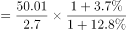
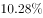
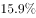
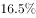
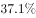
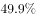
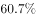
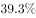
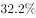

# 基期倍数计算

考点：[[20-考点/资料分析/倍数/基期倍数计算|倍数 / 基期倍数计算]]
材料：[[15-材料/资料分析/272115 2017年我国旅游业统计公报式材料：|272115 2017年我国旅游业统计公报式材料：]]

**问法模型**：题干问'2016年（基期）A约为B的多少倍'而材料只给2017年现期值和同比增速 → 采用基期倍数模型：A/B ×(1+分母增速)/(1+分子增速)。

## 推理链
1. 第1步：材料现期为2017年、题干求2016年（基期）；从首段提取：2017年国内旅游人数A=50.01亿人次（同比增速a，数值在文本中缺失）、入出境旅游总人数B=2.7亿人次（同比增速b，数值缺失），两指标同为'亿人次'，量级一致可直接相除。
2. 第2步：基期倍数公式：[A/(1+a)] ÷ [B/(1+b)] = A/B × (1+b)/(1+a)，即先算当期倍数再乘增速修正因子。
3. 第3步：截位直除当期倍数：50.01/2.7≈18.5；由首段定性表述'国内旅游市场高速增长、入出境市场平稳发展'可知分子增速a高于分母增速b，修正因子(1+b)/(1+a)<1，故基期倍数应小于18.5且略低。
4. 第4步：与选项对照：17、19、21、23中仅A项17<18.5（若忘做基期修正直接用现期倍数18.5会误选B=19），锁定A；官方解析代入增速计算结果约17，与A一致，故正确答案为A。

**最快解法**：⚡ 截位直除+增速定性排除法：先算现期倍数50.01÷2.7≈18.5；基期倍数=18.5×(1+b)/(1+a)，由首段'国内高速增长/入出境平稳发展'判断a>b，结果必<18.5，四个选项中只有17<18.5，无需增速具体数值即可秒选A。

## 易错点
- ⚠ 现期与基期混淆：材料数据全部是2017年，题干问2016年，直接用50.01÷2.7≈18.5会错选B（19），必须乘增速修正因子回推基期。
- ⚠ 修正因子方向记反：正确为×(1+分母B增速)÷(1+分子A增速)，即(1+b)/(1+a)；若记反成×(1+a)/(1+b)，会得到>18.5的错误方向而误选B。
- ⚠ 分母口径陷阱：分母必须用'入出境旅游总人数2.7亿人次'（入境+出境合计），勿误用入境13948万人次或出境13051万人次等单边指标；本题两指标同为亿人次，无需跨量级换算。

## 母题抽象
> 🧩 当题干出现'上年（基期）A约为B的多少倍'且材料给出两指标现期值与同比增速时，用基期倍数公式A/B×(1+分母增速)/(1+分子增速)；若增速数值缺失，可借材料定性增速高低（a>b则基期倍数<现期倍数）结合选项区间直接锁定答案。

**同类特征**：问'2016年……约为……的多少倍'（基期+倍数问法）、分子分母均为当年总量规模指标、材料提供现期值及同比增速（本题增速数值缺失）、现期倍数落在选项区间之间可定性排除、指标为国内旅游人数与入出境旅游总人数、适用基期倍数公式模型

## 相关题
- [[10-真题/资料分析/倍数/2247269 基期倍数计算|2247269]]（新疆 2018，相关度2）
- [[10-真题/资料分析/倍数/19181374 基期倍数计算|19181374]]（吉林 2024，相关度2）
- [[10-真题/资料分析/倍数/2136488 基期倍数计算|2136488]]（河南 2017，相关度2）
- [[10-真题/资料分析/倍数/2571742 基期倍数计算|2571742]]（山东 2020，相关度2）
- [[10-真题/资料分析/倍数/4004877 基期倍数计算|4004877]]（新疆 2021，相关度2）

---

### 题干
2016年，全国国内旅游人数约为入出境旅游总人数的多少倍？

### 选项
- A. 17　✅
- B. 19
- C. 21
- D. 23

### 官方解析

根据题干“2016年······为······的多少倍”，结合材料时间是2017年，可判定本题为基期倍数问题。定位文字材料第一段：2017年，······国内旅游人数50.01亿人次，比上年同期增长；入出境旅游总人数2.7亿人次，增长。根据公式：基期倍数，可得2016年，全国国内旅游人数约为入出境旅游总人数的倍数，满足条件的只有A项。

故正确答案为A。

### 给定材料

2017年，国内旅游市场高速增长，入出境市场平稳发展，供给侧结构性改革成效明显。国内旅游人数50.01亿人次，比上年同期增长；入出境旅游总人数2.7亿人次，增长；全年实现旅游总收入5.40万亿元，增长；全年全国旅游业对GDP的综合贡献为9.13万亿元，占GDP总量的；旅游直接就业2825万人，旅游直接和间接就业7990万人，占全国就业总人口的。

一、全年国内旅游收入增长

2017年，国内旅游人数50.01亿人次，比上年同期增长。其中，城镇居民36.77亿人次，增长；农村居民13.24亿人次，增长。国内旅游收入4.57万亿元，增长。其中，城镇居民花费3.77万亿元，增长；农村居民花费0.80万亿元，增长。

二、全年入境过夜旅游人数增长

2017年，入境旅游人数13948万人次，比上年同期增长。其中，外国人2917万人次，增长；香港同胞7980万人次，下降；澳门同胞2465万人次，增长；台湾同胞587万人次，增长。入境旅游人数按照入境方式分，船舶占，飞机占，火车占，汽车占，其他占。

2017年，入境过夜旅游人数6074万人次，比上年同期增长。其中，外国人2248万人次，增长；香港同胞2775万人次，增长；澳门同胞522万人次，增长；台湾同胞529万人次，增长。

三、全年国际旅游收入达1234亿美元

2017年，国际旅游收入1234亿美元，比上年同期增长。其中，外国人在华花费695亿美元，增长；香港同胞在内地花费301亿美元，下降；澳门同胞在内地花费83亿美元，增长；台湾同胞在大陆花费155亿美元，增长。

四、全年入境外国游客亚洲占，以观光休闲为目的游客占

2017年，入境外国游客人数4294万人次，亚洲占，美洲占，欧洲占，大洋洲占，非洲占。其中，按照年龄分，14岁以下人数占，15—24岁占，25—44岁占，45—64岁占，65岁以上占；按性别分，男占，女占；按目的分，会议/商务占，观光休闲占，探亲访友占，服务员工占，其他占。

2017年，按入境旅游人数排序，我国主要客源市场前17位国家如下：缅甸、越南、韩国、日本、俄罗斯、美国、蒙古、马来西亚、菲律宾、新加坡、印度、加拿大、泰国、澳大利亚、印度尼西亚、德国、英国。

五、全年中国公民出境旅游人数达13051万人次

2017年，中国公民出境旅游人数13051万人次，比上年同期增长。

> [!warning] 疑点（官方解析可能有误，待人工复核）
> 所给材料文本中2017年国内旅游人数与入出境旅游总人数的同比增速数值均缺失（原文图片/公式未识别），基期倍数无法据文本数字完整复算；官方解析也未展示增速具体代入过程，直接给出'满足条件的只有A项'。按铁律以官方答案A（17）为唯一事实，不作更改；且据首段'国内高速增长、入出境平稳发展'（a>b）推断基期倍数<18.5，与A=17方向自洽，仅提示增速数据缺失影响独立复算。

<!-- CODEX-ANSWER-REVIEW:BEGIN -->
### 本次独立复核

**复核状态：** `resolved`（答案与解析已核定）

**计分答案：** A（可计分）

**复核解析：**

2017年国内旅游人数50.01亿人次、同比增长12.8%；入出境旅游总人数2.7亿人次、同比增长3.7%。还原至2016年：(50.01÷1.128)÷(2.7÷1.037)≈17.03倍，最接近17，选A。两项增速值在公式图中，不是数据源缺失。

**相关信息：**

两量相除后“亿人次”单位抵消；基期倍数应按分母增速修正分子/分母现期比。

**题源依据：** [固定版本原题](https://github.com/Mentat-Uran/kaogongzhentizhengliu/blob/84ab93d4b64b61d897bece8a1c0a5bab06b4feb2/10-%E7%9C%9F%E9%A2%98/%E8%B5%84%E6%96%99%E5%88%86%E6%9E%90/%E5%80%8D%E6%95%B0/2776159%20%E5%9F%BA%E6%9C%9F%E5%80%8D%E6%95%B0%E8%AE%A1%E7%AE%97.md)；固定内容 commit `84ab93d4b64b61d897bece8a1c0a5bab06b4feb2`，Markdown blob `3bbcaf3fca58d69bf51ea5dd9d56e53a80641735`。
<!-- CODEX-ANSWER-REVIEW:END -->
