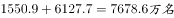
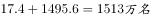
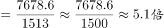

# 现期倍数（部分和-其余和的倍数计算）

考点：[[20-考点/资料分析/倍数/现期倍数（部分和-其余和的倍数计算）|倍数 / 现期倍数（部分和/其余和的倍数计算）]]
材料：[[15-材料/资料分析/280093 截至2019年12月31日中国共产党|280093 截至2019年12月31日中国共产党]]

**问法模型**：题干为'截至2019年12月31日，A（跨段时间区间之和）约是B（其余时间之和）的多少倍'→ 先按入党时间四段划分确定分子与分母各自包含的段落求和，再做现期倍数直除

## 推理链
1. 第1步：题干时间为截至2019年12月31日（与材料现期一致），问'新中国成立后至党的十八大前入党人数约是其余时间入党人数的几倍'，选项均为倍数，判定为现期倍数问题
2. 第2步：定位文字第一段入党时间四段数据：新中国成立前17.4万名、新中国成立后至十一届三中全会前1550.9万名、十一届三中全会后至十八大前6127.7万名、十八大以来1495.6万名，四段合计9191.6万名
3. 第3步：分子'新中国成立后至党的十八大前'对应两段之和：1550.9+6127.7=7678.6万名
4. 第4步：分母'其余时间'为剩余两段之和：17.4+1495.6=1513.0万名（注意须包含新中国成立前的17.4万名）
5. 第5步：代入倍数公式：7678.6÷1513.0≈5.07倍
6. 第6步：与选项对照，5.07最接近5.1倍，故选D

**最快解法**：⚡ 拆和+截位直除：分子1550.9+6127.7=7678.6，分母17.4+1495.6=1513；口算1513×5=7565，余数113.6，113.6/1513≈0.08，故约5.08倍，直接锁定D（5.1倍），无需精算

## 易错点
- ⚠ 分子漏段：'新中国成立后至党的十八大前'需跨两段求和（1550.9+6127.7），误只取其中一段会得约2.0倍或0.2倍，均不在选项
- ⚠ 分母漏段：'其余时间'包含新中国成立前的17.4万名，易被漏掉或误把'十八大以来'1495.6并回分子
- ⚠ 区间端点归属混淆：'至党的十八大前'不含十八大以来的1495.6万名，分段边界读错会整体错位

## 母题抽象
> 🧩 当题干出现'某时段（跨材料分段）之和约是其余时段之和的几倍'特征时，先按材料分段口径把分子、分母各自补全为段和，再用'分母×选项倍数'与分子比大小直除验证选项

**同类特征**：截至2019年12月31日、入党时间分段、新中国成立后至党的十八大前、其余时间入党人数、约是……的（几倍）、跨段求和作倍数

## 相关题
- [[10-真题/资料分析/比重/3522360 现期比重比较与计数（门槛折算筛选）|3522360]]（青海 2021，相关度1）
- [[10-真题/资料分析/倍数/2423343 基期倍数计算（同段共基总额的基期倍数比较）|2423343]]（甘肃 2019，相关度1）

---

### 题干
截至2019年12月31日，新中国成立后至党的十八大前入党的人数约是其余时间入党人数的：

### 选项
- A. 3.8倍
- B. 4.1倍
- C. 4.6倍
- D. 5.1倍　✅

### 官方解析

根据题干“2019年12月31日······是······”，结合选项求倍数，且材料时间为2019年12月31日，可判定本题为现期倍数问题。定位文字材料第一段可得“在党员的入党时间上，新中国成立前入党的17.4万名，新中国成立后至党的十一届三中全会前入党的1550.9万名，党的十一届三中全会后至党的十八大前入党的6127.7万名，党的十八大以来入党的1495.6万名。”则新中国成立后至党的十八大前入党的人数为，其余时间入党人数为，故新中国成立后至党的十八大前入党的人数约是其余时间入党人数的。

故正确答案为D。

### 给定材料

        截至2019年12月31日，中国共产党党员总数为9191.6万名，同比增长。在党员的性别、民族和学历上，女党员2559.9万名，少数民族党员680.3万名，大专及以上学历党员4661.5万名。在党员的入党时间上，新中国成立前入党的17.4万名，新中国成立后至党的十一届三中全会前入党的1550.9万名，党的十一届三中全会后至党的十八大前入党的6127.7万名，党的十八大以来入党的1495.6万名。在党员的职业上，工人（含工勤技能人员）644.5万名，农牧渔民2556.1万名，企事业单位、社会组织专业技术人员1440.3万名，企事业单位、社会组织管理人员1010.4万名，党政机关工作人员767.8万名，学生196.0万名，其他职业人员710.4万名，离退休人员1866.1万名。

        2019年共发展党员234.4万名，比上年增长。其中，发展女党员99.4万名，占；发展少数民族党员23.6万名，占；发展35岁及以下党员188.3万名，占；发展具有大专及以上学历的党员106.8万名，占。发展党员的职业上，工人（含工勤技能人员）14.3万名，企事业单位、社会组织专业技术人员31.6万名，企事业单位、社会组织管理人员25.3万名，农牧渔民42.4万名，党政机关工作人员13.4万名，学生84.4万名，其他职业人员22.9万名。

> [!warning] 疑点（官方解析可能有误，待人工复核）
> 官方解析文本中被隐去的具体算式未显示（'则为，其余时间入党人数为，故……'处留空），但按材料数据计算7678.6/1513.0≈5.07与官方答案D（5.1倍）一致，无实质矛盾
