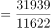
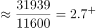
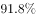
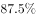
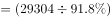
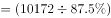
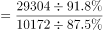
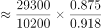
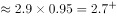

# 现期倍数计算

考点：[[20-考点/资料分析/倍数/现期倍数计算|倍数 / 现期倍数计算]]
材料：[[15-材料/资料分析/294540 2019年前三季度全国居民人均可支配|294540 2019年前三季度全国居民人均可支配]]

**问法模型**：题干时间（2019年前三季度）与材料现期一致且问'城镇平均数是农村平均数的多少倍'→ 现期倍数=城镇现期值÷农村现期值，无需基期转化

## 推理链
1. 第1步：题干限'2019年前三季度'，与材料现期一致，判定为现期倍数问题，直接取现期值相除
2. 第2步：从段1提取数据——城镇居民人均可支配收入31939元，农村居民人均可支配收入11622元（平均数即人均可支配收入本体，段1括号已说明'增长均为同比名义增长'）
3. 第3步：代入公式：倍数=31939÷11622
4. 第4步：估商验证：11622×2.75≈31961，与31939几乎相等，故商约2.748
5. 第5步：与选项对照：A.2.43、B.2.56、C.2.75、D.2.91，最接近2.748的是2.75，锁定C
6. 第6步：（备用路径验证）用段2中位数反推：城镇平均数=29304÷91.8%≈31930，农村平均数=10172÷87.5%≈11625，倍数≈2.746≈2.75，同样对应C，双路径互证一致

**最快解法**：⚡ 截位直除：31939÷11622，首两位商2.7，再用11622×2.75≈31961≈31939确认商≈2.75，直接锁定C；全程不用任何增速数据

## 易错点
- ⚠ 时间与增速陷阱：材料通篇是同比名义增速（8.8%、7.9%、9.2%等），本题问现期倍数，若误把增速代入做基期倍数（如除以1+增速）或多算一步会错；正确做法是现期值直接相除
- ⚠ 口径混淆：材料并列'可支配收入（全国22882元）'与'消费支出（全国15464元）'两套体系，本题主体是'人均可支配收入'，只能用段1的31939/11622，勿错拿消费支出的20379/9353（≈2.18）
- ⚠ 中位数误用陷阱：若误拿段2中位数直接相除，29304÷10172≈2.88，会向D.2.91倾斜；中位数≠平均数，且段2中'是平均数的91.8%/87.5%'是比例关系而非增速，误当增速用也会算错

## 母题抽象
> 🧩 当题干出现'现期时间+A是B的多少倍/几倍'特征时，判定现期倍数，用A现期值÷B现期值截位直除即可，切勿因材料满是增速而画蛇添足做基期处理；若给的是中位数与'是平均数的x%'比例关系，可反推平均数=中位数÷x%

**同类特征**：现期时间限定（2019年前三季度，与材料现期重合）、'是……的多少倍'倍数问法、城镇与农村两主体直接对比、主体为'平均数/人均'口径、数据在文字材料首段可直接定位、选项数值差距不大、适合截位直除

## 相关题
- [[10-真题/资料分析/倍数/2616148 现期倍数计算|2616148]]（海南 2020，相关度2）
- [[10-真题/资料分析/倍数/2047712 现期倍数计算|2047712]]（广东 2017，相关度2）
- [[10-真题/资料分析/倍数/2616169 现期倍数计算|2616169]]（海南 2020，相关度2）
- [[10-真题/资料分析/倍数/4637143 现期倍数计算|4637143]]（国考 2022，相关度2）
- [[10-真题/资料分析/倍数/2051002 现期倍数计算|2051002]]（江西 2017，相关度2）

---

### 题干
2019年前三季度，城镇居民人均可支配收入平均数约是农村居民人均可支配收入平均数的多少倍？

### 选项
- A. 2.43
- B. 2.56
- C. 2.75　✅
- D. 2.91

### 官方解析

方法一：根据题干“2019年前三季度······是······的多少倍”，结合材料时间为2019年前三季度，可判定本题为现期倍数问题。定位文字材料第一段：2019年前三季度······城镇居民人均可支配收入31939元······农村居民人均可支配收入11622元。则所求倍数，对应C项。

方法二：根据题干“2019年前三季度······是······的多少倍”，结合材料时间为2019年前三季度，可判定本题为现期倍数问题。定位文字材料第二段：（2019年前三季度）城镇居民人均可支配收入中位数29304元，增长，是平均数的；农村居民人均可支配收入中位数10172元，增长，是平均数的。则2019年前三季度城镇居民人均可支配收入平均数元；农村居民人均可支配收入平均数元。则所求倍数，对应C项。

故正确答案为C。

### 给定材料

        2019年前三季度，全国居民人均可支配收入22882元，比上年同期名义增长8.8%。其中，城镇居民人均可支配收入31939元，增长（以下如无特别说明，均为同比名义增长）7.9%；农村居民人均可支配收入11622元，增长9.2%。

        前三季度，全国居民人均可支配收入中位数19882元，增长9.0%，中位数是平均数的86.9%。其中，城镇居民人均可支配收入中位数29304元，增长7.6%，是平均数的91.8%；农村居民人均可支配收入中位数10172元，增长10.0%，是平均数的87.5%。

        按收入来源分，前三季度，全国居民人均工资性收入13020元，增长8.6%；人均经营净收入3757元，增长9.3%；人均财产净收入1949元，增长12.3%；人均转移净收入4157元，增长7.2%。

        2019年前三季度，全国居民人均消费支出15464元，比上年同期名义增长8.3%。其中，城镇居民人均消费支出20379元，增长7.2%；农村居民人均消费支出9353元，增长9.5%。

        前三季度，全国居民人均食品烟酒消费支出4310元，增长6.1%；人均衣着消费支出962元，增长3.8%；人均居住消费支出3607元，增长10.3%；人均生活用品及服务消费支出926元，增长3.2%；人均交通通信消费支出2078元，增长7.6%；人均教育文化娱乐消费支出1766元，增长13.5%；人均医疗保健消费支出1414元，增长10.9%；人均其他用品及服务消费支出401元，增长11.1%。

