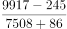
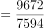
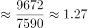
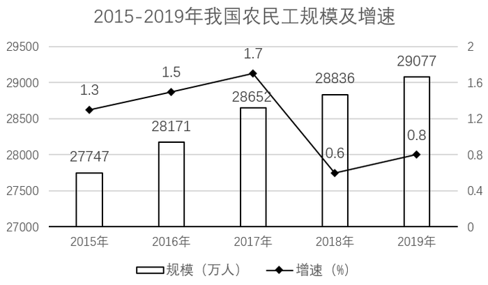

# 基期倍数（由现期值与增减量倒推基期值再作商）

考点：[[20-考点/资料分析/倍数/基期倍数（由现期值与增减量倒推基期值再作商）|倍数 / 基期倍数（由现期值与增减量倒推基期值再作商）]]
材料：[[15-材料/资料分析/294542 2015-2019年我国农民工总量规|294542 2015-2019年我国农民工总量规]]

**问法模型**：题干问'2018年A大约是B的多少倍'而材料只给2019年现期值及'比上年增减'→ 先用'现期值∓增减量'分别倒推2018年A、B基期值，再作商求倍数

## 推理链
1. 第1步：题干时间2018年早于材料时间2019年，判定为基期倍数问题；定位文字段：2019年省内流动9917万人（比上年增加245万人）、跨省流动7508万人（比上年减少86万人）
2. 第2步：基期换算规则：增加的人数要减去、减少的人数要加上，即基期值=现期值−增加量或现期值+减少量
3. 第3步：2018年省内流动=9917−245=9672万人，2018年跨省流动=7508+86=7594万人
4. 第4步：倍数=9672÷7594，截位直除：7594×1.27≈9644，9672−9644=28，28/7594≈0.004，故≈1.274
5. 第5步：与选项对照，C项1.27最接近（D项1.37为符号方向做反的陷阱值），故正确答案为C

**最快解法**：⚡ 基期直减直加+截位直除：2018省内=9917−245=9672，2018跨省=7508+86=7594，9672/7594≈1.27直选C；亦可走基期倍数公式：9917/7508×(1−1.1%)/(1+2.5%)≈1.32×0.965≈1.27验证

## 易错点
- ⚠ 现期基期混淆：直接用2019年数据9917/7508≈1.32作答，未做基期倒推，落在1.30~1.34之间易误选A或B
- ⚠ 增减符号方向做反：若把省内'增加245'误加、跨省'减少86'误减，得10162/7422≈1.37，恰好落入D项陷阱
- ⚠ 口径混用：'增长2.5%''下降1.1%'是增速可用于基期倍数公式，但'提高0.9个百分点'是占比变动，且'农民工总量29077万人'与'外出农民工17425万人'口径不同，均不能混入本题计算

## 母题抽象
> 🧩 当题干出现'基期年份+A是B的多少倍'而材料给现期值与'比上年增减'时，用'基期值=现期值∓增减量（增则减、减则加）'分别倒推A、B再作商选最近项，可用基期倍数公式A/B×(1+b)/(1+a)交叉验证

**同类特征**：2018年（时间早于材料现期一年）、是……的多少倍、外出农民工、省内流动/跨省流动、材料只给现期值+比上年增减人数、选项为小数倍数且含1.3附近的干扰值

## 相关题
- [[10-真题/资料分析/增长/1797642 增长量计算与倍数比较（两类企业同比增量之比）|1797642]]（山东 2016，相关度1）
- [[10-真题/资料分析/倍数/2247269 基期倍数计算|2247269]]（新疆 2018，相关度1）
- [[10-真题/资料分析/倍数/18643846 现期倍数（两期增量之比）|18643846]]（四川 2026，相关度1）
- [[10-真题/资料分析/比重/2604291 基期比重计算（增量倒推型）|2604291]]（广东 2020，相关度1）
- [[10-真题/资料分析/倍数/5802084 现期倍数（由现期值与完成计划率还原计划数后作比）|5802084]]（浙江 2023，相关度1）

---

### 题干
2018年外出农民工中，在省内流动农民工大约是跨省流动农民工的多少倍？

### 选项
- A. 1.34
- B. 1.30
- C. 1.27　✅
- D. 1.37

### 官方解析

根据题干“2018年······是······的多少倍”，结合材料时间为2019年，可判定本题为基期倍数问题。定位文字材料第二段可得：在外出农民工中，在省内流动的农民工9917万人，比上年增加245万人；跨省流动农民工7508万人，比上年减少86万人。故2018年外出农民工中，在省内流动农民工大约是跨省流动农民工的倍。

故正确答案为C。

### 给定材料

        2019年农民工总量达到29077万人，比上年增加241万人，增长0.8%。其中，本地农民工11652万人，比上年增加82万人，增长0.7%；外出农民工17425万人，比上年增加159万人，增长0.9%。在外出农民工中，年末在城镇居住的进城农民工13500万人，与上年基本持平。

        在外出农民工中，在省内流动的农民工9917万人，比上年增加245万人，增长2.5%；跨省流动农民工7508万人，比上年减少86万人，下降1.1%。省内流动农民工占外出农民工的56.9%，所占比重比上年提高0.9个百分点。分地区看，除东北地区省内流动农民工占外出农民工的比重比上年下降3.4个百分点以外，东部、中部和西部地区省内流动农民工占比分别比上年提高0.1、1.4和1.2个百分点。

