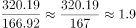

# 现期倍数计算（跨段拼数：全国−重点城市=其他城市）

考点：[[20-考点/资料分析/倍数/现期倍数计算（跨段拼数：全国−重点城市=其他城市）|倍数 / 现期倍数计算（跨段拼数：全国−重点城市=其他城市）]]
材料：[[15-材料/资料分析/305737 2018年第一季度全国星级饭店经营情|305737 2018年第一季度全国星级饭店经营情]]

**问法模型**：题干问'重点城市营业收入为其他城市的多少倍'且选项为区间 → 先用'全国487.11−重点城市320.19'拼出其他城市166.92亿元，再做现期倍数320.19÷166.92

## 推理链
1. 第1步：题干为2018年第一季度现期比较，选项给倍数区间，判定现期倍数问题
2. 第2步：文字段1给出全国星级饭店营业收入487.11亿元，文字段2给出50个重点旅游城市营业收入320.19亿元
3. 第3步：'其他城市'材料未直接给出，需拼数：487.11−320.19=166.92亿元
4. 第4步：所求倍数=320.19÷166.92
5. 第5步：估算：320.19÷166.92≈320÷167≈1.92倍（或166.92×2=333.84>320.19、166.92×1.5=250.38<320.19，锁定1.5~2区间）
6. 第6步：对照选项，1.92落在1.5-2倍之间，选C

**最快解法**：⚡ 拼数+截位直除：先口算487.11−320.19=166.92，再320.19÷166.92截位为320÷167≈1.92；更快的区间判定法：166.92×1.5≈250<320.19<166.92×2≈334，直接锁定C，不必精算

## 易错点
- ⚠ '其他城市'数据材料未直接给出，误以为材料缺数据无从下手，或错用重点城市÷全国（320.19÷487.11≈0.66）算反方向
- ⚠ 被文字段中'同比增长2.43%'误导去做基期倍数（487.11/1.0243），题干问的是2018Q1现期倍数，该增速是干扰信息
- ⚠ 量级/区间边界误判：1.92接近但未超过2倍，若粗算成320÷166≈1.93仍属C；若误把其他城市算成320.19−166.92之类拼错方向则落入D

## 母题抽象
> 🧩 当题干出现'A为B的多少倍'而B未直接给出时，用'总体−已知部分'拼出B，再做题间倍数直除；选项为区间时，优先用区间端点（B×1.5、B×2）与A比较锁定答案，避免精确除法

**同类特征**：重点城市为其他城市的几倍、其他城市需全国减重点城市拼数、选项为倍数区间（不到/1.1-1.5/1.5-2/2倍以上）、现期倍数（无基期字样）、两段文字口径跨段拼数、同比增长率作干扰项

## 相关题
（暂无）

---

### 题干
2018年第一季度全国50个重点旅游城市星级饭店营业收入为其他城市星级饭店营业收入的：

### 选项
- A. 不到1.1倍
- B. 1.1-1.5倍之间
- C. 1.5-2倍之间　✅
- D. 2倍以上

### 官方解析

根据题干“2018年第一季度······为······的”，结合材料时间为2018年第一季度，选项为多少倍，可判定本题为现期倍数问题。定位文字材料第一段可得，2018年第一季度，全国星级饭店第一季度的营业收入为487.11亿元；定位文字材料第二段可得，第一季度全国50个重点旅游城市星级饭店营业收入为320.19亿元。则2018年第一季度，其他城市星级饭店营业收入为487.11-320.19=166.92亿元，故所求倍数为倍，介于1.5-2倍之间。

故正确答案为C。

### 给定材料

        2018年第一季度，共有9586家星级饭店通过省级旅游主管部门审核，全国星级饭店第一季度的营业收入为487.11亿元，同比增长2.43%。餐饮收入为208.24亿元，客房收入为209.12亿元。

        第一季度全国50个重点旅游城市共有3636家星级饭店通过省级旅游主管部门数据审核，第一季度全国50个重点旅游城市星级饭店营业收入为320.19亿元。

