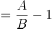
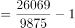
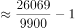

# 现期倍数计算（'比…多几倍'即A-B−1型）

考点：[[20-考点/资料分析/倍数/现期倍数计算（'比…多几倍'即A-B−1型）|倍数 / 现期倍数计算（'比…多几倍'即A/B−1型）]]
材料：[[15-材料/资料分析/307972 2020年7月—2021年7月我国原|307972 2020年7月—2021年7月我国原]]

**问法模型**：题干'2021年上半年，进口量比生产量多几倍'→先用'1-7月累计−7月当月'构造上半年两量，再按(进口−产量)/产量=进口/产量−1求'多'的倍数

## 推理链
1. 第1步：从文字材料提取：2021年1-7月进口原油30193万吨、7月进口4124万吨；1-7月原油产量11561万吨、7月产量1686万吨
2. 第2步：时间口径转换，上半年=1-7月累计−7月当月：上半年进口=30193−4124=26069万吨，上半年产量=11561−1686=9875万吨
3. 第3步：'比…多几倍'公式：多几倍=(A−B)/B=A/B−1（区别于'是几倍'=A/B）
4. 第4步：代入计算：(26069−9875)/9875=16194/9875
5. 第5步：截位估算：16194/9875≈161/98.8≈1.64（等价验证：26069/9875≈2.64，再减1）
6. 第6步：对照选项：1.64≈1.6倍，锁定A；若忘减1得2.64会误选C（C即'是几倍'陷阱）

**最快解法**：⚡ 截位直除＋差1辨析：先心算26069/9875≈2.6（'是几倍'），题问'多几倍'故2.6−1=1.6，秒选A；或直接算16194/9875，截前三位161/98.8≈1.6。选项间隔大（1.6/1.8/2.6/2.9），首一位即可区分

## 易错点
- ⚠ '比…多几倍'≠'是几倍'：26069/9875≈2.64是'是几倍'，须再减1得1.64，直接套会误选C（命题人故意设2.6倍）
- ⚠ 时间口径：材料文字只给1-7月累计与7月当月（混排），上半年必须做减法（30193−4124、11561−1686），不能直接拿11561、30193当上半年数据
- ⚠ 图表口径错配陷阱：表是产量'日均'口径（与本题月度总量无关），图是进口量'当月总量'口径且2021年1-2月为两月合并柱8957万吨，若从图中取数加总须把合并柱整体计入，切勿当单月拆分或从日均值列取数

## 母题抽象
> 🧩 当题干出现'上半年（某时段）A比B多/高几倍'而材料只给'1-N月累计＋第N月当月'混排时，先用'累计−当月'构造两现期量，再用(A−B)/B=A/B−1计算，并警惕'多几倍'与'是几倍'差1的选项陷阱

**同类特征**：上半年（需累计减当月构造现期量）、'比…多'+选项为倍数（多几倍型）、进口量与生产量两条线对比、文字'累计值+当月值'混排、单位万吨、量级一致

## 相关题
（暂无）

---

### 题干
2021年上半年，我国原油进口量比生产量多：

### 选项
- A. 1.6倍　✅
- B. 1.8倍
- C. 2.6倍
- D. 2.9倍

### 官方解析

根据题干“2021年上半年，······比······多”，结合选项为几倍，且与材料时间一致，可判定本题为现期倍数计算问题。定位文字材料可得：2021年1-7月，我国原油产量11561万吨······其中，7月我国原油产量1686万吨。1-7月我国进口原油30193万吨······其中，7月进口原油4124万吨。则2021年上半年原油进口量=30193-4124=26069万吨；原油生产量=11561-1686=9875万吨，故所求倍数倍。

故正确答案为A。

### 给定材料

        2021年1-7月，我国原油产量11561万吨，同比增长2.4%，比2019年同期增长3.9%。其中，7月我国原油产量1686万吨，增长2.5%，比2019年同期增长3.1%。1-7月我国进口原油30193万吨，下降5.6%。其中，7月进口原油4124万吨，下降19.6%。

