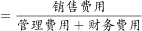
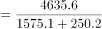
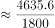
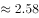

# 现期倍数计算（A是B的多少倍）

考点：[[20-考点/资料分析/倍数/现期倍数计算（A是B的多少倍）|倍数 / 现期倍数计算（A是B的多少倍）]]
材料：[[15-材料/资料分析/308024 2020年某行业销售费用、管理费用、|308024 2020年某行业销售费用、管理费用、]]

**问法模型**：题干问'A约是B的多少倍'且时间与材料一致 → 现期倍数模型：倍数=A÷B，其中B为管理+财务两项之和

## 推理链
1. 第1步：题干主体为'2020年该行业'，时间与材料口径一致，属现期问题，直接用全年数据
2. 第2步：定位表格1-12月累计行：销售费用4635.6亿元、管理费用1575.1亿元、财务费用250.2亿元
3. 第3步：先求分母之和：管理+财务=1575.1+250.2=1825.3亿元
4. 第4步：代入倍数公式：所求=4635.6÷1825.3≈2.54
5. 第5步：与选项对照：2.54最接近2.5，对应A项

**最快解法**：⚡ 估算法+截位直除：分母1825.3≈1800，分子4635.6≈4600，4600÷1800≈2.56；再用验证法：1825.3×2.5≈4563<4635.6且1825.3×3≈5476>4635.6，故倍数在2.5~3之间且更靠近2.5，锁定A

## 易错点
- ⚠ 全表为累计值，'2020年全年'直接读1-12月行即可，不必差分；若误用单月数据（如只取12月当月值）会严重算错
- ⚠ 三项费用数值列易看串行：财务费用量级极小（250.2），注意别把管理、财务读错列
- ⚠ 分母是'管理+财务之和'，需先加总再相除；误算成销售÷管理（≈2.9）会错选B

## 母题抽象
> 🧩 当题干出现'某年A是B的多少倍'且时间与材料一致时，直接取对应累计行（或合计行）数据，先合并B的分母项再相除，用选项倍数反乘验证锁定答案

**同类特征**：约是多少倍、A是B（多项之和）的倍数、时间与材料同年（2020年）、全年口径（1-12月累计行）、选项为离散倍数值可反乘验证

## 相关题
- [[10-真题/资料分析/倍数/2616169 现期倍数计算|2616169]]（海南 2020，相关度1）
- [[10-真题/资料分析/倍数/4637200 现期倍数计算（部分不合格量与其余部分不合格量之比）|4637200]]（国考 2022，相关度1）
- [[10-真题/资料分析/倍数/19283759 现期倍数（分项口径合并后跨年作比）|19283759]]（国考 2025，相关度1）
- [[10-真题/资料分析/倍数/2444699 现期倍数（部分÷比重反推总量后再作商）|2444699]]（四川 2019，相关度1）
- [[10-真题/资料分析/倍数/2578797 现期倍数计算（基期值+增长量还原现期值后求倍数）|2578797]]（四川 2020，相关度1）

---

### 题干
2020年该行业销售费用约是管理、财务费用之和的多少倍？

### 选项
- A. 2.5　✅
- B. 2.9
- C. 3.4
- D. 4.0

### 官方解析

根据题干“2020年······约是······的多少倍”，结合材料时间为2020年，可判定本题为现期倍数问题。定位表格材料可得：2020年1-12月该行业销售费用为4635.6亿元，管理费用为1575.1亿元，财务费用为250.2亿元。则所求倍数倍，最接近A项。

故正确答案为A。

### 给定材料

