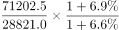
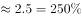

# 基期倍数计算（2017年公路周转量÷铁路周转量，区间判定）

考点：[[20-考点/资料分析/倍数/基期倍数计算（2017年公路周转量÷铁路周转量，区间判定）|倍数 / 基期倍数计算（2017年公路周转量÷铁路周转量，区间判定）]]
材料：[[15-材料/资料分析/308416 2018年我国各种运输方式（铁路-公|308416 2018年我国各种运输方式（铁路-公]]

**问法模型**：题干问'2017年A为B的（百分数区间）'而材料只给2018年现期值+同比增速 → 用基期倍数公式：现期倍数×(1+分母增速)/(1+分子增速)，直除后对照区间

## 推理链
1. 第1步：题干时间为2017年、材料为2018年且选项为百分数区间，判定基期倍数问题；题干指标是'货物运输周转量'，须取表格周转量块：公路71202.5亿吨公里(+6.6%)、铁路28821.0亿吨公里(+6.9%)
2. 第2步：基期倍数公式 = (A公路/B铁路) × (1+r铁路)/(1+r公路) = (71202.5/28821.0) × (1.069/1.066)
3. 第3步：截位直除 71202.5/28821.0 ≈ 712/288 ≈ 2.47（即现期约为247%）
4. 第4步：增速修正因子 1.069/1.066 ≈ 1.0028，影响约0.3%，可忽略或微调：2.47×1.003 ≈ 2.48
5. 第5步：基期倍数 ≈ 247%~248%，落在200%-300%之间，与选项C吻合

**最快解法**：⚡ 截位直除+增速微修正：71202.5/28821.0 截三位 ≈ 712/288 ≈ 2.47；两增速仅差0.2个百分点，修正因子1.069/1.066≈1.003可忽略，直接判定2.47倍=247%在200%-300%之间选C

## 易错点
- ⚠ 串行取数：题干问'周转量'，若误取总量块的公路395.9亿吨/铁路40.3亿吨（约981%）会错选'超过300%'，必须锁定周转量数据块
- ⚠ 基期与现期混淆：直接用71202.5/28821.0≈247%当基期倍数（本题因两增速接近、修正后仍在同一区间而侥幸正确，但公式上应乘(1+r铁路)/(1+r公路)，且修正方向分子分母勿放反）
- ⚠ 区间判断粗糙：约2.47倍对应247%，若误估接近3倍会错选D'超过300%'，注意公路周转量不到铁路的3倍

## 母题抽象
> 🧩 当题干出现'基期年份+A为B的几倍/百分之几'且材料只给现期值与增速时，用基期倍数公式 现期倍数×(1+B增速)/(1+A增速)，先截位直除现期倍数，增速接近时修正因子可忽略，再对照选项区间

**同类特征**：题干年份(2017)早于材料年份(2018)、'……为……的'+百分数选项、基期倍数、指标为货物运输周转量、选项为区间型(不到/之间/超过)

## 相关题
- [[10-真题/资料分析/倍数/456661 基期倍数（现期量−增长量求基期后作商）|456661]]（天津 2014，相关度1）
- [[10-真题/资料分析/倍数/2444763 基期倍数|2444763]]（四川 2019，相关度1）
- [[10-真题/资料分析/倍数/5430323 基期倍数（图外基期值倒推+现期与基期倍数）|5430323]]（浙江 2023，相关度1）
- [[10-真题/资料分析/倍数/1752646 基期倍数（亏损额基期还原+倍数计算）|1752646]]（北京 2016，相关度1）
- [[10-真题/资料分析/倍数/2578811 基期倍数（图形逐月加总＋文字段增速还原基期）|2578811]]（四川 2020，相关度1）

---

### 题干
2017年我国公路货物运输周转量为铁路的：

### 选项
- A. 不到100%
- B. 100%-200%之间
- C. 200%-300%之间　✅
- D. 超过300%

### 官方解析

根据题干“2017年······为······的”，结合材料时间为2018年，且选项为百分数，可判定本题为基期倍数问题。定位表格材料可得：2018年，我国公路货物运输周转量为71202.5亿吨公里，同比增长6.6%；我国铁路货物运输周转量为28821.0亿吨公里，同比增长6.9%。根据基期倍数计算公式：，可得2017年我国公路货物运输周转量为铁路的，即在200%-300%之间。

故正确答案为C。

### 给定材料

        2018年我国全年规模以上港口完成货物吞吐量133亿吨，同比增长2.7%，其中外贸货物吞吐量42亿吨，同比增长2.0%。规模以上港口集装箱吞吐量24955万标准箱，同比增长5.2%。

