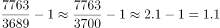

# 现期倍数计算（'多多少倍'型，(A-B)-B）

考点：[[20-考点/资料分析/倍数/现期倍数计算（'多多少倍'型，(A-B)-B）|倍数 / 现期倍数计算（'多多少倍'型，(A-B)/B）]]
材料：[[15-材料/资料分析/308437 我国养老相关企业的发展情况：2016|308437 我国养老相关企业的发展情况：2016]]

**问法模型**：题干'A比B约多多少倍'→用多的倍数=(A-B)÷B（即A÷B-1）模型，与'是几倍=A÷B'严格区分。

## 推理链
1. 第1步：定位图3（2021年9月月末城市企业数量排名），读取广州市7763家、青岛市3689家，两数据同为时点存量、单位均为'家'，可直接比较无需换算。
2. 第2步：题干问'比青岛约多多少倍'，对应公式：多的倍数=(A-B)÷B=A÷B-1，其中A=7763、B=3689。
3. 第3步：代入计算：(7763-3689)÷3689=4074÷3689≈1.10倍。
4. 第4步：与选项对照：1.1对应A选项，正确答案为A；若误算成7763÷3689≈2.1会错选C（2.1），此为命题人预设的干扰项。

**最快解法**：⚡ 截位直除+倍数关系转换：先心算7763÷3689（截位776÷369）≈2.1即'是青岛的2.1倍'，再减1得'多'约1.1倍，秒选A；或直接用差值4074÷3689，首位商1且明显大于1，锁定1.1。

## 易错点
- ⚠ '是X倍'与'多X倍'混淆：7763÷3689≈2.1是'广州是青岛的2.1倍'，'多'必须再减1得1.1倍，误选C是本题最大陷阱，选项2.1（C）与1.1（A）成对设置。
- ⚠ 口径与单位陷阱：本题两城市数据同为2021年9月月末存量、单位'家'，无需换算；但材料中注册量（流量、万家）与企业数量（存量、家）混排，勿与题1、题3的'万家'口径纠缠，本题不涉及万家换算。
- ⚠ 时间口径核对：题干限定'2021年9月月末'，对应图3时点存量数据，勿误用图1注册量数据。

## 母题抽象
> 🧩 当题干出现'A比B多/高多少倍'特征时，用(A-B)÷B（等价于A÷B-1）计算，并用A÷B先估'是几倍'再减1快速验证，切勿直接把A÷B当作'多'的倍数。

**同类特征**：2021年9月月末、比……多多少倍、城市企业数量对比、图3条形图直接读数、约（允许估算）、现期倍数

## 相关题
- [[10-真题/资料分析/倍数/10204451 现期倍数计算（部分与部分之和的倍数）|10204451]]（广东 2024，相关度1）
- [[10-真题/资料分析/倍数/10297461 现期倍数计算（含'二季度=上半年-一季度'时段拆分推算）|10297461]]（四川 2025，相关度1）
- [[10-真题/资料分析/倍数/1797608 现期倍数计算+加总排序定位|1797608]]（山东 2016，相关度1）
- [[10-真题/资料分析/倍数/2024182 现期倍数（两分项净增量之比）|2024182]]（重庆 2016，相关度1）
- [[10-真题/资料分析/倍数/2042820 现期倍数计算（同一子总体内占比相除）|2042820]]（江苏 2017，相关度1）

---

### 题干
2021年9月月末，广州市养老相关企业数量比青岛市约多多少倍？

### 选项
- A. 1.1　✅
- B. 1.4
- C. 2.1
- D. 2.4

### 官方解析

根据题干“2021年9月月末······比······多多少倍”，可判定本题为现期倍数问题。定位图3可得：（2021年9月月末）广州市、青岛市养老相关企业数量分别为7763家、3689家。故2021年9月月末，广州市养老相关企业数量比青岛市多倍。

故正确答案为A。

### 给定材料

        数据显示，我国近10年养老相关企业注册量逐年攀升。2020年注册量达5.09万家，同比增长22%。2021年1-3季度共注册3.92万家养老相关企业，同比增长16%。

        从地区来看，2021年9月月末，江苏省是我国养老相关企业数量最多的省份，占全国总量的9%，山东、广东排名第二、第三位。

        从城市分布来看，2021年9月月末，广州市拥有的养老相关企业数量最多，共7763家，占广东省总量的34.6%。

