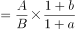
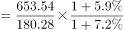
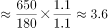

# 基期倍数计算

考点：[[20-考点/资料分析/倍数/基期倍数计算|倍数 / 基期倍数计算]]
材料：[[15-材料/资料分析/308438 某市2014-2020年社会消费品零|308438 某市2014-2020年社会消费品零]]

**问法模型**：题干问'2019年（基期）A是B的几倍'且材料只给2020年现期值和同比增速 → 套用基期倍数公式 A/(1+a) ÷ B/(1+b) = A/B × (1+b)/(1+a)

## 推理链
1. 第1步：题干时间2019年为基期，材料给2020年现期数据，判定为基期倍数问题
2. 第2步：从文字段提取：城镇现期A=653.54亿元、增速a=7.2%；乡镇现期B=180.28亿元、增速b=5.9%（题干'乡村'即材料'乡镇'，同义同口径）
3. 第3步：套用基期倍数公式：653.54/1.072 ÷ 180.28/1.059 = 653.54/180.28 × 1.059/1.072 ≈ 3.625 × 0.988 ≈ 3.58倍
4. 第4步：3.58落在3-4倍区间，与选项对照选C

**最快解法**：⚡ 两步定位法+方向修正：先截位直除现期倍数653.54/180.28≈3.6，再因a=7.2%＞b=5.9%，基期倍数=现期倍数×(1+b)/(1+a)＜3.625且降幅不足1%（约0.988），必落在3-4之间，无需精算直接选C

## 易错点
- ⚠ 同义替换陷阱：题干问'乡村'而材料写'乡镇'，须识别为同一口径，否则找不到数据
- ⚠ 修正方向搞反：分子用城镇增速还是乡镇增速易混，应乘(1+b)/(1+a)=1.059/1.072（<1），若乘反则得约3.67，虽同选C但计算过程错误，靠近区间边界时会选错
- ⚠ 口径混用：不可误用全市总额833.82/柱状图数据或限额以上口径，本题只能取文字段'按经营所在地分'的城镇653.54与乡镇180.28

## 母题抽象
> 🧩 当题干出现'基期年份+A是B的（几倍/多少倍）'而材料只给现期值和同比增速时，用基期倍数公式A/B×(1+b)/(1+a)；若只需定位区间，先算现期倍数截位直除，再用a与b大小判断修正方向（a＞b则基期倍数小于现期倍数），即可秒选

**同类特征**：2019年（基期时间）、是……的（倍数问法）、城镇/乡村（乡镇）消费品零售总额、材料给现期值+同比增速、选项为倍数区间形式、未直接给出基期量需换算

## 相关题
- [[10-真题/资料分析/倍数/2247269 基期倍数计算|2247269]]（新疆 2018，相关度2）
- [[10-真题/资料分析/倍数/19181374 基期倍数计算|19181374]]（吉林 2024，相关度2）
- [[10-真题/资料分析/倍数/2136488 基期倍数计算|2136488]]（河南 2017，相关度2）
- [[10-真题/资料分析/倍数/2571742 基期倍数计算|2571742]]（山东 2020，相关度2）
- [[10-真题/资料分析/倍数/2776159 基期倍数计算|2776159]]（浙江 2021，相关度2）

---

### 题干
2019年，该市城镇消费品零售总额是乡村消费品零售总额的：

### 选项
- A. 不到2倍
- B. 2倍-3倍
- C. 3倍-4倍　✅
- D. 超过4倍

### 官方解析

根据题干“2019年······是······的”，结合选项为倍数且材料时间为2020年，可判定本题为基期倍数问题。定位文字材料第一段可得：2020年城镇实现消费品零售总额653.54亿元（A），同比增长7.2%（a）；乡镇实现消费品零售总额180.28亿元（B），同比增长5.9%（b）。根据公式：基期倍数，则所求倍数，即2019年，该市城镇消费品零售总额是乡村消费品零售总额的3倍-4倍。

故正确答案为C。

### 给定材料

        2020年某市实现社会消费品零售总额833.82亿元，同比增长7.0%。按消费形态分，批发和零售业实现713.67亿元，同比增长6.1%；住宿和餐饮业实现120.15亿元，同比增长12.3%。按经营所在地分，城镇实现653.54亿元，同比增长7.2%；乡镇实现180.28亿元，同比增长5.9%。

