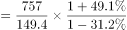
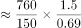
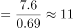

# 基期倍数（基期量反推后相除）

考点：[[20-考点/资料分析/倍数/基期倍数（基期量反推后相除）|倍数 / 基期倍数（基期量反推后相除）]]
材料：[[15-材料/资料分析/309963 2015年全国环境与安全状况统计公报|309963 2015年全国环境与安全状况统计公报]]

**问法模型**：题干问'2014年A是B的多少倍'而材料只给2015年现期值与同比增速 → 采用基期倍数公式 A/(1+a) ÷ B/(1+b) = A/B × (1+b)/(1+a)

## 推理链
1. 第1步：从材料第四段提取数据——2015年旱灾直接经济损失757亿元（A），同比下降31.2%（a=-31.2%）；海洋灾害直接经济损失149.4亿元（B），同比增加49.1%（b=+49.1%）
2. 第2步：因2014年基期值材料未给，用基期倍数公式：(A/(1+a))÷(B/(1+b)) = (757/149.4) × (1.491/0.688)
3. 第3步：截位直除——757/149.4≈5.07，1.491/0.688≈2.17，5.07×2.17≈11.0（等价反推：旱灾基期757÷0.688≈1100亿元，海洋基期149.4÷1.491≈100.2亿元，1100÷100.2≈11.0）
4. 第4步：与选项对照，11.0 对应 D，故正确答案为D

**最快解法**：⚡ 基期倍数公式法+截位直除：倍数=(757/149.4)×(1.491/0.688)，先算757/149.4≈5.1，再算1.491/0.688≈2.17，5.1×2.17≈11.0直接锁定D；关键动作是把'下降31.2%'代入(1-31.2%)=0.688、'增加49.1%'代入(1+49.1%)=1.491，两个因子方向相反

## 易错点
- ⚠ 增速方向混淆：旱灾是'下降31.2%'（负增长，除以0.688），海洋灾害是'增加49.1%'（正增长，除以1.491），若两者都按(1+增速)处理或方向写反，结果会严重偏离11.0
- ⚠ 直接用现期相除：757/149.4≈5.1，误选B（5.0）——忽略两个主体增速差异大，必须做(1+b)/(1+a)修正
- ⚠ '增加49.1%'是增长率不是百分点，也非'增加到'，若误读会算错海洋灾害基期量

## 母题抽象
> 🧩 当题干出现'基期年份A是B的多少倍'且材料只给现期值与同比增速时，用基期倍数公式 A/B×(1+b)/(1+a)，验证时注意两个增速分别代入(1+增速)并保留正负号

**同类特征**：基期年份（2014年）设问、'是……的多少倍'句式、材料只给现期值与同比增速、两个主体出自同一段（自然灾害损失）、两个增速一负一正、基期倍数模型

## 相关题
- [[10-真题/资料分析/增长/14403672 增长量计算（已知现期值与同比增速求增长量）|14403672]]（山东 2025，相关度1）

---

### 题干
2014年全年因旱灾造成直接经济损失是该年度因海洋灾害造成直接经济损失的多少倍？

### 选项
- A. 0.8
- B. 5.0
- C. 7.3
- D. 11.0　✅

### 官方解析

根据题干“2014年······是······”，可判定本题为基期倍数问题。定位文字材料第四段可知：（2015年）全年因旱灾造成直接经济损失757亿元（A），下降31.2％（a）。全年因海洋灾害造成直接经济损失149.4亿元（B），增加49.1％（b）。根据公式：基期倍数，可知所求。

故正确答案为D。

### 给定材料

        近岸海域298个海水水质监测点，在2015年监测中，达到国家一、二类海水水质标准的监测点占62.8%，比上年下降10.1个百分点；三类海水占14.1％，上升8.1个百分点；四类、劣四类海水占23.1％，上升2.1个百分点。

        在监测的330个城市中，有273个城市空气质量达到二级以上(含二级)标准，占监测城市数的82.7％；有53个城市为三级，占16.1％；有4个城市为劣三级，占1.2％。在监测的331个城市中，城市区域声环境质量好的城市占6.3％，较好的占67.4％，轻度污染的占25%，中度污染的占0.9％。

        2015年年末城市污水处理厂日处理能力达10262万立方米，比上年末增长13.4％；城市污水处理率达到76.9％，提高1.6个百分点。集中供热面积39.1亿平方米，增长3.0％。建成区绿地率达到34.5％，提高0.3个百分点。

        2015年全年各类自然灾害造成直接经济损失5340亿元，比上年增加1.1倍，占国内生产总值的1.31％。全年农作物受灾面积3743万公顷，减少20.7％。其中，绝收486万公顷，减少1.1％。全年因洪涝、滑坡和泥石流灾害造成直接经济损失3505亿元，增加4.4倍；死亡3101人。全年因旱灾造成直接经济损失757亿元，下降31.2％。全年因低温冷冻和雪灾造成直接经济损失318亿元，死亡51人。全年因海洋灾害造成直接经济损失149.4亿元，增加49.1％。全年累计发生赤潮面积10892平方公里，减少22.8％。全年大陆地区共发生5级以上地震17次，成灾10次，造成直接经济损失235.7亿元，死亡2705人。全年共发生森林火灾7723起，下降12.8％。

        2015年全年各类生产安全事故共死亡79552人，比上年下降4.4％。亿元国内生产总值生产安全事故死亡人数为0.201人，下降19.0％；工矿商贸企业就业人员10万人生产安全事故死亡人数为2.13人，下降11.3％；道路交通万车死亡人数为3.2人，下降11.1％；煤矿百万吨死亡人数为0.749人，下降16.0％。

