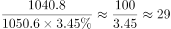

# 现期倍数计算（部分占比换算后作比）

考点：[[20-考点/资料分析/倍数/现期倍数计算（部分占比换算后作比）|倍数 / 现期倍数计算（部分占比换算后作比）]]
材料：[[15-材料/资料分析/311710 某省人口流动与劳务回流：2010年人|311710 某省人口流动与劳务回流：2010年人]]

**问法模型**：'A约是B的多少倍'且选项为倍数区间 → 现期倍数=A÷B，B为饼图占比须先换算成具体人数（B=整体×占比）

## 推理链
1. 第1步：从文字段1提取'外出到本省'对应数据——2010年外出省内1040.8万人（外出省外1050.6万人）
2. 第2步：从饼图提取北京市占比3.45%，其基数是外出省外人口1050.6万，而非2091.4万或全省人口
3. 第3步：换算外出到北京市人数=1050.6×3.45%≈36.25万人
4. 第4步：代入倍数公式：1040.8÷36.25≈28.7倍（因1040.8≈1050.6，可速算为1÷3.45%≈29倍）
5. 第5步：28.7倍落在20—30倍区间，对照选项确定为C

**最快解法**：⚡ 等量代换+特殊分数：因外出省内1040.8万≈外出省外1050.6万（相差不到1%），倍数≈1÷3.45%≈1×29≈29倍（3.45%≈1/29），直接锁定C'在20—30倍之间'，无需精确计算36.25万

## 易错点
- ⚠ 基数陷阱：北京市人数=3.45%×1050.6万（外出省外人口）；若误乘外出总人口2091.4万得约14.5倍（错选B），若误乘反推的全省人口约8043.8万得约57倍（错选D）
- ⚠ 口径辨析：'外出到本省'=文字段'外出省内1040.8万'，不能误用外出总人口2091.4万或全省人口作分子
- ⚠ '外出到北京市'仅是饼图中一个目的地（3.45%），不能误把'外出省外1050.6万'或50.2%当作北京市人数

## 母题抽象
> 🧩 当题干出现'A是B的多少倍'且B以饼图占比形式给出时，先确认该占比的基数再换算B=基数×占比，倍数=A÷B；若分子与占比基数近似相等，可直接用1÷占比快速定位选项区间

**同类特征**：外出到本省、外出到北京市、约是……倍、倍数区间型选项（低于/在…之间/高于）、2010年人口普查数据、饼图占比需换算人数

## 相关题
（暂无）

---

### 题干
2010年该省外出到本省人数约是外出到北京市人数的（    ）倍。

### 选项
- A. 低于10倍
- B. 在10—20倍之间
- C. 在20—30倍之间　✅
- D. 高于30倍

### 官方解析

根据题干“2010年······是······倍”，可判定本题为现期倍数问题。定位文字材料第一段可知，2010年，某省外出省内1040.8万人，外出省外1050.6万人；定位饼状图可知，该省外出到北京市的人口占比为3.45%。则该省外出到北京市的人口为1050.6×3.45%万人，所求倍数为，在20—30倍之间。

故正确答案为C。

### 给定材料

        2010年人口普查，某省外出人口达2091.4万人，占全省人口总数约26%，其中，外出省内1040.8万人，外出省外1050.6万人，分别占外出人口总数的49.8%和50.2%。在省内外来人口中，有82.8%的人口由乡村到城镇，其中，由乡村进入大中城市、小城镇的人口分别占省内外来人口的48.8%、34%。在外出省外人口中，92.89%的人口来源于乡村、7.11%的人口来源于城镇。

        近年来，由于东部地区劳动力、土地等基本生产要素成本上升等因素影响。该省劳务输出出现人口回流。2013年省外务工人员回流166.4万人，实现就业133.38万人，其中，第二产业46.40万人，第三产业49.44万人。2014年省外务工人员回流152.47万人，实现就业123.39万人，其中，第二产业46.45万人，第三产业48.47万人。2015年截至第三季度，省外务工人员回流135.95万人，实现就业121.27万人，其中，第二产业41.47万人，第三产业48.53万人。

