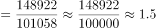
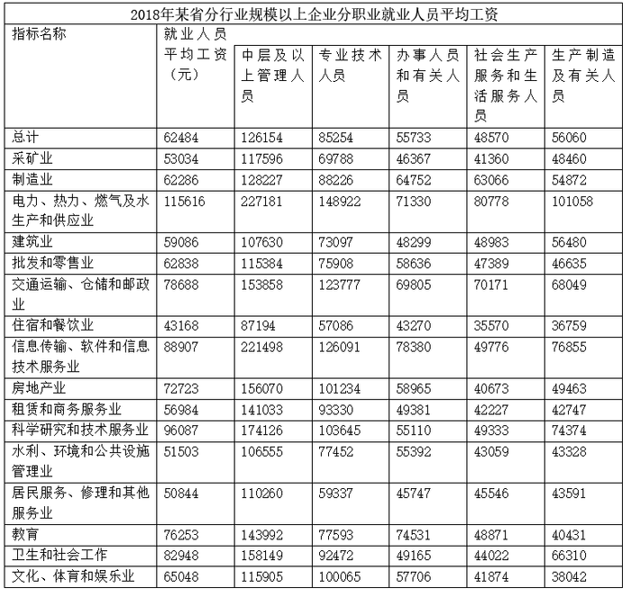

# 现期倍数计算（表格极值定位+两列作商）

考点：[[20-考点/资料分析/倍数/现期倍数计算（表格极值定位+两列作商）|倍数 / 现期倍数计算（表格极值定位+两列作商）]]
材料：[[15-材料/资料分析/312959 2018年某省规模以上企业就业人员年|312959 2018年某省规模以上企业就业人员年]]

**问法模型**：“表中2018年平均工资最高的行业，其A约是B的多少倍”→先按指定列定位极值行业，再取同行两列现期值直接相除求倍数

## 推理链
1. 第1步：在表格‘就业人员平均工资（元）’列中横向比较找最高行业：电力、热力、燃气及水生产和供应业115616元为16个行业中最高（制造业62286、信息传输业88907等均低于它）
2. 第2步：陷阱核验——‘平均工资最高’指全口径列115616元，而非‘中层及以上管理人员’列最高（该列最高为信息传输业221498元），定位行业应为电力热力燃气及水生产供应业
3. 第3步：从该行提取两列数据：专业技术人员平均工资148922元，生产制造及有关人员平均工资101058元，均为2018年现期值
4. 第4步：代入现期倍数公式：倍数=148922÷101058
5. 第5步：截位计算≈148.9÷101.1≈1.47
6. 第6步：与选项对照，1.47与1.5最接近（A为1.3、C为1.7均偏差更大），故选B

**最快解法**：⚡ 截位直除+选项间距排除：定位电力热力燃气及水生产供应业行，直接算148922/101058，截位为149/101≈1.47，四个选项间距0.2且跨1.47两侧仅1.5符合，无需精算即可锁定B

## 易错点
- ⚠ 行业定位错误：误把‘平均工资最高’理解为‘中层及以上管理人员’列最高，错定位到信息传输业（221498元），算得126091/76855≈1.64而误选C
- ⚠ 列口径混用：‘就业人员平均工资’列是全口径平均，不能对五类职业列算术平均得到，作商时必须取同行业同一行的两个分职业列数据
- ⚠ 现期基期混淆：题干问2018年当年倍数，直接用表格现期值作商，不要误用文字段增速做基期化（那是兄弟题的模型）

## 母题抽象
> 🧩 当题干出现‘表中某指标最高的行业（地区），其A约是B的多少倍’时，先按题干指定列定位极值行，再取同行两列现期数据直接相除，用截位直除对照选项间距锁定答案

**同类特征**：平均工资最高的行业、约是……的多少倍、现期倍数、表格极值定位、专业技术人员、生产制造及有关人员

## 相关题
- [[10-真题/资料分析/倍数/19526367 现期倍数计算（累计量做差还原当期值后求倍数）|19526367]]（国考 2026，相关度2）
- [[10-真题/资料分析/倍数/2188148 现期倍数计算（跨段定位最大-最小项后作商）|2188148]]（陕西 2018，相关度2）
- [[10-真题/资料分析/倍数/2616148 现期倍数计算|2616148]]（海南 2020，相关度1）
- [[10-真题/资料分析/倍数/10204451 现期倍数计算（部分与部分之和的倍数）|10204451]]（广东 2024，相关度1）
- [[10-真题/资料分析/倍数/10297461 现期倍数计算（含'二季度=上半年-一季度'时段拆分推算）|10297461]]（四川 2025，相关度1）

---

### 题干
表中2018年平均工资最高的行业，其规模以上企业专业技术人员平均工资约是生产制造及有关人员的多少倍？

### 选项
- A. 1.3
- B. 1.5　✅
- C. 1.7
- D. 1.9

### 官方解析

根据题干“表中2018年······约是······的多少倍”，可判定本题为现期倍数问题。定位表格材料可得：2018年平均工资最高的行业为电力、热力、燃气及水生产和供应业，其规模以上企业专业技术人员平均工资为148922元，生产制造及有关人员为101058元。则所求倍数倍。

故正确答案为B。

### 给定材料

        2018年某省规模以上企业就业人员年平均工资为62484元，比上年增长10.1%。其中，中层及以上管理人员增长9.7%；专业技术人员增长20.7%；办事人员和有关人员增长5.7%；社会生产服务和生活服务人员增长8.5%；生产制造及有关人员增长9.7%。

