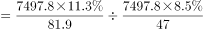
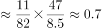
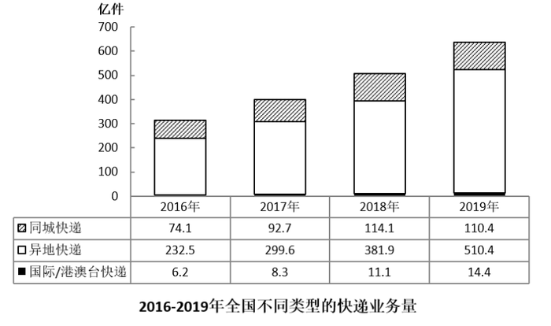

# 现期倍数（比重×总量求部分值 + 收入-业务量平均数链条换算）

考点：[[20-考点/资料分析/倍数/现期倍数（比重×总量求部分值 + 收入-业务量平均数链条换算）|倍数 / 现期倍数（比重×总量求部分值 + 收入/业务量平均数链条换算）]]
材料：[[15-材料/资料分析/312960 2016-2019年我国快递业发展情|312960 2016-2019年我国快递业发展情]]

**问法模型**：题干问'A地区平均每件快递产生的收入是B地区的多少倍'→ 用单件收入=地区收入/业务量，地区收入=全国收入×比重，倍数=(A比重/A业务量)÷(B比重/B业务量)，全国收入在比值中约掉

## 推理链
1. 第1步：从正文提取条件——2019年中部业务量81.9亿件、收入占比11.3%；西部业务量47亿件、收入占比8.5%；全国快递业务收入7497.8亿元
2. 第2步：规则——地区收入=全国收入×地区比重，单件收入=地区收入/业务量，倍数=(11.3%×7497.8/81.9)÷(8.5%×7497.8/47)，7497.8在分子分母中约掉
3. 第3步：代入计算——(11.3×47)/(8.5×81.9)=531.1/696.15≈0.76，即中部单件收入约10.3元/件，西部约13.6元/件
4. 第4步：与选项对照——0.76与B项0.8最接近（与0.5差0.26、与1.3差0.54），故选B

**最快解法**：⚡ 约分+截位直除：先看出7497.8在倍数分子分母中约掉，只需算(11.3×47)/(8.5×81.9)；分子≈531，分母≈8.5×82≈697，531/697首位商7、约0.76，与0.8最接近，秒选B

## 易错点
- ⚠ 收入只有比重没有绝对值：必须按'部分值=比重×7497.8'的结构理解，若不知道总量可在比值中约掉而硬算两组大数（7497.8×11.3%≈847.2、7497.8×8.5%≈637.3），既耗时又易算错
- ⚠ 倍数方向颠倒：中部单件收入(≈10.3元/件)小于西部(≈13.6元/件)，比值约0.76<1；若把分子分母颠倒会得到1/0.76≈1.31，恰好掉入C项1.3的陷阱
- ⚠ 口径混用：业务量必须用正文东中西部口径的绝对量（81.9/47亿件），不能从堆积柱状图取数（图中是同城/异地/国际分类，与地区口径无关）；且正文指标是收入（亿元）、图是业务量（亿件），两套指标不可交叉

## 母题抽象
> 🧩 当题干出现'A的平均每件/单位值是B的多少倍'且收入只给比重（比重+总量结构）时，用倍数=(A比重×B业务量)/(B比重×A业务量)，总量在比值中约掉，只比较比重与业务量的交叉乘积，并先估方向确认比值是否小于1

**同类特征**：'平均每件快递产生的快递业务收入'（单件收入=收入/业务量）、'是……的多少倍'（现期倍数问法）、地区收入只给比重不给绝对值（比重+总量换算结构）、业务量给绝对量（81.9亿件、47亿件）、数据全部来自正文文字段，不涉及统计图、选项两端分布（0.5/0.8 与 1.3/2.1），暗示需先判断比值大于还是小于1

## 相关题
（暂无）

---

### 题干
2019年，中部地区平均每件快递产生的快递业务收入约是西部地区的多少倍？

### 选项
- A. 0.5
- B. 0.8　✅
- C. 1.3
- D. 2.1

### 官方解析

根据题干“2019年······是······的多少倍”，可判定本题为现期倍数问题。定位文字材料第一段可得：2019年，我国中部、西部地区分别完成业务量81.9亿件和47亿件。全年快递业务收入7497.8亿元，其中中部、西部地区的业务收入所占比重分别为11.3%和8.5%。根据公式：地区快递业务收入=全国快递业务收入×地区占比，则所求倍数，与B项最接近。

故正确答案为B。

### 给定材料

        2019年，我国快递业务量为635.2亿件，其中东部、中部、西部地区分别完成业务量506.3亿件、81.9亿件和47亿件。全年快递业务收入7497.8亿元，其中东部、中部、西部地区的业务收入所占比重分别为80.2%、11.3%和8.5%。东部、中部、西部地区业务收入占全国比重分别比上年上升0.2个百分点、上升0.1个百分点和下降0.3个百分点。

        2016-2018年，我国快递业务收入分别为3974.4亿元、4957.1亿元、6038.4亿元。

