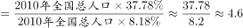

# 基期倍数（由比重升降百分点反推基期比重求两地区之比）

考点：[[20-考点/资料分析/倍数/基期倍数（由比重升降百分点反推基期比重求两地区之比）|倍数 / 基期倍数（由比重升降百分点反推基期比重求两地区之比）]]
材料：[[15-材料/资料分析/312967 2020年第七次全国人口普查数据：全|312967 2020年第七次全国人口普查数据：全]]

**问法模型**：题干问'2010年（基期）东部人口是东北人口的约几倍'→ 用'升减降加'由2020年现期比重还原2010年基期比重，基期倍数=两地基期比重之比（同一年全国总量相同，直接约去，无需算绝对人口数）

## 推理链
1. 第1步：题干定位基期为2010年、求倍数；从材料第一段取数：2020年东部占39.93%、东北占6.98%，与2010年相比东部比重上升2.15个百分点、东北下降1.20个百分点
2. 第2步：基期比重还原规则——上升的减、下降的加：2010年东部比重=39.93%-2.15%=37.78%，2010年东北比重=6.98%+1.20%=8.18%
3. 第3步：基期倍数=(37.78%×2010年全国人口)÷(8.18%×2010年全国人口)，同一年份全国总量相同可整体约去，化为37.78÷8.18
4. 第4步：截位直除：37.78÷8.18，首位商4，8.18×4.6≈37.63，故约为4.62倍
5. 第5步：与选项对照：4.62与A项'约4.6倍'最接近，故选A

**最快解法**：⚡ 比重反推＋截位直除：口诀'升减降加'秒写37.78%与8.18%，直接37.78÷8.18≈4.6（验证8.18×4.6=37.6），全程不算任何绝对人口数、也不需要用141178÷1.0538还原2010年总量，约20秒锁定A

## 易错点
- ⚠ 符号还原搞反：若把'东部上升2.15'误加、'东北下降1.20'误减，得42.08÷5.78≈7.3，恰好误选D——命题人把双向反号设为干扰项
- ⚠ 基期现期混淆：直接用2020年现期比重相除39.93÷6.98≈5.7，恰好误选B
- ⚠ 只还原一个地区：东部正确还原为37.78%却把东北基期比重错算为6.98%-1.20%=5.78%，得37.78÷5.78≈6.5，恰好误选C

## 母题抽象
> 🧩 当题干出现'基期年份A是B的约几倍'且材料只给现期比重与'比重上升/下降x个百分点'时，按'升减降加'还原两地基期比重后直接相除（同期总量自动约去），并可反向验签：现期比重直接相除、符号全反、只还原其一应分别命中其余干扰选项

**同类特征**：基期时间'2010年'早于材料现期2020年、'A是B的'＋'约多少倍'的倍数问法、材料仅给地区占比及'上升/下降x个百分点'的变化量、无需全国人口绝对总量（同一年比重之比总量约去）、'个百分点'与'%'表述仅一字之差、不可混用、正确答案取决于两处符号还原是否同时正确（干扰项对应不同符号错误组合）

## 相关题
（暂无）

---

### 题干
2010年，东部地区人口是东北地区人口的：

### 选项
- A. 约4.6倍　✅
- B. 约5.7倍
- C. 约6.5倍
- D. 约7.3倍

### 官方解析

根据题干“2010年······是······的”，选项是约多少倍，且材料时间为2020年，可判定本题为基期倍数问题。定位文字材料第一段可得：2020年东部地区人口占39.93%，东北地区占6.98%；与2010年相比，东部地区人口所占比重上升2.15个百分点，东北地区下降1.20个百分点。则2010年，东部地区人口占总人口的比重为39.93%-2.15%=37.78%，东北地区人口占总人口的比重为6.98%+1.2%=8.18%，题目所求倍数。

故正确答案为A。

### 给定材料

        2020年全国人口共141178万人，比2010年增长了约5.38%。从地区分布上看，2020年东部地区人口占39.93%，中部地区占25.83%，西部地区占27.12%，东北地区占6.98%。与2010年相比，东部地区人口所占比重上升2.15个百分点，中部地区下降0.79个百分点，西部地区上升0.22个百分点，东北地区下降1.20个百分点。

        从性别构成上看，2020年男性人口为72334万人，女性人口为68844万人。从年龄构成上看，2020年0-14岁人口为25338万人，15-59岁人口为89438万人，60岁及以上人口为26402万人（其中，65岁及以上人口为19064万人）。从城乡分布上看，2020年居住在城镇的人口为90199万人，居住在乡村的人口为50979万人，与2010年相比，城镇人口增加23642万人，乡村人口减少16436万人。从民族构成上看，2020年汉族人口为128631万人，各少数民族人口为12547万人，与2010年相比，汉族人口增长4.93%，各少数民族人口增长10.26%，少数民族人口比重上升0.40个百分点。

