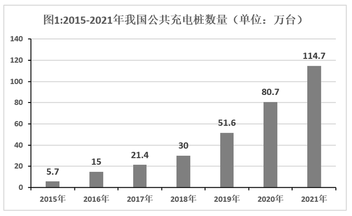

# 基期量+比值（车桩配比）

考点：[[20-考点/资料分析/倍数/基期量+比值（车桩配比）|倍数 / 基期量+比值（车桩配比）]]
材料：[[15-材料/资料分析/323376 2015—2021年我国新能源汽车销|323376 2015—2021年我国新能源汽车销]]

**问法模型**：题干问'2020年底（基期年份）保有量与充电桩的配比'→先用现期784万辆÷(1+59.25%)反推2020年底基期保有量，再除以图1的2020年充电桩80.7万台，得A:B型比值选最接近项

## 推理链
1. 第1步：题干时间为'2020年底'，文字材料只给现期数据——2021年保有量784万辆、同比+59.25%；图1给出2020年公共充电桩80.7万台（分子需反推、分母直接读图）
2. 第2步：基期量公式：基期=现期÷(1+增长率)；配比=2020年底保有量÷2020年充电桩数量（分子'保有量'在前，与选项'车：桩'口径一致）
3. 第3步：2020年底保有量=784÷1.5925≈492万辆（截位速算784÷1.6≈490）；配比=492÷80.7≈6.1（用490算得490÷80.7≈6.07）
4. 第4步：与选项对照：6.1:1即C项；D项6.8:1=784÷114.7为2021年现期配比干扰项，B项4.2:1≈492÷114.7为分子分母年份错配干扰项，均排除，故选C

**最快解法**：⚡ 公式法+截位直除：59.25%≈60%，784÷1.6=490；再算490÷80.7，由80.7×6=484.2≈490知商≈6.1，直接锁定C

## 易错点
- ⚠ 现期/基期混淆：题干问2020年底，若直接用2021年现期784÷114.7≈6.8:1会错选D（D正是现期配比干扰项，即题2口径）
- ⚠ 分子分母年份错配：分子反推出2020年保有量≈492后，分母误用2021年充电桩114.7万台，得492÷114.7≈4.3而错选B
- ⚠ 基期反推公式方向错：误用784×(1−59.25%)≈319.5，得319.5÷80.7≈4.0又错选B；正确须除以(1+59.25%)

## 母题抽象
> 🧩 当题干要求'某基期年份A与B的配比/比值'而材料只给A的现期值和同比增速时，先用'现期÷(1+增速)'还原基期A，再除以B的同期值；命题人通常在选项中同时放置'现期比值'与'年份错配比值'作干扰项，逐一核对年份即可排除

**同类特征**：2020年底（基期时间点）、保有量与公共充电桩数量配比、同比增长59.25%（隐藏反推条件）、车：桩先后顺序、约为（选最接近值）、选项含现期配比6.8:1干扰

## 相关题
（暂无）

---

### 题干
2020年底，我国新能源汽车保有量与公共充电桩数量配比约为：

### 选项
- A. 3.1：1
- B. 4.2：1
- C. 6.1：1　✅
- D. 6.8：1

### 官方解析
根据题干“2020年底，······与······配比约为”，可判定本题为比值计算问题。定位文字材料和图1可得：2021年，我国新能源汽车保有量达784万辆，同比增长59.25%，2020年我国公共充电桩数量为80.7万台。故2020年底新能源汽车保有量万台，与公共充电桩数量配比为490：80.7490：816：1，与C项最接近。
故正确答案为C。

### 给定材料

        近年来，我国新能源汽车销量及保有量快速提升，充电基础设施布局也日渐完善。2021年新能源汽车销量达352.1万辆，同比增长157.51%；截至2021年，我国新能源汽车保有量达784万辆，同比增长59.25%。

