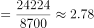
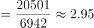

# 比值计算与最接近目标值比较（在职退休比）

考点：[[20-考点/资料分析/倍数/比值计算与最接近目标值比较（在职退休比）|倍数 / 比值计算与最接近目标值比较（在职退休比）]]
材料：[[15-材料/资料分析/323377 2012—2020年中国医保运行情况|323377 2012—2020年中国医保运行情况]]

**问法模型**：题干问'在职退休比最接近3的年份' → 逐年用 在职人数÷退休人数 算比值（或比较 在职−3×退休 的差值），取与3差值最小者

## 推理链
1. 第1步：从图1柱状提取四个选项年份数据（万人）：2012年在职19861/退休6624，2013年在职20501/退休6942，2019年在职24224/退休8700，2020年在职25429/退休9026
2. 第2步：规则：在职退休比=在职职工参保人数÷退休职工参保人数；折线无数值标签必须自算，且比较与3的接近度可转化为比较|在职−3×退休|（分母同量级，差值大小结论一致）
3. 第3步：算3×退休人数：2012年=19872、2013年=20826、2019年=26100、2020年=27078
4. 第4步：与在职人数作差：2012年差11、2013年差325、2019年差1876、2020年差1649；即各年比值均小于3，2012≈2.998、2013≈2.953、2019≈2.784、2020≈2.817
5. 第5步：差值最小者为2012年（比值≈2.998最接近3），对照选项得D

**最快解法**：⚡ 差值法：不用算精确比值，直接比较'3×退休人数'与'在职人数'的差——2012年19872−19861=11，远小于2013年325、2020年1649、2019年1876，差最小即2012年最接近3；亦可先看折线2012年为最高点且各年比值均<3，最高者即最接近3

## 易错点
- ⚠ 折线无数据标签且2016—2019四年比值几乎水平（约2.77—2.78），凭目测折线位置易误判，必须用柱状数据精算相除
- ⚠ 图1左轴从5000起而非0，柱高视觉比例失真，不能凭柱高差或柱形对比推断比值大小
- ⚠ 分子分母方向易混（在职÷退休，不能颠倒）；选项跨2012/2013/2019/2020四年，2020年折线微升易被误认为回升至接近3（实际仅约2.82），须逐年核验

## 母题抽象
> 🧩 当题干出现'某比值最接近目标值K的是哪年/哪项'时，不必算出精确比值，改比较|分子−K×分母|，差值最小者即答案；若各年比值均小于K，则比值最大的年份最接近K

**同类特征**：在职退休比、最接近3、年份比较、折线无数值标签需自算、柱状数据相除、职工医保（万人）

## 相关题
- [[10-真题/资料分析/增长/2187792 同比增长率比较（增速最快年份判断）|2187792]]（黑龙江 2018，相关度1）
- [[10-真题/资料分析/增长/2719394 增长量比较|2719394]]（国考 2021，相关度1）
- [[10-真题/资料分析/其他/2376556 顺差-逆差定义下的差额（进口-出口）逐年比较|2376556]]（黑龙江 2019，相关度1）
- [[10-真题/资料分析/增长/2051658 增速回落幅度（百分点）比较|2051658]]（陕西 2017，相关度1）
- [[10-真题/资料分析/增长/2307728 同比增长率比较（一般增长率比较问题）|2307728]]（辽宁 2018，相关度1）

---

### 题干
2012—2020年中，在职退休比最接近3的是：

### 选项
- A. 2020年
- B. 2019年
- C. 2013年
- D. 2012年　✅

### 官方解析

方法一：根据题干“2012—2020年中，在职退休比······”，可判定本题为比值计算问题。定位统计图可得2012—2020年在职职工参保人数与退休职工参保人数。根据在职退休比，可得各年份在职退休比分别为：

A项，2020年；

B项，2019年；

C项，2013年；

D项，2012年。

在职退休比最接近3的是2012年。

方法二：定位统计图折线数据，观察可知2012、2013、2019、2020年在职退休比最接近3的是2012年。

故正确答案为D。

### 给定材料

