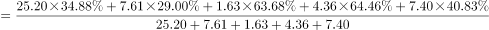
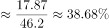
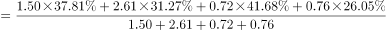
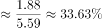
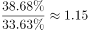
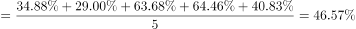
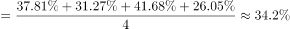
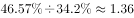

# 现期倍数（区域整体比重需按营业收入加权还原后作商）

考点：[[20-考点/资料分析/倍数/现期倍数（区域整体比重需按营业收入加权还原后作商）|倍数 / 现期倍数（区域整体比重需按营业收入加权还原后作商）]]
材料：[[15-材料/资料分析/323433 2021年第一季度全国15个重点旅游|323433 2021年第一季度全国15个重点旅游]]

**问法模型**：题干'A区域某比重约是B区域的几倍'→ 不能取比重算术平均，须先用Σ(营业收入×比重)÷Σ营业收入还原区域整体比重，再作商求倍数

## 推理链
1. 第1步：由表下注释确定分组——华东5城（上海、南京、无锡、苏州、杭州）、东北4城（沈阳、大连、长春、哈尔滨），并摘出各城营业收入与餐饮收入比重
2. 第2步：区域整体比重=Σ(各城营业收入×餐饮比重)÷Σ营业收入（以营业收入为权重的加权平均），不能对比重直接简单平均
3. 第3步：华东餐饮收入=25.20×34.88%+7.61×29.00%+1.63×63.68%+4.36×64.46%+7.40×40.83%≈17.87亿元，营业收入合计=25.20+7.61+1.63+4.36+7.40=46.20亿元，整体比重≈17.87÷46.20≈38.7%
4. 第4步：东北餐饮收入=1.50×37.81%+2.61×31.27%+0.72×41.68%+0.76×26.05%≈1.88亿元，营业收入合计=1.50+2.61+0.72+0.76=5.59亿元，整体比重≈1.88÷5.59≈33.7%
5. 第5步：倍数=38.7%÷33.7%≈1.15，对照选项A(1.15)、B(1.28)、C(1.36)、D(1.51)，锁定A

**最快解法**：⚡ 加权整合法+截位估算：先把各城餐饮收入截位粗算——华东≈8.8+2.2+1.0+2.8+3.0≈17.8亿元、东北≈0.57+0.81+0.30+0.21≈1.89亿元，分别除以营业收入合计46.2和5.59得约38.7%与33.8%，38.7/33.8≈1.15，直选A；切勿用比重算术平均(46.57%÷34.20%≈1.36)误选C

## 易错点
- ⚠ 最大陷阱：把5城/4城的餐饮比重做算术平均（华东46.57%、东北34.20%）得≈1.36选C——官方解析明确指出此算法不科学，C正是为该错误算法设置的干扰项
- ⚠ 区域分组藏在表下注释且行序交错（华北/东北/华东混排），漏读注释会把天津、石家庄误入华东、把沈阳误出东北，城市范围一错全盘皆错
- ⚠ 找错列：'餐饮收入比重(%)'与相邻的'客房收入比重(%)'极易混淆，两列数值不同（如哈尔滨26.05%对52.53%），用错列结果完全偏离

## 母题抽象
> 🧩 当题干出现'某区域整体的比重/平均数约是另一区域的几倍'且材料只给各成员指标时，必须以营业收入（或数量）为权重加权还原区域整体值再作商，切勿对成员比重简单算术平均

**同类特征**：约是……的几倍、区域整体（华东/东北）对比、餐饮收入比重、需表下注释区域分组、现期倍数、算术平均vs加权平均陷阱

## 相关题
- [[10-真题/资料分析/倍数/10204451 现期倍数计算（部分与部分之和的倍数）|10204451]]（广东 2024，相关度1）
- [[10-真题/资料分析/倍数/10297461 现期倍数计算（含'二季度=上半年-一季度'时段拆分推算）|10297461]]（四川 2025，相关度1）
- [[10-真题/资料分析/倍数/1797608 现期倍数计算+加总排序定位|1797608]]（山东 2016，相关度1）
- [[10-真题/资料分析/倍数/2024182 现期倍数（两分项净增量之比）|2024182]]（重庆 2016，相关度1）
- [[10-真题/资料分析/倍数/2042820 现期倍数计算（同一子总体内占比相除）|2042820]]（江苏 2017，相关度1）

---

### 题干
2021年第一季度15个重点旅游城市中，华东地区星级饭店的餐饮收入比重约是东北地区的几倍？

### 选项
- A. 1.15　✅
- B. 1.28
- C. 1.36
- D. 1.51

### 官方解析

根据题干“······约是······的几倍”，可判定本题为现期倍数问题。定位统计表可得：2021年第一季度华东地区星级饭店的营业收入及餐饮收入比重依次为上海25.20亿元、34.88%，南京7.61亿元、29.00%，无锡1.63亿元、63.68%，苏州4.36亿元、64.46%，杭州7.40亿元、40.83%；东北地区依次为沈阳1.50亿元、37.81%，大连2.61亿元、31.27%，长春0.72亿元、41.68%，哈尔滨0.76亿元、26.05%。根据公式：比重，则华东地区星级饭店的餐饮收入比重；东北地区星级饭店的餐饮收入比重，故华东地区约是东北地区的倍。

故正确答案为A。

备注：由于正确算法计算量几乎无法笔算，考虑出题人可能按照比重的平均数计算此题：华东地区星级饭店餐饮收入比重，东北地区星级饭店的餐饮收入比重，如此计算华东地区约是东北地区的倍，对应C项。但从数学角度，C项算法并非科学算法。

### 给定材料

> [!warning] 疑点（官方解析可能有误，待人工复核）
> 官方解析备注自认：科学加权算法计算量几乎无法笔算，若按各城比重算术平均（华东46.57%÷东北34.20%≈1.36）得C项；官方最终以加权口径（≈1.15）定A为唯一正确答案，存在命题口径争议。本题以A作答为准，C是算术平均这一非科学算法的对应项，复习时须警惕此陷阱设计。
