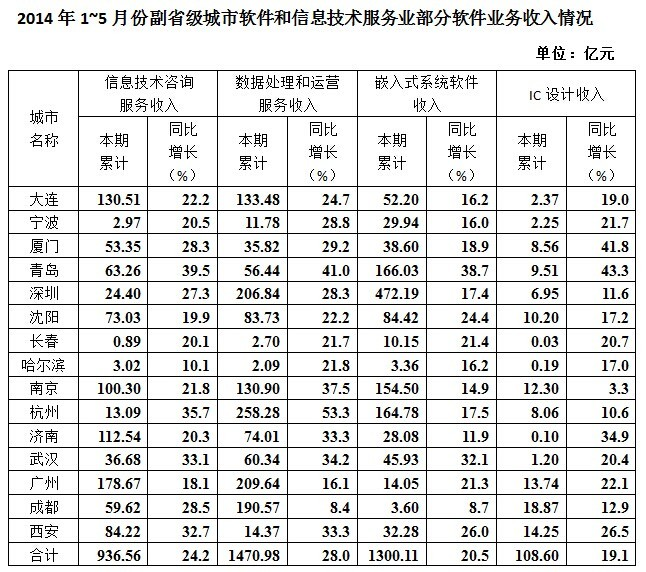

# 多项数据加和比较

考点：[[20-考点/资料分析/其他/多项数据加和比较|其他 / 多项数据加和比较]]

**问法模型**：题干问'表中四项软件业务收入之和最高的东北地区副省级城市'→对选项中四个城市逐行将表中对应四项分项收入直接相加后横向比较大小

## 推理链
1. 第1步：材料背景为2014年1—5月全国软件业务收入13254亿元，表格按城市列出各分项软件业务收入，题干限定比较范围为东北地区的副省级城市，即大连、长春、沈阳、哈尔滨四市
2. 第2步：所用规则为简单加总——对每个候选城市，将表中指定的四项软件业务收入分列数值逐一相加，不涉及增长率计算
3. 第3步：逐行代入求和——大连四项之和最大；长春四项之和明显低于大连；沈阳四项之和低于大连；哈尔滨四项之和明显小于大连
4. 第4步：结论为四个候选城市中只有大连的四项之和最高
5. 第5步：与选项对照，A为大连，故正确答案选A

**最快解法**：⚡ 粗加比较法（观察+估算）：四个候选城市各分项数值差距明显，无需精确求和——大连各分项普遍最大，粗加即知其和最高；长春、哈尔滨与大连差距明显可直接排除，沈阳加总后仍小于大连，锁定A

## 易错点
- ⚠ 未按题干指定的四项分列加总，误比较了'软件业务收入'总计列或其他列
- ⚠ 看错行、漏加某一分项，导致某城市加总结果失真
- ⚠ 忽略限定词'东北地区副省级城市'，把其他城市纳入比较；同时注意时间范围为2014年1—5月

## 母题抽象
> 🧩 当题干出现'表中（限定区域或条件的若干对象）某几项指标之和最大/最高'的特征时，先按限定条件筛选对应行，再对指定列逐行加总比较；数值差距明显时用粗算或观察法即可锁定答案，不必精算

**同类特征**：四项软件业务收入之和、之和最高、东北地区副省级城市、表格多列数据加总比较、2014年1—5月、城市间横向比较

## 相关题
- [[10-真题/资料分析/其他/2049344 两列做差取绝对值比较（截面排名表找差值最大主体）|2049344]]（河南 2017，相关度1）
- [[10-真题/资料分析/增长/2453096 增长量比较（同比增量=现期存量−基期存量）|2453096]]（上海 2020，相关度1）

---

### 题干
2014年1～5月，表中四项软件业务收入之和最高的东北地区副省级城市是：

### 选项
- A. 大连　✅
- B. 长春
- C. 沈阳
- D. 哈尔滨

### 官方解析
结合选项，各地区四项软件业务收入之和分别为：大连：；长春：，明显比大连要低；沈阳：；哈尔滨：，依旧明显要小于大连。通过计算可知，大连的四项软件业务收入之和最高。
故正确答案为A。

### 给定材料

        2014年1—5月，我国软件和信息技术服务业实现软件业务收入13254亿元，同比增长，比去年同期回落3.3个百分点。其中，软件产品完成收入4141亿元，信息系统集成服务完成收入2649.3亿元，信息技术咨询服务完成收入1399.2亿元，数据处理和运营服务完成收入2429.5亿元，嵌入式系统软件完成收入2230.3亿元，IC设计完成收入405.1亿元。

