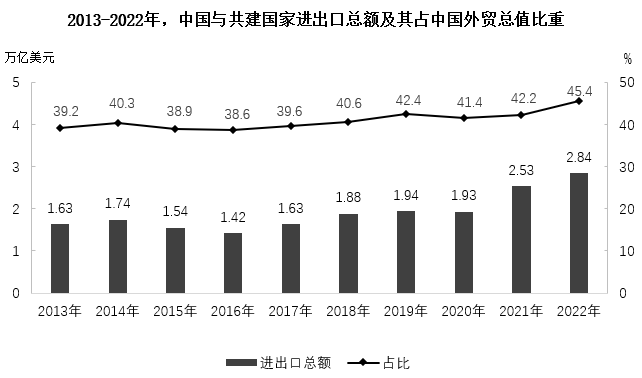

# 多期数值加总（合计值计算与区间判断）

考点：[[20-考点/资料分析/其他/多期数值加总（合计值计算与区间判断）|其他 / 多期数值加总（合计值计算与区间判断）]]
材料：[[15-材料/资料分析/6366920 2013—2022年中国与共建国家进|6366920 2013—2022年中国与共建国家进]]

**问法模型**：题干以'2013-2022年……合计约为'提问且选项为区间 → 将该时段各年柱状图数值（进出口总额，左轴）逐一加总后对照区间

## 推理链
1. 第1步：从柱状图（左轴，柱=进出口总额，单位万亿美元）读出2013-2022年十年数据：1.63、1.74、1.54、1.42、1.63、1.88、1.94、1.93、2.53、2.84
2. 第2步：题干所求为十年合计，仅用柱值直接求和，右轴折线（占比%）与本题无关，公式为 S=Σ各年进出口总额
3. 第3步：代入加总：1.63+1.74+1.54+1.42+1.63+1.88+1.94+1.93+2.53+2.84=19.08万亿美元
4. 第4步：19.08万亿美元落在'17-20万亿美元之间'（B项）区间内，不满足A（≥20）、C（14-17）、D（≤14）
5. 第5步：故正确答案为B

**最快解法**：⚡ 区间型选项用截位估算法：各数只保留一位小数加总 1.6+1.7+1.5+1.4+1.6+1.9+1.9+1.9+2.5+2.8=18.8≈19，误差不超过0.5，稳落17-20区间，秒选B（亦可先算后两年2.5+2.8≈5.3，再按前八年均值约1.7估8×1.7≈13.6，合计约19）

## 易错点
- ⚠ 串轴陷阱：误把右轴折线占比（%）数据纳入计算，本题只看左轴柱值
- ⚠ 漏项/抄错：2013年与2017年同为1.63、2020年1.93与2019年1.94仅差0.01，十年硬加易漏项，漏加任一年（约1.4-2.8）即可能滑出正确区间
- ⚠ 边界误判：19.08很接近20，粗估过度（如按平均2估成20）可能误选A'至少20万亿美元'

## 母题抽象
> 🧩 当题干出现'某连续时段合计约为'且选项为数值区间时，用截位估算/取整加总（保留一位小数即可），粗算结果对照区间锁定答案，无需精算到两位小数

**同类特征**：合计约为、跨越十年全时段（2013-2022）、柱状图数值直接加总、选项为数值区间（区间型选项）、只涉及单一指标（进出口总额，不涉占比）

## 相关题
（暂无）

---

### 题干
2013-2022年，中国与共建国家进出口总额合计约为：

### 选项
- A. 至少20万亿美元
- B. 在17-20万亿美元之间　✅
- C. 在14-17万亿美元之间
- D. 至多14万亿美元

### 官方解析
定位统计图可知2013-2022年中国与共建国家每年的进出口总额。则题目所求=1.63+1.74+1.54+1.42+1.63+1.88+1.94+1.93+2.53+2.84=19.08万亿美元，在B项范围内。
故正确答案为B。

### 给定材料

