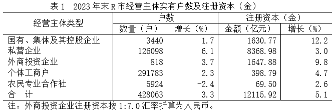

# 查表直算+汇率（单位）换算

考点：[[20-考点/资料分析/其他/查表直算+汇率（单位）换算|其他 / 查表直算+汇率（单位）换算]]
材料：[[15-材料/资料分析/7173399 R市2023年末户籍人口及城镇化情况|7173399 R市2023年末户籍人口及城镇化情况]]

**问法模型**：题干问'注册资本约为多少亿美元'→ 查表取人民币注册资本，按注释汇率折算：美元=人民币亿元÷7.0

## 推理链
1. 第1步：从表1定位外商投资企业一行，2023年末注册资本（金）为1647.88亿元（注意是人民币口径）
2. 第2步：从表格注释提取折算规则——外商投资企业注册资本按1:7.0汇率折算为人民币，故亿元人民币÷7.0=亿美元
3. 第3步：代入计算：1647.88÷7.0≈235.41亿美元
4. 第4步：与选项对照：235最接近235.41，选D；选项B的1648恰是未除汇率的原人民币数值（命题陷阱），A、C为干扰量级

**最快解法**：⚡ 截位直除：1647.88÷7.0≈1648÷7≈235.4，秒杀锁定D（把1647.88截位为1648，除以7口算得235.4）

## 易错点
- ⚠ 忽略表格注释的汇率1:7.0，直接把1647.88亿元当美元，误选B（1648）——这是命题人埋的最大陷阱
- ⚠ 折算方向搞反：误乘7.0得约11535亿美元（远超任何选项），人民币折美元必须除以7.0
- ⚠ 看错行取数：错取国有集体企业1630.77亿元或合计12115.92亿元等相邻数据，行定位要锁定'外商投资企业'

## 母题抽象
> 🧩 当题干问'…约为多少亿美元'且材料注明'按1:X汇率折算为人民币'时，用'表中人民币金额÷X'折算，并验证选项中未除汇率的原数值即为陷阱项

**同类特征**：注册资本约为多少亿美元、注释：按1:7.0汇率折算为人民币、外商投资企业（表1单行数据）、查表直算+单位换算、亿元→亿美元

## 相关题
（暂无）

---

### 题干
2023年末，R市外商投资企业的注册资本约为多少亿美元？

### 选项
- A. 1501
- B. 1648
- C. 214
- D. 235　✅

### 官方解析
根据题干“2023年末······注册资本约为多少亿美元”，结合材料给出人民币折算的汇率，可判定本题为比值计算问题。定位统计表可得：2023年末R市外商投资企业注册资本为1647.88亿元；定位注释可得：外商投资企业注册资本按1：7.0汇率折算为人民币。则2023年末，R市外商投资企业的注册资本为亿美元。
故正确答案为D。

### 给定材料

        2023年末R市户籍人口308.36万人，比上年末增加0.44万人，其中城镇人口152.45万人，比上年末增加0.53万人。2023年新登记各类经营主体5.97万户，其中，新登记企业1.87万户。年末实有经营主体42.81万户，增长3.3%，其中，民营经营主体42.38万户，占比99%。

