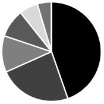
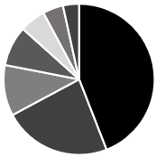

# 图形判断·饼图占比结构匹配

考点：[[20-考点/资料分析/其他/图形判断·饼图占比结构匹配|其他 / 图形判断·饼图占比结构匹配]]
材料：[[15-材料/资料分析/7944543 这份材料讲国家标准物质（取得定级证书|7944543 这份材料讲国家标准物质（取得定级证书]]

**问法模型**：题干要求选出'最有可能准确反映……地域分布情况'的饼图 → 先按数据确定扇区个数（0值地区不占扇区），再按材料顺序从12点方向顺时针比对各相邻扇区相对大小逐项排除

## 推理链
1. 第1步：从材料第三段提取地域数据：华北234项、华东124项、东北62项、西北48项、华南32项、西南24项、华中未新建（0项），加和234+124+62+48+32+24+0=524，与当期新增524项吻合
2. 第2步：规则一，华中地区为0项、不占扇区，饼图应只有6个扇区；规则二，无图例时按材料数据顺序从12点钟方向开始顺时针排布
3. 第3步：数扇区个数，只含6个扇区的图形才可能正确，排除含7个扇区的C、D两项
4. 第4步：对比剩余A、B，最明显差异在最后两个扇区（华南与西南）：华南32项明显大于西南24项，故倒数第二个扇区应大于最后一个扇区
5. 第5步：可加占比验证：华北234/524≈44.7%约占近半、华东124/524≈23.7%约四分之一，前两扇区合计约68%，与A项前两扇区占大头、末两扇区依次递减（华南>西南）一致
6. 第6步：A项符合全部特征，B项华南与西南大小关系颠倒，排除B，锁定答案A

**最快解法**：⚡ 扇区个数排除法+相邻扇区大小比较：第一步数扇区，华中0项→只有6个扇区，秒杀排除C、D；第二步只看最后两扇区，华南32>西南24，排除B选A；全程无需精确计算占比

## 易错点
- ⚠ 忽略'华中地区未新建标准物质'即0项，按7个地区找7扇区图形，误选C或D
- ⚠ 无图例时未按材料叙述顺序（从12点顺时针）对应数据顺序，把华南与西南的位置或大小关系看反，误选B
- ⚠ 误用截至2025年上半年累计18982项作占比分母或误把各区域数值与18982项混算；正确分母应是当期新增524项（各区域之和恰为524，加和验证可防漏读0项）

## 母题抽象
> 🧩 当题干出现'最有可能准确反映……分布情况'且选项为饼图时，用'两步排除法'：先数扇区个数（零值类别不占扇区）排除扇区数不符项，再按材料顺序从12点顺时针比对相邻扇区相对大小（可用总份数与最大两项占比粗验），即可锁定答案

**同类特征**：最有可能准确反映……分布情况、饼形图/饼状图选项、地域分布、某地区未新建（0项）、无图例按材料顺序12点顺时针、图形匹配排除

## 相关题
- [[10-真题/资料分析/比重/13504464 现期比重（饼图占比图形匹配）|13504464]]（新疆 2025，相关度1）

---

### 题干
下列选项中，最有可能准确反映2025年上半年我国新建标准物质地域分布情况的是（    ）。

### 选项
- A. 

　✅
- B. 

- C. 

- D. 

### 官方解析
定位文字材料第三段可得：2025年上半年，我国新批准建立国家标准物质524项。从地域分布看，华北地区新建标准物质234项，华东地区新建标准物质124项，东北地区新建标准物质62项，西北地区新建标准物质48项，华南地区新建标准物质32项，西南地区新建标准物质24项，华中地区未新建标准物质。饼形图未给出图例时，应按材料数据顺序（从前往后或从上往下），从12点钟方向开始顺时针排布。
因华中地区未新建标准物质，可知饼状图只包括6个地区，排除C、D两项。对比A、B两项，最明显的区别为华南地区和西南地区的大小关系（即最后两部分），华南地区32项明显大于西南地区24项，排除B项。
故正确答案为A。

### 给定材料

        标准物质与尺子、砝码一样，是测量中必不可少的参照工具。它是已提前获得准确测量结果、均匀稳定的样品，待测样品以其为标准，确保不同时间、人员、实验室的测量结果可比。标准物质研制生产机构在开展具体品种标准物质的生产供应前，须通过技术审评并取得定级证书，这些取得定级证书的标准物质，统称为“国家标准物质”。根据计量溯源性、准确度和用途等，国家标准物质目前分为两类，即一级标准物质和二级标准物质。

        国家标准物质数量快速增长的原因有四个方面：一是用途广泛、涉及经济、社会发展的各个领域；二是需求大幅增加，检测部门和行业主管部门日益重视测量结果的准确性；三是产业发展迅速，除了中国计量科学研究院等机构之外，越来越多的企业积极申报国家标准物质；四是政策支持，国家市场监管总局出台了一系列措施，比如将国家标准物质纳入国务院计量发展规划、发布建设和管理指导意见，并优化审评制度，提高审批效率。

        截至2025年上半年，市场监管总局累计批准建立国家标准物质18982项。2025年上半年，我国新批准建立国家标准物质524项，同比增长78.8%，涉及研制单位51家。从研制单位类型看，企业申报标准物质379项，同比增长86.7%；科研事业单位申报145项，同比增长61.1%。从地域分布看，华北地区新建标准物质234项，华东地区新建标准物质124项，东北地区新建标准物质62项，西北地区新建标准物质48项，华南地区新建标准物质32项，西南地区新建标准物质24项，华中地区未新建标准物质。

