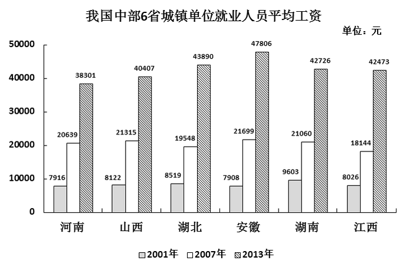

# 中位数计算（偶数个数据取中间两数平均）

考点：[[20-考点/资料分析/其他/中位数计算（偶数个数据取中间两数平均）|其他 / 中位数计算（偶数个数据取中间两数平均）]]
材料：[[15-材料/资料分析/182050 以分组柱状图呈现2001、2007、|182050 以分组柱状图呈现2001、2007、]]

**问法模型**：题干问'某一年份6省数据的中位数'→ 先按图例只取该年份6个数据，排序后取中间两数（第3、4位）求算术平均

## 推理链
1. 第1步：从柱状图白色柱（图例=2007年）读取6省数据：河南20639、山西21315、湖北19548、安徽21699、湖南21060、江西18144（单位：元）
2. 第2步：中位数规则——6个数据为偶数个，须将6个数完整排序后取中间两数（第3、4位）的平均值
3. 第3步：从大到小排序：21699、21315、21060、20639、19548、18144，锁定中间两数为21060和20639
4. 第4步：代入计算 (21060+20639)÷2 = 41699÷2 = 20849.5元
5. 第5步：与选项对照，A项20849.5元与计算结果一致；B项20639、C项21060恰为中间单个数据，是干扰项，故选A

**最快解法**：⚡ 排序取中法+尾数辅助：只读白色柱6个数，降序排列后直接锁定21060和20639两个中间数；求和41699（尾数0+9=9，和为奇数，结果必带.5，排除B、C整数项），除以2得20849.5，秒选A

## 易错点
- ⚠ 三柱颜色相近（灰/白/斜纹），须严格按图例对位白色柱=2007年，最易把2001年灰色柱或2013年斜纹柱数据混入排序
- ⚠ 偶数个数据的中位数误取第3或第4个数本身（对应干扰项B 20639、C 21060），必须取中间两数的平均值
- ⚠ 6省数据须排全，漏一省或抄错近似值即错：湖南21060与山西21315、河南20639三者接近，易混淆错位

## 母题抽象
> 🧩 当题干出现'N个地区/年份某指标的中位数'特征时，先完整取出同一年份同口径的N个数据并排序，N为偶数取中间两数平均、N为奇数取正中那个数，选项常以中间单个数据设干扰，切勿直接选中间数

**同类特征**：2007年（单一截面年份）、中部六省（6个数据）、平均工资、中位数、柱状图取数、排序取中间

## 相关题
- [[10-真题/资料分析/增长/2030132 年均增长率比较|2030132]]（四川 2016，相关度1）
- [[10-真题/资料分析/增长/3522685 增长率计算（增长倍数=增长量-基期量）|3522685]]（广西 2021，相关度1）
- [[10-真题/资料分析/增长/13504662 增长率计算与趋势比较（折线图匹配）|13504662]]（辽宁 2025，相关度1）
- [[10-真题/资料分析/增长/2578513 环比增长率比较（月平均工资增速最快）|2578513]]（内蒙古 2020，相关度1）
- [[10-真题/资料分析/其他/11226440 中位数计算（奇数个数据排序取中位）|11226440]]（江苏 2025，相关度1）

---

### 题干
2007年中部六省城镇单位就业人员平均工资中位数为（  ）。

### 选项
- A. 20849.5元　✅
- B. 20639元
- C. 21060元
- D. 20400.8元

### 官方解析
定位柱状图材料中2007年数据可得，2007年中部六省城镇单位就业人员平均工资从大到小排列为：21699、21315、21060、20639、19548、18144。故所求中位数为位于中间两数的平均数，中位数。
故正确答案为A。

### 给定材料

