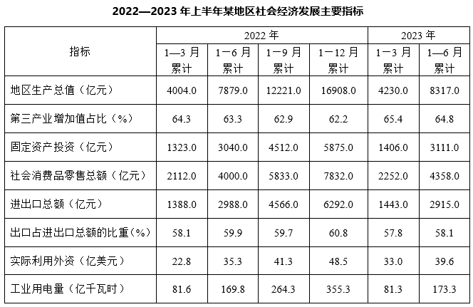

# 累计值差分求单季值并比较大小

考点：[[20-考点/资料分析/其他/累计值差分求单季值并比较大小|其他 / 累计值差分求单季值并比较大小]]
材料：[[15-材料/资料分析/3303536 某地区（兄弟题干称'该市'，与表题'|3303536 某地区（兄弟题干称'该市'，与表题']]

**问法模型**：题干给'累计'时点数据却问'哪个季度最多' → 用相邻两列累计值相减还原各单季值，再横向比较（非同比）

## 推理链
1. 第1步：从表中提取进出口总额累计值：2022年1—3月1388.0、1—6月2988.0、1—9月4566.0、1—12月6292.0亿元；2023年1—3月1443.0、1—6月2915.0亿元
2. 第2步：规则——单季值=本期累计−上期累计；其中2022年Q1=1388.0、2023年Q1=1443.0本身就是一季度值，无需差分
3. 第3步：代入计算：2022年Q2=2988.0−1388.0=1600.0；2022年Q3=4566.0−2988.0=1578.0；2022年Q4=6292.0−4566.0=1726.0；2023年Q2=2915.0−1443.0=1472.0（亿元）
4. 第4步：六个季度序列为1388.0/1600.0/1578.0/1726.0/1443.0/1472.0，最大值1726.0亿元出现在2022年第四季度
5. 第5步：对照选项，1726.0对应C（2022年第四季度），与官方答案一致

**最快解法**：⚡ 差分＋口算比较：选项只涉4个季度，逐个做百位级减法——Q2=2988−1388=1600、Q3=4566−2988=1578、Q4=6292−4566=1726、2023Q2=2915−1443=1472；其中Q4差分两端数差最大（6292−4566），一眼估出1726为最大，直接锁C，无需精算全部

## 易错点
- ⚠ 把1—6月累计2988.0、1—12月累计6292.0等直接当'当季值'拿来比较——每列表头均为'累计'，单季值必须相邻累计相减
- ⚠ 2023年只有1—3月、1—6月两个累计时点，2023年Q2=2915.0−1443.0=1472.0，误直接用1443.0或2915.0参与比较
- ⚠ 忽略题干时间范围'2022年Q1—2023年Q2'，注意一季度值即累计值本身（1388.0、1443.0）不需差分，虽本题主选项未含Q1，但同类题常在此设坑

## 母题抽象
> 🧩 当表格全部是'累计值'而题干问'某季度/某月最多（或多少）'时，先做相邻累计差分还原单期值，再比较大小，切勿拿累计值直接排序；2023年时点不足时注意差分链在哪一列截止

**同类特征**：累计值统计表、问单季度数值、最多的季度是、进出口总额、相邻累计相减、跨年季度比较

## 相关题
- [[10-真题/资料分析/增长/15121354 增长量计算与比较（拼合进出口总额后找同比减少年份）|15121354]]（江苏 2024，相关度1）
- [[10-真题/资料分析/其他/4652171 累计值差分求单月值（当期值还原）＋最值比较|4652171]]（北京 2022，相关度1）
- [[10-真题/资料分析/其他/2741675 累计值差分还原单月值并比较计数|2741675]]（山东 2021，相关度1）

---

### 题干
2022年第一季度—2023年第二季度，该市进出口总额最多的季度是：

### 选项
- A. 2022年第二季度
- B. 2022年第三季度
- C. 2022年第四季度　✅
- D. 2023年第二季度

### 官方解析
定位表格资料可知，该市2022年1—3月累计进出口总额为1388.0亿元，1—6月累计进出口总额为2988.0亿元，1—9月累计进出口总额为4566.0亿元，1—12月累计进出口总额为6292.0亿元；2023年1—3月累计进出口总额为1443.0亿元，1—6月累计进出口总额为2915.0亿元。则该市各季度进出口总额分别为：2022年第二季度=2988.0-1388.0=1600亿元；2022年第三季度=4566.0-2988.0=亿元；2022年第四季度=6292.0-4566.0=亿元；2023年第二季度=2915.0-1443.0=亿元。比较可得，2022年第四季度该市进出口总额最多。
故正确答案为C。

### 给定材料

> [!warning] 疑点（官方解析可能有误，待人工复核）
> 官方解析文字中2022年第三、四季度及2023年第二季度的差分结果数字缺失（写作'=亿元'），按材料实算应为1578.0、1726.0、1472.0亿元；最大值判断（2022年第四季度）与计算一致，不影响正确答案C
