# 直接读数与数值大小比较（三组满意度关系式判断）

考点：[[20-考点/资料分析/其他/直接读数与数值大小比较（三组满意度关系式判断）|其他 / 直接读数与数值大小比较（三组满意度关系式判断）]]
材料：[[15-材料/资料分析/182296 2015年5月国家统计局调查队在江苏|182296 2015年5月国家统计局调查队在江苏]]

**问法模型**：题干设'经常互动、偶尔互动、基本不互动'三组满意度为a、b、c并问三者关系 → 从材料收尾段'与村委会互动的频率'一行直接读出三个百分数，按数值大小排序写成不等式对照选项

## 推理链
1. 第1步：定位材料最后一句'从与村委会互动的频率看'维度，该行仅含经常互动、偶尔互动、基本不互动三组满意度数值，与年龄层、居住状态两个维度的满意度互不归属。
2. 第2步：按题干赋值顺序依次读数：a=经常互动组满意度、b=偶尔互动组满意度、c=基本不互动组满意度（具体百分数本卷被隐去，以原题卷实际数值为准，严禁凭空补数）。
3. 第3步：对三个百分数做纯数值大小比较，无需任何换算或加权（满意度比较是百分数数值比较，警惕把百分点当倍数、把占比当人数）。
4. 第4步：将三个数值按原卷读数从大到小（或按选项要求）排序，还原成a、b、c的不等关系式。
5. 第5步：将所得关系式与四个选项逐一对照，匹配官方给出的正确答案C项对应的不等式。

**最快解法**：⚡ 

## 易错点
- ⚠ 三维度满意度（年龄层/居住状态/互动频率）共9个百分数密集排列于一段，串行读错是头号陷阱，必须先给每行标号定位再取数。
- ⚠ a、b、c的对应关系由题干固定（a=经常、b=偶尔、c=基本不互动），自行排序后若不按a、b、c原序还原关系式，极易错选；且本卷选项为公式图片，须以原卷选项文字为准核对。
- ⚠ 此题是数值比较模型，勿与兄弟小题3'平均满意度'混淆——平均满意度需按题干定义选择算术平均或以分组占比加权的模型，而本题只比大小、不做任何运算。

## 母题抽象
> 🧩 当题干出现'设……分别为a、b、c，则有（大小关系）'特征时，回材料定位对应维度的一行三个数值，按数值大小排序写成不等式，与选项逐一对照即得答案，切勿跨维度取数。

**同类特征**：设……分别为a、b、c、与村委会互动的频率、经常互动/偶尔互动/基本不互动、对当前生活状态的满意度、大小关系式选项（不等式）、单一时点截面数据的直接读数比较

## 相关题
（暂无）

---

### 题干
设与村委会经常互动、偶尔互动、基本不互动的受访老人对当前生活状态的满意度分别为a、b、c，则有（    ）。

### 选项
- A. 
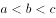

- B. 
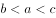

- C. 
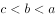
　✅
- D. 
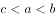

### 官方解析

根据文字材料第二段中“从与村委会互动的频率看，经常互动、偶尔互动、基本不互动的老人对当前生活状态的满意度分别为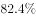、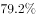、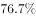。”可知，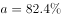，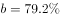，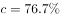。那么，。

故正确答案为C。

### 给定材料

        2015年5月，国家统计局调查队在江苏省某市开展了农村养老现状专项调研。受访老人中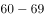岁的占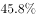，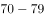岁的占，80岁及其以上的占。受访老人中有一个子女的占，有两个子女的占，无子女的占。受访老人中与配偶同住的占，与未婚子女同住的占，与某个已婚子女同住的占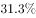，在子女家轮流住的占，独居的占。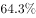的受访老人为男性。从不同住子女探望老人的频率看，的受访老人表示每天来探望，的表示每周来探望，的表示每月来探望，其余的表示子女遇事或根据要求来探望。

        调查显示，看电视（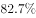）、串门聊天（）、打牌（）、散步（）、听广播（）和读书看报（）是农村老人的主要闲暇活动。当问及“你想不想参加集体活动”时，的受访老人表示“想参加”，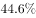的老人表示“可参加可不参加”，还有的老人表示“不想参加”。关于受访老人对当前生活状态的满意度，从年龄层看，岁、岁，80岁及其以上的老人对当前生活状态的满意度分别为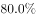、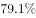、；从居住状态看，与子女同住、与配偶同住、独居的老人对当前生活状态的满意度分别为、、；从与村委会互动的频率看，经常互动、偶尔互动、基本不互动的老人对当前生活状态的满意度分别为、、。

