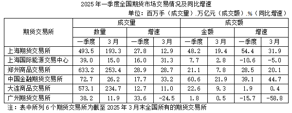

# 多行加总求总量（全国=6家之和）

考点：[[20-考点/资料分析/其他/多行加总求总量（全国=6家之和）|其他 / 多行加总求总量（全国=6家之和）]]
材料：[[15-材料/资料分析/4966917 2025年一季度及3月全国6家期货交|4966917 2025年一季度及3月全国6家期货交]]

**问法模型**：题干问'全国2025年一季度成交额约为多少万亿元'而表中无全国行 → 依据注释'6家即全国全部'，将成交额一季度列6个数值直接加总

## 推理链
1. 第1步：题干求'全国'一季度成交额，注释明确所列6家为截至2025年3月末全国全部期货交易所，故全国=6家之和，无需另找全国行
2. 第2步：从表中定位'成交额—金额—一季度'列（不是成交量列、不是3月列），取出6个数值：上期所48.2、上期能源7.7、郑商所21.1、中金所60.6、大商所22.6、广期所1.8（单位均为万亿元）
3. 第3步：加总：48.2+7.7+21.1+60.6+22.6+1.8=162.0万亿元（小数位2+7+1+6+6+8=30，整数位48+7+21+60+22+1=159，合计162.0）
4. 第4步：与选项对照：162.0与B项162完全一致（A.153、C.175、D.184均偏离9以上），故选B

**最快解法**：⚡ 尾数法+凑整加总：只加小数位0.2+0.7+0.1+0.6+0.6+0.8=3.0（进位3），整数位48+7+21+60+22+1=159，共162，一步锁定B；本题选项间隔大（≥9），加总无需精细估算

## 易错点
- ⚠ 列定位错误：误把成交量列加总（493.5+39.0+633.2+72.7+573.1+38.2≈1849.7百万手），量级与'万亿元'完全不符；须认准'成交额—金额'组
- ⚠ 时间口径错误：误加'3月'列成交额（合计约59.4万亿元）而非'一季度'列；一季度是1~3月累计值
- ⚠ 漏加小数值行（如广期所1.8、上期能源7.7）导致总数偏低掉入A项153附近

## 母题抽象
> 🧩 当题干问'全国/全部……总量'而材料只给分项行、且注释表明'所列为全部'时，直接将对应指标列加总，用尾数法快速核对选项即可

**同类特征**：全国（注释=6家之和）、成交额（万亿元）、2025年一季度累计值、约为多少万亿元、简单加总模型

## 相关题
- [[10-真题/资料分析/增长/1746808 隔年（间隔）基期量计算|1746808]]（国考 2016，相关度1）
- [[10-真题/资料分析/平均数/2184641 现期平均数计算（部分÷比重反推整体+月均+亿元→万亿元单位换算）|2184641]]（选调 2018，相关度1）

---

### 题干
2025年一季度全国期货市场成交额约为多少万亿元？

### 选项
- A. 153
- B. 162　✅
- C. 175
- D. 184

### 官方解析
定位统计表可得：2025年一季度表中所列6个期货交易所市场成交额分别为48.2万亿元、7.7万亿元、21.1万亿元、60.6万亿元、22.6万亿元、1.8万亿元。则所求为万亿元，与B项最接近。
故正确答案为B。

### 给定材料

