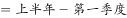
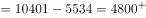
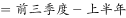
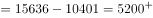
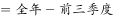
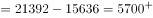

# 当年累计值差分还原当期值后比大小

考点：[[20-考点/资料分析/其他/当年累计值差分还原当期值后比大小|其他 / 当年累计值差分还原当期值后比大小]]
材料：[[15-材料/资料分析/184896 2015年城镇居民人均消费支出（当年|184896 2015年城镇居民人均消费支出（当年]]

**问法模型**：题干问'人均消费支出最少的季度'，而表格为当年累计口径 → 先相邻行相减还原各季度当期值，再比较四个当期值大小

## 推理链
1. 第1步：表为2015年当年累计口径，四行累计值依次为第一季度5534元、上半年10401元、前三季度15636元、全年21392元，均非当期值
2. 第2步：规则：某季度当期值=本行累计值−上一行累计值（第一季度即为首行5534）
3. 第3步：差分计算：Q1=5534；Q2=10401−5534=4867；Q3=15636−10401=5235；Q4=21392−15636=5756
4. 第4步：比较：4867<5534<5235<5756，最少的是第二季度，对应选项B

**最快解法**：⚡ 差分法+放缩口算：先看Q2=10401−5534，因10401<2×5534（11068），故Q2<Q1；再与后半段单季增量比较：Q3=15636−10401=5235、Q4=21392−15636=5756均明显大于4867，直接锁定第二季度最小，无需精算全部差值

## 易错点
- ⚠ 忽视表名'当年累计'四字，直接拿四行数据比大小会误判第一季度（5534）最少而错选A
- ⚠ 把上半年累计10401元或前三季度累计15636元误当作某季度当期值，量级相同更易混淆
- ⚠ 跨行相减口径错误：全年−第一季度=15858元是Q2—Q4三个季度的合计，不是单季值

## 母题抽象
> 🧩 当题干出现'当年累计'表并问某季度（当期）量的最值或排序时，先用相邻行相减还原各期当期值，再比较，切勿直接用累计行数据比大小

**同类特征**：当年累计、最少的季度、人均消费支出、累计值差分还原当期值、行间直接比大小无效

## 相关题
- [[10-真题/资料分析/其他/5483995 简单计算·月度值按季度加总后比较大小（双轴图读数）|5483995]]（北京 2023，相关度1）
- [[10-真题/资料分析/其他/5893734 季度加总比较（月度数据求和后比大小）|5893734]]（国考 2024，相关度1）
- [[10-真题/资料分析/其他/2188320 简单加总（饼图数据排序求和）|2188320]]（江西 2018，相关度1）
- [[10-真题/资料分析/比重/4808286 两期比重比较（两期比重差）|4808286]]（湖北 2022，相关度1）
- [[10-真题/资料分析/平均数/5510309 现期平均数大小比较（城乡混合口径，同权重加权平均单调性）|5510309]]（广东 2023，相关度1）

---

### 题干
2015年，城镇居民人均消费支出最少的季度是：

### 选项
- A. 第一季度
- B. 第二季度　✅
- C. 第三季度
- D. 第四季度

### 官方解析

定位图表可得，2015年各季度城镇居民人均消费支出分别为：

第一季度：5534；第二季度；第三季度；第四季度。支出最少的季度为第二季度，B项当选。

故正确答案为B。

### 给定材料

> [!warning] 疑点（官方解析可能有误，待人工复核）
> 官方解析文字中Q2—Q4的当期值数字缺失（仅列出'第一季度：5534'），系表述不完整；经差分验证Q2=4867确为最小，结论与正确答案B一致，不影响答案
