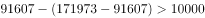

# 简单加减计算（跨口径作差-分项差额）

考点：[[20-考点/资料分析/其他/简单加减计算（跨口径作差-分项差额）|其他 / 简单加减计算（跨口径作差/分项差额）]]
材料：[[15-材料/资料分析/185340 2010—2014年我国批发和零售业|185340 2010—2014年我国批发和零售业]]

**问法模型**：题干问'A比B多多少个'且表中只直接给出'合计'与其中一个分项 → 先用'合计−分项'反推另一分项，再作差（一步公式：差额=2×分项−合计）

## 推理链
1. 第1步：定位表格2013年列，批发和零售业（合计）法人企业171973个，批发业法人企业91607个，零售业段落未直接给出
2. 第2步：由口径关系'零售业=合计−批发业'，得零售业法人企业=171973−91607=80366个
3. 第3步：批发业比零售业多=批发业−零售业=91607−80366=11241个（等价一步式：2×91607−171973=183214−171973=11241）
4. 第4步：与选项对照，11241对应D项，且尾数为1（183214−171973尾数4−3=1），锁定D

**最快解法**：⚡ 尾数法+一步差公式：差额=2×批发业−合计=183214−171973，只算尾数4−3=1，四个选项中仅D（11241）尾数为1，直接锁定；无需完整计算零售业80366

## 易错点
- ⚠ 口径混淆：表为'合计/批发业'三段混排，查数必须核对行首标签，勿把批发业91607个当成全行业数据
- ⚠ 零售业数据表中不可见，不能凭空找数，必须先做'合计−批发业'推算（171973−91607=80366个）再作差
- ⚠ 比较方向搞反：问的是'批发业比零售业多'，若算成零售业−批发业会得负值；另注意单位是'个'，勿与其他行'万人/亿元'指标混算

## 母题抽象
> 🧩 当题干出现'某分项比另一分项多/少多少'且材料只给'合计'与其中一个分项时，用差额=2×已知分项−合计一步求解，再用尾数法与选项对照验证

**同类特征**：批发业比零售业多、法人企业（个）、2013年、合计−批发业=零售业、跨口径作差、差额为具体个数

## 相关题
- [[10-真题/资料分析/平均数/2136494 现期平均数比较（平均每个法人单位从业人员数从高到低排序）|2136494]]（河南 2017，相关度1）
- [[10-真题/资料分析/比重/2662250 基期比重计算|2662250]]（新疆 2020，相关度1）

---

### 题干
2013年，批发业法人企业比零售业多（    ）个。

### 选项
- A. 7023
- B. 7158
- C. 8281
- D. 11241　✅

### 官方解析

定位表格可知，2013年批发和零售业法人企业171973个，批发业91607个，则批发业法人企业比零售业多 且尾数为1。

故正确答案为D。

### 给定材料

