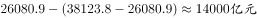
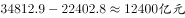
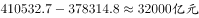
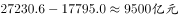

# 两指标差额比较（同一年份内作差比大小，含'合计−批发业'推算零售业）

考点：[[20-考点/资料分析/其他/两指标差额比较（同一年份内作差比大小，含'合计−批发业'推算零售业）|其他 / 两指标差额比较（同一年份内作差比大小，含'合计−批发业'推算零售业）]]
材料：[[15-材料/资料分析/185340 2010—2014年我国批发和零售业|185340 2010—2014年我国批发和零售业]]

**问法模型**：题干以'以下各项中两个指标之间差额最大的是'发问 → 对四个选项分别按'指标A−指标B'求差额，比较数值后取最大项

## 推理链
1. 第1步：A项先推算零售业库存：2014年合计期末商品库存38123.8亿元−批发业26090.9亿元=零售业12042.9亿元，则批发业与零售业库存之差=26090.9−12042.9=14038.0亿元
2. 第2步：B项查'批发业'段：2013年进口额34812.9亿元、出口额22402.8亿元，绝对差额=34812.9−22402.8=12410.1亿元
3. 第3步：C项查'批发和零售业'合计段：2012年商品销售额410532.7亿元、商品购进额373514.8亿元，差额=410532.7−373514.8=37017.9亿元
4. 第4步：D项查合计段：2011年进口额27230.6亿元、出口额17795.0亿元，差额=27230.6−17795.0=9435.6亿元
5. 第5步：比较四个差额：37017.9＞14038.0＞12410.1＞9435.6（单位均为亿元），C项差额最大，与官方答案C一致

**最快解法**：⚡ 量级预判+截位作差：各选项按亿元取整粗估——C项410533−373515≈37000亿、B项22403−3451≈19000亿、A项26091−12033≈14000亿、D项27231−17795≈9400亿，C约为次大项B的两倍，粗估即可直接锁定C，无需逐项精算

## 易错点
- ⚠ 口径标签混淆：A、B查'批发业'段，C、D查'批发和零售业'合计段，两段同名指标数值非常接近（如批发业出口22402.8 vs 合计出口22452.6仅差49.8），错行取数即出错
- ⚠ A项是两步计算：表中无零售业行，必须先'合计38123.8−批发业26090.9=零售业12042.9'再与批发业作差；若漏掉推算步骤，大小判断可能失误
- ⚠ '差额'是同一年份内两个不同指标的差，不是同比增长额，勿套'2014−2013'公式；且四个选项分属2011—2014四个不同年份，须按各选项指定年份取数，并注意亿元大数作差时位数对齐

## 母题抽象
> 🧩 当题干出现'下列各项中两个指标差额最大/最小'时，逐项核对口径标签取两数作差（涉零售业先做'合计−批发业'推算），先粗估各差额量级排除小项，再对量级最大的候选精算确认

**同类特征**：两个指标之间差额最大、四个选项分属不同年份与不同口径、同一年份内两指标作差（非同比增长）、需先推算零售业（合计−批发业）、亿元大数减法、位数对齐

## 相关题
（暂无）

---

### 题干
以下各项中两个指标之间差额最大的是（    ）。

### 选项
- A. 2014年批发业期末商品库存额与零售业期末商品库存额
- B. 2013年批发业进口额与出口额
- C. 2012年批发和零售业商品销售额与商品购进额　✅
- D. 2011年批发和零售业进口额与出口额

### 官方解析

定位表格，A项差额为，B项差额为，C项差额为，D项差额为，则差额最大为2012年批发和零售业商品销售额与商品购进额。

故正确答案为C。 

### 给定材料

> [!note] 复核校正
> 题图与官方公式图均显示2013年批发业进口额34812.9亿元，出口额22402.8亿元，差额12410.1亿元；C项差额37017.9亿元最大。此前数次复核均误读了该格首位，现按两张固定源图校正。

<!-- CODEX-ANSWER-REVIEW:BEGIN -->
### 本次独立复核

**复核状态：** `resolved`（答案与解析已核定）

**计分答案：** C（可计分）

**复核解析：**

逐项求题干所问两个指标的差额（按绝对值比较）。A：2014年批发业库存26080.9−零售业库存(38123.8−26080.9)=14038.0亿元。B：题图及官方公式图给出2013年批发业进口额34812.9、出口额22402.8亿元，绝对差额=34812.9−22402.8=12410.1亿元。C：2012年批发和零售业商品销售额410532.7−商品购进额373514.8=37017.9亿元。D：2011年批发和零售业进口额27230.6−出口额17795.0=9435.6亿元。C项差额最大，选C。此前把进口额误读为3451.2/34512.9/31451.2均不对；固定题图和对应官方公式图一致为34812.9。

**相关信息：**

2016年广东省公务员录用考试《行测》题（县级以上）；其他 / 两指标差额比较（同一年份内作差比大小，含'合计−批发业'推算零售业）。单位：亿元。固定表图及官方公式图确认2013年批发业进口额34812.9，四项绝对差额次序为C>A>B>D。

**题源依据：** [固定版本原题](https://github.com/Mentat-Uran/kaogongzhentizhengliu/blob/84ab93d4b64b61d897bece8a1c0a5bab06b4feb2/10-%E7%9C%9F%E9%A2%98/%E8%B5%84%E6%96%99%E5%88%86%E6%9E%90/%E5%85%B6%E4%BB%96/2031592%20%E4%B8%A4%E6%8C%87%E6%A0%87%E5%B7%AE%E9%A2%9D%E6%AF%94%E8%BE%83%EF%BC%88%E5%90%8C%E4%B8%80%E5%B9%B4%E4%BB%BD%E5%86%85%E4%BD%9C%E5%B7%AE%E6%AF%94%E5%A4%A7%E5%B0%8F%EF%BC%8C%E5%90%AB'%E5%90%88%E8%AE%A1%E2%88%92%E6%89%B9%E5%8F%91%E4%B8%9A'%E6%8E%A8%E7%AE%97%E9%9B%B6%E5%94%AE%E4%B8%9A%EF%BC%89.md)；固定内容 commit `84ab93d4b64b61d897bece8a1c0a5bab06b4feb2`，Markdown blob `0993a59c1154bb15bbb6e3d4dfd13d052f15deb9`。
<!-- CODEX-ANSWER-REVIEW:END -->
