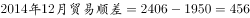
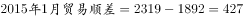
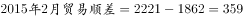
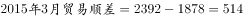

# 简单计算—贸易顺差（出口−进口）逐月做差与最大值定位

考点：[[20-考点/资料分析/其他/简单计算—贸易顺差（出口−进口）逐月做差与最大值定位|其他 / 简单计算—贸易顺差（出口−进口）逐月做差与最大值定位]]
材料：[[15-材料/资料分析/185366 2014年6月—2015年3月美国进|185366 2014年6月—2015年3月美国进]]

**问法模型**：题干问'贸易顺差最大的月份'→ 对美国各月做'出口额−进口额'差值，逐月比较取最大差值对应月份

## 推理链
1. 第1步：从柱状图提取美国各月出口额与进口额（亿美元），注意柱顶上排为出口、下排为进口，如2015年3月出口2392、进口1878
2. 第2步：贸易顺差=出口额−进口额，需逐月做差（币种统一为亿美元，不涉及欧元区数据）
3. 第3步：代入选项四个月计算：2014年12月 2406−1950=456；2015年1月 2319−1892=427；2015年2月 2221−1862=359；2015年3月 2392−1878=514
4. 第4步：核对选项外其余月份做差均更小：6月414、7月408、8月399、9月434、10月419、11月395，均低于514
5. 第5步：比较全部10个月差值，2015年3月顺差514亿美元最大，对应D项

**最快解法**：⚡ 差额比较法+尾数观察：先锁定候选月——顺差大需'出口高且进口低'同月出现；3月出口2392接近最大值2406、进口1878接近最小值1862，理论差值上界2406−1862=544，3月实际差514最接近上界；再快速验证选项月：12月456、1月427、2月359均小于514，直接选D

## 易错点
- ⚠ 双轴双币种陷阱：顺差只能用左轴美国（亿美元）柱数据运算，勿误读右轴欧元区折线数值混算
- ⚠ 柱顶两行数字看串行：上排为出口、下排为进口，若对应反了差值会整体出错
- ⚠ 极值点直判陷阱：顺差最大月既非出口最高月（10月/12月2406）也非进口最低月（2月1862），不能单看一条序列极值下结论；2月出口骤降至2221致其顺差359反为全期最小，易误选C

## 母题抽象
> 🧩 当题干出现'贸易顺差/差额最大的月份（时期）'特征时，用'逐月做差（高序列−低序列）+取最大'方法，验证最大差值月是两序列同月差最优组合而非单序列极值点

**同类特征**：贸易顺差最大、出口−进口逐月做差、月份定位型比较、柱顶上下两排数值按图例对应、单一币种（亿美元）内部运算

## 相关题
- [[10-真题/资料分析/其他/3523614 贸易顺差（出口额−进口额）做差比较|3523614]]（四川 2021，相关度1）

---

### 题干
2014年6月至2015年3月美国贸易顺差最大的月份是：

### 选项
- A. 2014年12月
- B. 2015年1月
- C. 2015年2月
- D. 2015年3月　✅

### 官方解析

贸易顺差=出口额-进口额，定位柱状图可得：

A.；B.；

C. ；D.；

D项2015年3月的贸易顺差最大。

故正确答案为D。

### 给定材料

