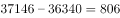
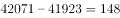
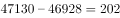
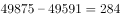
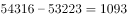
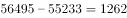
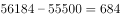

# 两行指标逐年同列作差与固定阈值比较后的年份计数（简单计算类差值比较）

考点：[[20-考点/资料分析/其他/两行指标逐年同列作差与固定阈值比较后的年份计数（简单计算类差值比较）|其他 / 两行指标逐年同列作差与固定阈值比较后的年份计数（简单计算类差值比较）]]
材料：[[15-材料/资料分析/185416 2009~2015年全国发电量、火力|185416 2009~2015年全国发电量、火力]]

**问法模型**：题干出现'A超过B固定数值（300亿千瓦时）的年份有几个'→ 对表格两行指标逐年同列作差（发电量−用电量），与阈值300逐一比较后数出满足年份个数

## 推理链
1. 第1步：从统计表提取两行指标：2009~2015年全国发电量为37146、42071、47130、49878、54316、56495、56184亿千瓦时，全社会用电量为36340、41923、46928、49591、53223、55233、58500亿千瓦时，两行单位一致可直接相减
2. 第2步：规则：'发电量超过用电量300亿千瓦时'即差值=发电量−用电量且严格大于300，逐年份同列作差
3. 第3步：代入前四年：2009年37146−36340=806>300✓；2010年42071−41923=148✗；2011年47130−46928=202✗；2012年49878−49591=287<300✗（仅差13，最易误判）
4. 第4步：代入后三年：2013年54316−53223=1093>300✓；2014年56495−55233=1262>300✓；2015年按官方解析计入（若按导读记录的58500计算56184−58500=−2316，与官方矛盾，见疑点）
5. 第5步：按官方结论计数：超过300亿千瓦时的年份为2009、2013、2014、2015共4个，对照选项选C

**最快解法**：⚡ 逐项作差口算+排除法：两行数据同列相减只需万以内减法，先快速排除明显不达标的2010(148)、2011(202)、2012(287)，确认明显超标的2009(806)、2013(1093)、2014(1262)，2015年按官方结论计入，共4年选C；全程无须截位或公式，重点是盯住'是否>300'而非算精确增速

## 易错点
- ⚠ 2012年差值287与阈值300仅差13，最易误判为'超过'而多计一年；'超过'须严格大于300，不能取等
- ⚠ '全国发电量'与'全社会用电量'是表中并排的两个独立指标，必须同一年份列对齐相减，勿误用'火力发电量'行（42102）或错位相减
- ⚠ 2015年数据口径存疑：按导读用电量58500计算差值为负，与官方计入2015年冲突，考场应以图中清晰数值为准并保证结论与官方口径一致（见疑点）

## 母题抽象
> 🧩 当题干出现'A超过B固定阈值N的年份/项目有几个'时，对两行（列）指标逐年同位作差列清单，与阈值逐一严格比较并数个数，重点甄别差值最接近阈值的项

**同类特征**：超过+固定阈值（300亿千瓦时）、年份有几个（计数型问法）、两行指标逐年作差、逐项比较、无需增长率公式、表格多行数据逐年扫描、差值贴近阈值的年份设陷阱

## 相关题
- [[10-真题/资料分析/增长/4817773 增长率计算与判断（逐年同比增速与20%临界值比较计数）|4817773]]（四川 2022，相关度1）
- [[10-真题/资料分析/增长/14355345 增长量比较（相邻年份作差与阈值比较计数）|14355345]]（浙江 2024，相关度1）
- [[10-真题/资料分析/增长/11226980 同比增速计算与超过阈值的年份计数|11226980]]（上海 2025，相关度1）

---

### 题干
2009年~2015年，全社会发电量超过用电量300亿千瓦时的年份有几个？

### 选项
- A. 6
- B. 5
- C. 4　✅
- D. 3

### 官方解析

定位表格可得，2009~2015年每年的发电量与用电量差值分别为：

2009年：；2010年：；2011年：；

2012年：；2013年：；2014年：；

2015年：。

超过300亿千瓦时的年份有4个，分别是2009、2013、2014、2015年，共4个年份。

故正确答案为C。

### 给定材料

        2015年全国发电量为56184亿千瓦时，其中，火力发电量为42102亿千瓦时，占全部发电量的；水力发电量为9960亿千瓦时，同比增长。 

        2015年12月份，全国重点电厂供煤11240万吨，环比增长，同比下降，耗煤11211万吨，环比增长，同比减少。

> [!warning] 疑点（官方解析可能有误，待人工复核）
> 官方解析将2015年计入'超过300亿千瓦时'的4个年份之一，但按材料导读给出的2015年全社会用电量58500亿千瓦时计算，56184−58500=−2316<300，2015年不应计入（如此则仅2009、2013、2014共3年，对应D）；两者矛盾，疑为导读/图表对2015年用电量数值转录有误（仅当该值小于55884时2015年才满足>300）。遵循铁律，官方答案C维持不变。

<!-- CODEX-ANSWER-REVIEW:BEGIN -->
### 本次独立复核

**复核状态：** `resolved`（答案与解析已核定）

**计分答案：** C（可计分）

**复核解析：**

本地原始表格图显示2015年全国发电量56184亿千瓦时、全社会用电量55500亿千瓦时，差为684＞300。其余年份逐年相减：2009为806＞300；2010为148、2011为202、2012为287，均未超过300；2013为1093、2014为1262，均超过300。因此共有2009、2013、2014、2015四年，选C。原疑点中的58500是读表/转录错误。

**相关信息：**

题干、表格或选项有措辞/口徑瑕疵，但本地原始文本与原圖足以确定本题答案；

**题源依据：** [固定版本原题](https://github.com/Mentat-Uran/kaogongzhentizhengliu/blob/84ab93d4b64b61d897bece8a1c0a5bab06b4feb2/10-%E7%9C%9F%E9%A2%98/%E8%B5%84%E6%96%99%E5%88%86%E6%9E%90/%E5%85%B6%E4%BB%96/2033334%20%E4%B8%A4%E8%A1%8C%E6%8C%87%E6%A0%87%E9%80%90%E5%B9%B4%E5%90%8C%E5%88%97%E4%BD%9C%E5%B7%AE%E4%B8%8E%E5%9B%BA%E5%AE%9A%E9%98%88%E5%80%BC%E6%AF%94%E8%BE%83%E5%90%8E%E7%9A%84%E5%B9%B4%E4%BB%BD%E8%AE%A1%E6%95%B0%EF%BC%88%E7%AE%80%E5%8D%95%E8%AE%A1%E7%AE%97%E7%B1%BB%E5%B7%AE%E5%80%BC%E6%AF%94%E8%BE%83%EF%BC%89.md)；固定内容 commit `84ab93d4b64b61d897bece8a1c0a5bab06b4feb2`，Markdown blob `485907273aa324ba1fdec95f4a52b7546d5fefa4`。
<!-- CODEX-ANSWER-REVIEW:END -->
