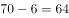
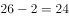
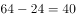

# 基期量反推（增量逆推）+分层区间个数差

考点：[[20-考点/资料分析/其他/基期量反推（增量逆推）+分层区间个数差|其他 / 基期量反推（增量逆推）+分层区间个数差]]
材料：[[15-材料/资料分析/186404 2015年（含'十二五'2011—2|186404 2015年（含'十二五'2011—2]]

**问法模型**：题干求基期年（2014年）落在'A以上且不超过B'区间的机场个数 → 先用'现期个数−增长个数'分别反推两端基期个数，再做区间相减

## 推理链
1. 第1步：从材料段2提取条件：2015年旅客吞吐量100万人次以上的机场有70个，比上年增长6个；1000万人次以上的有26个，比上年增长2个
2. 第2步：所用规则：基期量=现期量−增长量（'比上年增长6个/2个'是个数增量）；区间'100万以上且不超过1000万'的个数=（100万以上个数）−（1000万以上个数）
3. 第3步：代入计算：2014年100万以上机场=70−6=64个；2014年1000万以上机场=26−2=24个；故2014年区间内机场=64−24=40个
4. 第4步：与选项对照：40个对应选项B，故正确答案为B

**最快解法**：⚡ 合并心算：(70−26)−(6−2)=44−4=40个，两步减法口算即出，无需动笔；或分步64−24=40，锁定B

## 易错点
- ⚠ 误把'比上年增长6个/2个'当作吞吐量增量或直接忽略，用现期数直接相减70−26=44个而误选C；必须先各自反推2014年个数（70−6、26−2）
- ⚠ 时间口径陷阱：题干问的是2014年（基期），材料给的是2015年（现期），勿直接用70和26作答
- ⚠ 区间端点口径：'1000万人次以上'的26个已包含恰为1000万的机场，与题干'不超过1000万'口径匹配，直接用(70−6)−(26−2)即可，无需再调整端点

## 母题抽象
> 🧩 当题干出现'基期年+某区间（A以上且不超过B）的数量'特征时，用'现期−增量'分别反推A、B两端的基期量再相减，并核对区间端点与'以上/不超过'的口径是否一致

**同类特征**：基期年份2014、100万人次以上而不超过1000万、机场数量（个数）、比上年增长X个（个数增量反推）、分层区间计数、两式相减

## 相关题
（暂无）

---

### 题干
2014年，旅客吞吐量100万人次以上而不超过1000万人次的中国机场数量有：

### 选项
- A. 38个
- B. 40个　✅
- C. 44个
- D. 48个

### 官方解析

根据材料“2015年中国机场旅客吞吐量100万人次以上的有70个，比上年增长6个”可知2014年中国机场旅客吞吐量100万人次以上的有个；根据材料“旅客吞吐量1000万人次以上的有26个，比上年增长2个”可知14年中国机场旅客吞吐量1000万人次以上的有个；所以2014年旅客吞吐量100万人次以上而不超过1000万人次的中国机场数量有个。

故正确答案为B。

### 给定材料

        2015年中国机场旅客吞吐量91477万人次，比上年增长，其中，国内航线完成82895万人次，增长；国际航线完成8582万人次，增长，“十二五”时期中国机场旅客吞吐量如下图。

        2015年中国机场旅客吞吐量100万人次以上的有70个，比上年增长6个，完成旅客吞吐量占全国机场旅客吞吐量的；旅客吞吐量1000万人次以上的有26个，比上年增长2个，完成旅客吞吐量占全部机场旅客吞吐量的；北京、上海和广州三大城市占全部机场旅客吞吐量的。

        2015年中国各地区机场旅客吞吐量的分布情况是：华北地区占，比上年降低0.5个百分点；东北地区占，降低0.1个百分点；华东地区占，提高0.2个百分点；中南地区占，降低0.6个百分点；西南地区占，提高0.6个百分点；西北地区占，提高0.2个百分点；新疆地区占，提高0.2个百分点。

