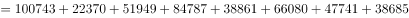

# 多数据取数加总求和（尾数法判定选项）

考点：[[20-考点/资料分析/其他/多数据取数加总求和（尾数法判定选项）|其他 / 多数据取数加总求和（尾数法判定选项）]]
材料：[[15-材料/资料分析/186506 2016年国家自然科学基金面上项目在|186506 2016年国家自然科学基金面上项目在]]

**问法模型**：题干给出明确子口径（教育部隶属单位）并要求总金额 → 锁定图2逐部取8个金额直接求和

## 推理链
1. 第1步：题干口径为'教育部隶属单位'获批项目的总金额，对应图2《教育部隶属单位获批国家自然科学基金面上项目金额（万元）》，而非表格的全口径数据；读取8个科学部金额：数理38685、化学47741、生命66080、地球38861、工程与材料84787、信息51949、管理22370、医学100743（万元）
2. 第2步：所用规则：总金额=8个科学部获批金额之和（分类数据加总，无缺失项）
3. 第3步：代入计算：38685+47741+66080+38861+84787+51949+22370+100743=451216（万元）
4. 第4步：与选项对照：A项451216万元与计算结果完全一致；尾数核验：5+1+0+1+7+9+0+3=26，尾数为6，四个选项中仅A尾数为6，故选A

**最快解法**：⚡ 

## 易错点
- ⚠ 口径陷阱：误用统计表（全口径）的金额或总计1017527万元作答，而题干限定'教育部隶属单位'这一子口径，必须用图2取数
- ⚠ 读图串行陷阱：图2自上而下为数理→医学，与表格首行医学的行序相反，易取错行或漏掉最底部的医学100743万元
- ⚠ 单位与选项干扰：本题选项单位即万元，无需换算；若习惯性÷10000会错选；同时B/D选项数值接近，须靠尾数或精确加总区分，不能估算条形长短

## 母题抽象
> 🧩 当题干要求'某一子口径的合计值'且材料提供分条数据图时，先按口径锁定对应图表（而非同名指标的全口径表），再对各项取数用尾数法求和，与选项尾数对照即可秒选

**同类特征**：教育部隶属单位、获批…面上项目的总金额、单一现期年份2016、图2横向条形图取数、8个分类数据求和、选项尾数各异适合尾数法

## 相关题
- [[10-真题/资料分析/比重/2042808 资助率（批准项数÷受理申请数）比值比较|2042808]]（江苏 2017，相关度1）

---

### 题干
2016年教育部隶属单位获批国家自然科学基金面上项目的总金额是：

### 选项
- A. 451216万元　✅
- B. 462158万元
- C. 446354万元
- D. 446893万元

### 官方解析

定位柱状图二，2016年教育部隶属单位获批国家自然科学基金面上项目的总金额，计算得尾数为6，A项满足。

故正确答案为A。

### 给定材料

