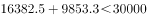

# 多列求和比较（简单加减计算·两列加总找合计最大省份）

考点：[[20-考点/资料分析/其他/多列求和比较（简单加减计算·两列加总找合计最大省份）|其他 / 多列求和比较（简单加减计算·两列加总找合计最大省份）]]
材料：[[15-材料/资料分析/187102 2016年1-11月全国及31个地区|187102 2016年1-11月全国及31个地区]]

**问法模型**：题干问'医院和乡镇卫生院的诊疗人次数合计最多的省份' → 应将每个省份'医院-诊疗人次'与'乡镇卫生院-诊疗人次'两列对应相加后比较大小（两列加总比较模型）

## 推理链
1. 第1步：从表格定位江苏、浙江、河南、广东四省的'医院-诊疗人次数（万人次）'与'乡镇卫生院-诊疗人次数（万人次）'两列数据
2. 第2步：规则——'合计'必须将医院列与乡镇卫生院列两两相加，只看医院单列不构成'合计'（北京、上海乡镇卫生院为'-'，与本题四省无关）
3. 第3步：代入计算——江苏22059.3+7242.1=29301.4；浙江22732.9+8127.2=30860.1；河南16382.5+9853.3=26235.8；广东33587.8+5882.7=39470.5（万人次）
4. 第4步：与选项对照——四省合计中广东39470.5万人次最大，且广东医院单列33587.8已超过其余任一省两列之和（如江苏29301.4），故合计最多的省份为广东，选D

**最快解法**：⚡ 量级排除法+口算加总——广东医院单列33587.8万人次已大于其余三省'医院+乡镇卫生院'之和的最大者（江苏22059.3+7242.1=29301.4），无需逐项精算即可锁定广东；若需精确验证则四省加总为29301.4/30860.1/26235.8/39470.5，广东最大

## 易错点
- ⚠ 只看医院单列就下结论：本题广东医院单列恰好最高结论未变，但若省略加总步骤，在兄弟题'出院人数合计最多'中就会出错（医院单列山东1153.3最高，加上乡镇卫生院后排序会变），命题常在此设错
- ⚠ 读错列：诊疗人次（万人次）与出院人数（万人）两列相邻、量级相近，误读为出院人数列（如广东1094.4）将得出完全不同的合计
- ⚠ 单位与量级干扰：表中数值为'万人次'、量级跨度大（广东33587.8 vs 西藏27.5），比较时勿与出院人数'万人'口径混用

## 母题抽象
> 🧩 当题干出现'A和B两项合计最多的地区'特征时，先找单列最大值的省份，再验证其单列最大值是否大于其他选项两项之和；若成立直接锁定，否则逐项加总比较

**同类特征**：医院和乡镇卫生院、诊疗人次数、合计、最多的省份、两列加总比较、2016年1-11月累计口径

## 相关题
- [[10-真题/资料分析/其他/2051726 两列加总计数（简单加减计算）|2051726]]（陕西 2017，相关度1）
- [[10-真题/资料分析/其他/2051712 两列数据加总后大小比较（简单加减计算）|2051712]]（陕西 2017，相关度1）
- [[10-真题/资料分析/其他/4708172 现期数据加和（三大产业合计行求和）|4708172]]（福建 2019，相关度1）

---

### 题干
2016年1-11月医院和乡镇卫生院的诊疗人次数合计最多的省份是：

### 选项
- A. 江苏
- B. 浙江
- C. 河南
- D. 广东　✅

### 官方解析

由题干“2016年1-11月······人数合计最多的······”可以判定本题为简单加减计算问题。定位表格材料，四个选项的诊疗人次数合计分别为：

A项：江苏万人次；

B项：浙江万人次；

C项：河南万人次；

D项：广东万人次。

所以诊疗人次数合计最多的省份为广东省。

故正确答案为D。

### 给定材料

        据国家卫计委统计，2016年1-11月全国医疗卫生机构出院人数达19912.9万人，同比提高。其中：医院15392.5万人，同比提高；基层医疗卫生机构3618.6万人，同比提高；其他机构901.8万人。医院中：公立医院13080.0万人，同比提高；民营医院2312.5万人，同比提高。

   

> [!warning] 疑点（官方解析可能有误，待人工复核）
> 官方解析中四个选项的合计数值留空（'江苏 万人次'等未填具体数字），未给出计算过程；经补算江苏29301.4、浙江30860.1、河南26235.8、广东39470.5万人次，结论D无误
