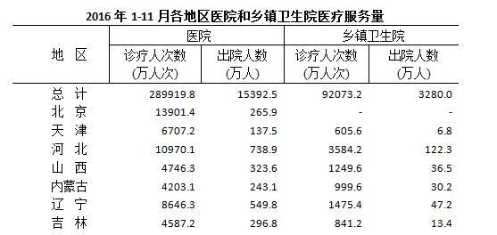

# 两数之比比较（比值排序：出院人数÷诊疗人次数由高到低）

考点：[[20-考点/资料分析/其他/两数之比比较（比值排序：出院人数÷诊疗人次数由高到低）|其他 / 两数之比比较（比值排序：出院人数÷诊疗人次数由高到低）]]
材料：[[15-材料/资料分析/187102 2016年1-11月全国及31个地区|187102 2016年1-11月全国及31个地区]]

**问法模型**：题干出现'A与B之比由高到低的省份依次为'的比值排序问法 → 按'出院人数÷诊疗人次数'对四省分别求比值后排序对照选项；因四个选项首位省份各不相同，只需确定比值最高的省份即可锁定答案

## 推理链
1. 第1步：题干只涉及湖南、陕西、甘肃、四川四省，且只用'医院'两列；从表中提取——湖南出院807.8万人、诊疗8533.5万人次，陕西出院505.9万人、诊疗7072.7万人次，甘肃出院275.9万人、诊疗4039.3万人次，四川出院1005.4万人、诊疗15406.2万人次
2. 第2步：比值=出院人数(万人)÷诊疗人次数(万人次)，按题干语序分子为出院人数、分母为诊疗人次数，颠倒即错
3. 第3步：截位直除代入：湖南≈807.8/8533.5≈9.5%；陕西≈505.9/7072.7≈7.2%；甘肃≈275.9/4039.3≈6.8%；四川≈1005.4/15406.2≈6.5%
4. 第4步：四省比值排序为湖南(9.5%)＞陕西(7.2%)＞甘肃(6.8%)＞四川(6.5%)，湖南第一，而四个选项中只有A项首位为湖南，故正确答案为A

**最快解法**：⚡ 选项首位各不相同（A湖南/B陕西/C甘肃/D四川），无需完成全部排序，只比谁最高：湖南分子807.8约为陕西505.9的1.6倍而分母8533.5仅为7072.7的1.2倍，分子倍数＞分母倍数故湖南＞陕西；四川分子虽比湖南大(1005.4＞807.8)但分母15406.2约为8533.5的1.8倍，故湖南＞四川；甘肃分子275.9最小。四省中湖南比值明显最高（约9.5%），直接锁定A

## 易错点
- ⚠ 读错列：诊疗人次(万人次)与出院人数(万人)两列相邻、量级相近，分子必须是出院人数、分母必须是诊疗人次数，取反或串列（如把四川诊疗15406.2误作出院人数）即错
- ⚠ 口径陷阱：本题只用'医院'两列，不涉及乡镇卫生院，与同材料第1-3题'医院+乡镇卫生院两列加总'模型不同，切勿加总乡镇卫生院数据
- ⚠ 近似排序风险：陕西(≈7.2%)与甘肃(≈6.8%)比值接近，若做完整排序需截位保留足够位数；本题靠选项首位互异规避了此风险

## 母题抽象
> 🧩 当题干出现'两指标之比由高到低（依次为）'且四个选项首位省份各不相同时，只算比值最高者即可锁定答案；比值按题干语序确定分子分母，用'分子倍数与分母倍数对比'定性判断或截位直除定量验证

**同类特征**：出院人数与诊疗人次数之比、由高到低、省份依次为、比值比较/排序、只用医院两列数据、选项首位省份各不相同

## 相关题
（暂无）

---

### 题干
2016年1-11月医院的出院人数与诊疗人次数之比由高到低的省份依次为：

### 选项
- A. 湖南 陕西 甘肃 四川　✅
- B. 甘肃 陕西 湖南 四川
- C. 四川 陕西 湖南 甘肃
- D. 陕西 湖南 四川 甘肃

### 官方解析
由“2016年1-11月······之比由高到低”可以判定本题为比值比较问题。观察选项可知，选项只涉及到湖南、陕西、甘肃、四川四个省份，且第一名各不相同，故只需确定这四个省份中最高的一个即可。
A项：湖南；
B项：陕西；
C项：甘肃；
D项：四川。
很显然，四个省份的比值最高的是湖南。
故正确答案为A。

### 给定材料

        据国家卫计委统计，2016年1-11月全国医疗卫生机构出院人数达19912.9万人，同比提高。其中：医院15392.5万人，同比提高；基层医疗卫生机构3618.6万人，同比提高；其他机构901.8万人。医院中：公立医院13080.0万人，同比提高；民营医院2312.5万人，同比提高。

   

