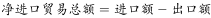
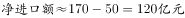
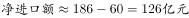
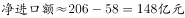
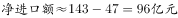

# 净进口额（进口-出口）计算与比较

考点：[[20-考点/资料分析/其他/净进口额（进口-出口）计算与比较|其他 / 净进口额（进口-出口）计算与比较]]
材料：[[15-材料/资料分析/187292 某省对外贸易情况：图1给出2011-|187292 某省对外贸易情况：图1给出2011-]]

**问法模型**：题干问'净进口贸易总额数值最小的年份' → 对每一年用恒等式 净进口=进口-出口=（总额-出口）-出口=总额-2×出口 计算后比较找最小

## 推理链
1. 第1步：从图1（单位亿美元）读取选项涉及各年的进出口总额与出口额：2011年170.49/49.98、2012年185.89/59.83、2014年206/57.78、2015年142.84/46.54
2. 第2步：图1进口额未直接标数，先由总额-出口求进口（如2015年142.84-46.54=96.30亿美元），再得净进口=进口-出口=总额-2×出口
3. 第3步：代入计算：2011年170.49-2×49.98=70.53；2012年185.89-2×59.83=66.23；2014年206-2×57.78=90.44；2015年142.84-2×46.54=49.76（亿美元）
4. 第4步：比较四个结果，2015年49.76亿美元最小
5. 第5步：对照选项，2015年对应A项，故正确答案为A

**最快解法**：⚡ 差额公式估算：净进口=总额-2×出口，截位口算：2011年170-100≈70、2012年186-120≈66、2014年206-116≈90、2015年143-93≈50，2015年明显最小，直接锁A，无需精算

## 易错点
- ⚠ 把柱内标注的总额（如2015年142.84）或一次相减得到的进口额（如2015年96.30）误当成净进口额，净进口须'总额-2×出口'再减一次出口
- ⚠ 图1进口额未直接标数，须用总额减出口推算，且阴影段对应出口，勿把阴影段误认成进口
- ⚠ 单位口径：本题只用图1（亿美元），但本材料表2为万美元，跨图表计算必须换算（1亿美元=10000万美元），官方解析将图1单位写作'亿元'属笔误

## 母题抽象
> 🧩 当题干出现'净进口/净出口（差额）最大或最小的年份'特征时，用恒等式净差额=总额-2×单边额逐年代入估算比较，验证目标年份的差额确为最值

**同类特征**：净进口贸易总额、数值最小的年份、堆叠柱状图、进口-出口、总额-2×出口、亿美元单位读数

## 相关题
（暂无）

---

### 题干
以下各项中，该省净进口贸易总额数值最小的年份是：

### 选项
- A. 2015　✅
- B. 2011
- C. 2012
- D. 2014

### 官方解析

定位材料统计图，2011年进口额为170.49亿元、出口额为49.98亿元，2012年进口额为185.89亿元、出口额为59.83亿元，2014年进口额为206亿元、出口额为57.78亿元，2015年进口额为142.84亿元、出口额为46.54亿元。

，2011年，2012年，2014年，2015年。2015年净进口额最小。

故正确答案为A。

### 给定材料

下面是某省的对外贸易进出口总额的部分数据资料，请根据图表回答下述问题：

> [!warning] 疑点（官方解析可能有误，待人工复核）
> 官方解析将图1数据的单位写作'亿元'，而材料图1明确标注为'亿美元'，属解析单位笔误；各年在同一单位下比较，不影响答案A的正确性

<!-- CODEX-ANSWER-REVIEW:BEGIN -->
### 本次独立复核

**复核状态：** `resolved`（答案与解析已核定）

**计分答案：** A（可计分）

**复核解析：**

1. 第1步：从图1（单位亿美元）读取选项涉及各年的进出口总额与出口额：2011年170.49/49.98、2012年185.89/59.83、2014年206/57.78、2015年142.84/46.54
2. 第2步：图1进口额未直接标数，先由总额-出口求进口（如2015年142.84-46.54=96.30亿美元），再得净进口=进口-出口=总额-2×出口
3. 第3步：代入计算：2011年170.49-2×49.98=70.53；2012年185.89-2×59.83=66.23；2014年206-2×57.78=90.44；2015年142.84-2×46.54=49.76（亿美元）
4. 第4步：比较四个结果，2015年49.76亿美元最小
5. 第5步：对照选项，2015年对应A项，故正确答案为A

**最快解法**：⚡ 差额公式估算：净进口=总额-2×出口，截位口算：2011年170-100≈70、2012年186-120≈66、2014年206-116≈90、2015年143-93≈50，2015年明显最小，直接锁A，无需精算

**相关信息：**

2017年422联考《行测》题（吉林卷甲级）；其他 / 净进口额（进口-出口）计算与比较。单位与比较口径按题面材料：2017年度/期间。

**题源依据：** [固定版本原题](https://github.com/Mentat-Uran/kaogongzhentizhengliu/blob/84ab93d4b64b61d897bece8a1c0a5bab06b4feb2/10-%E7%9C%9F%E9%A2%98/%E8%B5%84%E6%96%99%E5%88%86%E6%9E%90/%E5%85%B6%E4%BB%96/2052080%20%E5%87%80%E8%BF%9B%E5%8F%A3%E9%A2%9D%EF%BC%88%E8%BF%9B%E5%8F%A3-%E5%87%BA%E5%8F%A3%EF%BC%89%E8%AE%A1%E7%AE%97%E4%B8%8E%E6%AF%94%E8%BE%83.md)；固定内容 commit `84ab93d4b64b61d897bece8a1c0a5bab06b4feb2`，Markdown blob `78970ac3877fd71df53b494b8485a80b88ba5246`。
<!-- CODEX-ANSWER-REVIEW:END -->
