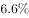
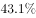
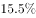
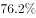
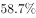
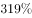
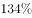
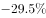
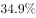
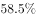

# 现期上界估计（极端假设法）

考点：[[20-考点/资料分析/其他/现期上界估计（极端假设法）|其他 / 现期上界估计（极端假设法）]]
材料：[[15-材料/资料分析/187688 2012年A、B、C三国宏观经济与对|187688 2012年A、B、C三国宏观经济与对]]

**问法模型**：题干问'某项最多不可能超过多少'→ 在材料只有总量与排序、无分项金额时，用'末位项≤总量÷项数'反推单项上界

## 推理链
1. 第1步：从材料提取条件——2012年A国吸引外国直接投资接近200亿美元（即略低于200亿）；前五行业依次为采矿业、金属机械及电子业、交通通信业、化工制药业、机动车及运输设备制造业。
2. 第2步：确认口径——机动车及运输设备制造业排第5，是前五行业中金额最小的一项，材料未给各行业具体金额。
3. 第3步：所用规则（极端假设）——第5名金额≤前五行业平均值，即不超过总量÷5=200÷5=40亿美元。
4. 第4步：反证验证——若机动车及运输设备制造业超过40亿美元，则前五个行业均超过40亿，合计必超5×40=200亿美元，与'接近200亿美元'矛盾，故40为不可突破的上界。
5. 第5步：对照选项——A=40为该上界，B(30)、C(20)、D(10)均可被突破（五行业可均接近40亿），故选A。

**最快解法**：⚡ 极端假设法（均值上界）：排第5的行业金额≤吸引外资总量÷5=200÷5=40亿美元，一步锁定A，无需各行业具体金额，也无需精确的总量数值（'接近200亿'取200即可）。

## 易错点
- ⚠ 误把'不可能超过'当成选最小项：40、30、20、10都不会被超过，但题目问的是最紧的上界，应取满足反证推导的最大选项40，选D或C即掉坑。
- ⚠ 材料只给前五行业的排序、未给金额，误以为缺数据无法求解；正确思路是'排序+总量约束'做上界估计，而不是硬找行业金额。
- ⚠ 口径混淆：若误用外资来源前五国合计116亿÷5≈23.2亿作界会错选C；来源国与行业是两套口径，约束行业金额的应是行业总盘子'接近200亿美元'。

## 母题抽象
> 🧩 当题干出现'某项最多不可能超过'且材料只给总量与排名（无分项金额）时，用极端假设法：末位项≤总量÷项数（如200÷5=40），直接选该上界对应选项。

**同类特征**：最多不可能超过、上界估计、极端假设、前五行业只给排序不给金额、吸引外资接近200亿美元、现期计算问题

## 相关题
- [[10-真题/资料分析/增长/19283961 增长量不变（等差外推）求首次超过某值的现期计算|19283961]]（国考 2025，相关度1）

---

### 题干
2012年，A国机动车及运输设备制造业吸引外国直接投资最多不可能超过（    ）亿美元。

### 选项
- A. 40　✅
- B. 30
- C. 20
- D. 10

### 官方解析
根据“2012年，……投资最多不可能超过（    ）亿美元”，判断本题为现期计算问题。定位材料第二段，2012年，A国吸引的外国直接投资接近200亿美元，2012年吸引外资前五的行业分别是采矿业、金属机械及电子业、交通通信业、化工制药业和机动车及运输设备制造业；则机动车及运输设备制造业不可能超过。
故正确答案为A。

### 给定材料

       2012年，A国取得了的经济增长速度，超过世界平均水平近1倍。2012年，A国的进出口总额为3816.5亿美元，同比增长；其中出口1900亿美元，同比降低，进口1916.5亿美元，同比增长。

       2012年，A国吸引的外国直接投资接近200亿美元，全球排名第17位，较上年上升4位。来自A国的官方投资统计机构的数据显示，2012年吸引外资前五的行业分别是采矿业、金属机械及电子业、交通通信业、化工制药业和机动车及运输设备制造业；排名前五名的国家分别是新加坡(49亿美元)、日本（25亿美元）、韩国（19亿美元）、美国（12亿美元）和毛里求斯（11亿美元）。

       2012年，B国GDP为2828亿美元，经济增长速度比上年略有降低，但依然超过。2012年，B国的进出口总额1790.1亿美元，比上年降低了；其中进口358.7亿美元，同比降低，出口1431.4亿美元，同比增长。B国的贸易顺差由上年的608.9亿美元，增长到2012年的1072.7亿美元，增长了，其中进口较上年减少272.2亿美元，占贸易顺差的。一方面，B国不断采取措施，改善国内投资环境，吸引外资进入；另一方面，B国在电力、电信、交通运输、法律法规执行力、政治局势和安全等方面存在许多不足，因此，B国的外资流入表现出波动大且增长迅速的特征。2011年，B国外资净流入为89.2亿美元，比上一年增长，比2004年增长了；在2004—2011年，最高增长率达到了，最低的增长率为，波动幅度大。

       2012年，C国的经济增长达到。该国国际贸易的增速快于国内经济的增速，进出口总额为7857.3亿美元，同比增长，其中出口3859.3亿美元，同比增长，进口3998亿美元，同比增长。

       2012年，C国的对外投资和吸引外资呈现出两种截然不同的趋势。数据显示，2012年，C国对外投资额约为260亿美元，世界排名由上年的第28位上升到2012年的第15位。2012年，C国吸引外国直接投资126.6亿美元，同比减少，为近12年来最低。从投资来源国来看，来自美国的占，日本占，加拿大占，德国占，荷兰占。

