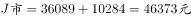
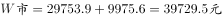
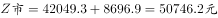
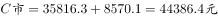
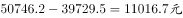

# 跨行两项目加总后城市间极值做差（简单计算）

考点：[[20-考点/资料分析/其他/跨行两项目加总后城市间极值做差（简单计算）|其他 / 跨行两项目加总后城市间极值做差（简单计算）]]
材料：[[15-材料/资料分析/187692 某研究中心对C、Z、W、J四个城市农|187692 某研究中心对C、Z、W、J四个城市农]]

**问法模型**：题干要求'基本养老保险+住房'两项合成后最高与最低城市之差 → 逐城将两项求和，找最大与最小值后做差、就近取选项

## 推理链
1. 第1步：定位表格第3项'基本养老保险（元）'与第6项'住房（元）'，提取四城数据：J市36089.0与10284.0，W市29753.9与9975.6，Z市42049.3与8696.9，C市35816.3与8570.1
2. 第2步：两项均为一次性投入'元'，量纲一致可直接相加，合成值=养老保险+住房
3. 第3步：逐城代入求和：J=36089.0+10284.0=46373.0；W=29753.9+9975.6=39729.5；Z=42049.3+8696.9=50746.2；C=35816.3+8570.1=44386.4
4. 第4步：横向比较四城合成值，最高为Z市50746.2元，最低为W市39729.5元
5. 第5步：做差 50746.2−39729.5=11016.7 元
6. 第6步：11016.7 与选项对照，最接近11000，选D

**最快解法**：⚡ 极值'差之差'法：先目测确认合成后最高为Z、最低为W（养老项Z最高42049.3、W最低29753.9，住房项W反高于Z），故差=（42049.3−29753.9）−（9975.6−8696.9）≈12295−1279≈11016，截位口算即可锁定D（11000）

## 易错点
- ⚠ 不能分别取单项极值城市直接相加或相减：养老最高是Z、住房最高是J，但合成后最高是Z、最低是W，必须逐城求和后再比较
- ⚠ 口径陷阱：表中医疗保险、民政保障、城市管理费为'元/年'，本题只涉及第3、6两项一次性'元'，勿把年度项混入求和
- ⚠ 城市列顺序为J、W、Z、C，与叙述习惯不同易串列；万元级数据做减法时注意位数对齐，11016.7易因错位误选C（10000）

## 母题抽象
> 🧩 当题干出现'A、B两项合成后最高（低）的城市与最低（高）的城市相差多少'特征时，先逐行求和定位极值城市，再用'差之差'法（A项极值差减去B项反向差）口算验证，就近选答案

**同类特征**：两项人均公共成本、合成（求和）后比较、最高城市与最低城市、相差约…元、万元级数据做差、选项为约数需就近匹配

## 相关题
（暂无）

---

### 题干
农民工市民化的基本养老保险和住房两项人均公共成本最高的城市与最低的城市，相差约( )元。

### 选项
- A. 8000
- B. 9000
- C. 10000
- D. 11000　✅

### 官方解析

定位表格第3项和第6项，农民工市民化的基本养老保险和住房两项人均公共成本分别为：；；；。最高的城市与最低的城市之差为。D项最接近。

故正确答案为D。

### 给定材料

为了衡量农民工在市民化过程中政府的公共支出，某研究中心对C市、Z市、W市、J市四个城市进行了调研测算。

> [!warning] 疑点（官方解析可能有误，待人工复核）
> 官方解析中具体数值因图片占位未显示（'分别为：；；；。'），但按表格数据核算 50746.2−39729.5=11016.7≈11000，与答案D一致，无实质错误
