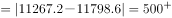
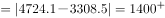
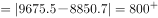

# 现期差值比较（同一行-进口额−出口额-取最大）

考点：[[20-考点/资料分析/其他/现期差值比较（同一行-进口额−出口额-取最大）|其他 / 现期差值比较（同一行|进口额−出口额|取最大）]]
材料：[[15-材料/资料分析/191536 2016年'一带一路'沿线64国的经|191536 2016年'一带一路'沿线64国的经]]

**问法模型**：题干问'2016年进口额与出口额数值相差最大的是'并限定四个区域选项 → 对选项所涉各行在同一直行内作差取绝对值|进口额−出口额|，逐行比较取最大者。

## 推理链
1. 第1步：从统计表提取四个选项区域同行的进口额与出口额（单位均为亿美元）：东南亚11国11267.2/11798.6，南亚8国4724.1/3308.5，西亚、北非19国9675.5/8850.7，东欧20国9775.5/11388.4。
2. 第2步：规则——'相差'=同一行内两列作差取绝对值|进口额−出口额|，不需单位换算、不涉及增长率（材料无基期）。
3. 第3步：代入计算：东南亚|11267.2−11798.6|=531.4；南亚|4724.1−3308.5|=1415.6；西亚北非|9675.5−8850.7|=824.8；东欧|9775.5−11388.4|=1612.9。
4. 第4步：比较差值：1612.9＞1415.6＞824.8＞531.4，最大为东欧20国，对应选项D。

**最快解法**：⚡ 口算截位估差（百位截位）：东南亚≈11800−11270≈530，南亚≈4720−3310≈1416，西亚北非≈9680−8850≈830，东欧≈11390−9780≈1610；一眼锁定东欧20国最大，选D；东欧差值1612.9可精算复核。

## 易错点
- ⚠ 正负号陷阱：东欧为出口＞进口（9775.5−11388.4=−1612.9），南亚为进口＞出口（+1415.6），直接相减会出现负数，比较时必须取绝对值，勿因负值或方向不同而排除东欧。
- ⚠ 概念偷换：误把'进口+出口'（对外贸易总额）当作比较对象，若比总额则最大为东南亚11国（11267.2+11798.6=23065.8亿美元），会误选A；本题比的是两者之差。
- ⚠ 对象范围：题干限'主要区域'且选项仅含四大区域，蒙古单列行（|38.7−45.0|=6.3）不参与比较，勿因材料含蒙古而纠结或跨行错配两列数据。

## 母题抽象
> 🧩 当题干出现'A与B数值相差最大（最小）的是'且统计表分列给出A、B两列时，对选项涉及的行逐行取|A−B|口算截位比较，锁定极值行即答案。

**同类特征**：相差最大、进口额与出口额、2016年（现期，无增速）、'一带一路'沿线主要区域、逐行同列作差、选项限定四大区域

## 相关题
- [[10-真题/资料分析/综合/2452881 简单差值比较（进出口额差额最大值）|2452881]]（河南 2019，相关度2）
- [[10-真题/资料分析/其他/2049344 两列做差取绝对值比较（截面排名表找差值最大主体）|2049344]]（河南 2017，相关度1）
- [[10-真题/资料分析/其他/5101669 两率差值比较（覆盖率与绿地率逐年作差找最大年份）|5101669]]（云南 2022，相关度1）
- [[10-真题/资料分析/其他/2604246 普及率差值比较（两折线逐点相减找最大年份，单位为百分点）|2604246]]（广东 2020，相关度1）
- [[10-真题/资料分析/其他/4695871 两分量差值（做差取绝对值）逐年比较|4695871]]（选调 2018，相关度1）

---

### 题干
“一带一路”沿线主要区域中，2016年进口额与出口额数值相差最大的是：

### 选项
- A. 东南亚11国
- B. 南亚8国
- C. 西亚、北非19国
- D. 东欧20国　✅

### 官方解析

定位统计表，东南亚11国进口额与出口额数值差亿美元；南亚8国进口额与出口额数值差亿美元；西亚、北非19国进口额与出口额数值差亿美元；东欧20国进口额与出口额数值差亿美元；故“一带一路”沿线主要区域中，2016年进口额与出口额数值相差最大的是东欧20国，D项符合。

故正确答案为D。

### 给定材料

<b>根据以下资料，回答下列5题。</b>

        2016年“一带一路”沿线64个国家GDP之和约为12.0万亿美元，占全球GDP的；人口总数约为32.1亿人，占全球总人口的；对外贸易总额（）约为71885.6亿美元，占全球贸易总额的。

> [!warning] 疑点（官方解析可能有误，待人工复核）
> 官方解析中四个差值的具体数字在所给文本中显示为空缺（'数值差___亿美元'），非口径错误；按表格复算差值分别为531.4、1415.6、824.8、1612.9亿美元，最大为东欧20国，与官方答案D一致。
