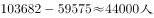
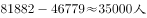

# 两指标同年做差的极值比较（简单加减计算）

考点：[[20-考点/资料分析/其他/两指标同年做差的极值比较（简单加减计算）|其他 / 两指标同年做差的极值比较（简单加减计算）]]
材料：[[15-材料/资料分析/191724 2007~2016年B市城乡低保（城|191724 2007~2016年B市城乡低保（城]]

**问法模型**：题干问'城市低保人数和农村低保人数相差最大的年份' → 对选项年份逐年做差（城市人数−农村人数），比较差值取最大

## 推理链
1. 第1步：题干只需比较2007、2009、2013、2016四个年份，从统计表'农村—低保人数'列与'城市—低保人数'列对应抄数：77818/147576、79821/147142、59575/103682、46779/81882
2. 第2步：规则为差值=城市低保人数−农村低保人数（各年城市均大于农村，差值均为正，无需绝对值）
3. 第3步：代入计算：2007年147576−77818=69758；2009年147142−79821=67321；2013年103682−59575=44107；2016年81882−46779=35103
4. 第4步：比较差值：69758＞67321＞44107＞35103，2007年相差最大，与选项A对应

**最快解法**：⚡ 做差估量级+精算两项：先口算看差值首位，2013年约4.4万、2016年约3.5万，均明显小于7万，直接淘汰C、D；只需精比2007与2009：147576−77818=69758，147142−79821=67321（城市人数2009虽更接近14.7万，但农村人数也更大，做差后2007胜出），锁定A

## 易错点
- ⚠ 查表串列：误把'农村五保人数'列当作农村低保人数，或把'城市低保户数'（单位为户）当作城市低保人数，人/户单位与列名必须核清
- ⚠ 比错对象：直接比较单列数值最大值——2009年城市低保人数147142是四年中最大，误选B；必须做差而非比单列
- ⚠ 差值方向处理：本题城市始终大于农村，若习惯性取绝对值反而多算一步；注意年份与行对应，抄错行即全盘皆错

## 母题抽象
> 🧩 当题干出现'A指标与B指标相差最大的年份'特征时，只需锁定选项所列年份，两列对应做差后比较差值，切忌直接比较某一列数值的大小

**同类特征**：相差最大的年份、城市低保人数、农村低保人数、两列做差、选项给出具体年份、表格定位比较

## 相关题
- [[10-真题/资料分析/增长/16437529 增长率比较（同比增速最大的年份）|16437529]]（山东 2024，相关度1）
- [[10-真题/资料分析/其他/5699162 两指标差额（差值）大小比较|5699162]]（江苏 2023，相关度1）

---

### 题干
2007～2016年期间，B市城市低保人数和农村低保人数相差最大的年份是：

### 选项
- A. 2007年　✅
- B. 2009年
- C. 2013年
- D. 2016年

### 官方解析

根据题干“B市城市低保人数和农村低保人数相差最大的年份”可知，本题为简单加减计算问题。定位到表格，可得2007年、2009年、2013年、2016年B市城市低保人数和农村低保人数分别相差、、、，故2007年B市城市低保人数和农村低保人数相差最大。

故正确答案为A。

### 给定材料

       2016年B市有农村低保户数28925户，低保人数为46779人；全年累计支出农村低保资金38402.0万元。农村五保供养人数4474人，其中：集中五保供养人数1711人，分散供养人数2763人；全年累计支出农村五保供养资金5668.7万元，比上年增加支出596.3万元。

       2016年B市有城市低保户数48802户，低保人数为81882人；全年累计支出城市低保资金80215.8万元。

