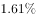
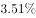
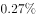
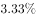
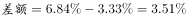

# 两现期水平值相减求差额（百分点差计算）

考点：[[20-考点/资料分析/其他/两现期水平值相减求差额（百分点差计算）|其他 / 两现期水平值相减求差额（百分点差计算）]]
材料：[[15-材料/资料分析/192014 中国人民银行2015年内6次（3月1|192014 中国人民银行2015年内6次（3月1]]

**问法模型**：题干出现'某月底+调整后+存贷款基准利率差额为'→ 定位该月调整行，取'调整后'两个水平值直接大减小

## 推理链
1. 第1步：'2015年7月底调整后'对应表中7月21日一行的'调整后'口径：存款基准利率3.33%、贷款基准利率6.84%
2. 第2步：差额模型=贷款基准利率−存款基准利率（两个现期水平值直接相减，无需基期、无需除法）
3. 第3步：代入计算：6.84−3.33=3.51，结果为3.51个百分点（绝对差，非增长比率）
4. 第4步：与选项对照，C项为3.51个百分点，故正确答案为C

**最快解法**：⚡ 尾数法直减：6.84−3.33，末位4−3=1、十分位8−3=5，直接得3.51，定位选项中'3.51个百分点'秒选C，全程口算

## 易错点
- ⚠ 读行读列错误：必须取7月21日行的'调整后'两列（存款3.33、贷款6.84），误取'调整前'（3.06、6.57）或串到8月22日行（3.60、7.02）即错，两列数值相近横向扫行易串列
- ⚠ 量纲混淆：6.84−3.33=3.51是绝对差（百分点），不能表述为'增长3.51%'；若选项同时出现'3.51%'与'3.51个百分点'表述，须按百分点差口径甄别
- ⚠ 减法方向：应贷款减存款得正3.51，勿用存款减贷款得−3.51或混入其他行数值相减

## 母题抽象
> 🧩 当题干出现'某时点两类指标差额/相差多少'特征时，锁定该时点对应行的两个水平值直接大减小，结果为绝对差（百分点）而非百分比，验证单位口径与选项表述一致

**同类特征**：某月底+调整后、存贷款基准利率、差额、两水平值相减、简单加减计算、百分点差

## 相关题
- [[10-真题/资料分析/比重/1789664 比重差值计算（百分点搭桥）|1789664]]（江苏 2016，相关度1）
- [[10-真题/资料分析/其他/1796142 累计值与当月值差值计算（1-10月=1-11月累计−11月当月）|1796142]]（贵州 2016，相关度1）
- [[10-真题/资料分析/其他/1796248 多期数据区间加总（简单加减计算）|1796248]]（黑龙江 2016，相关度1）
- [[10-真题/资料分析/增长/2031162 增速之差（百分点加减还原，简单计算题）|2031162]]（北京 2017，相关度1）
- [[10-真题/资料分析/比重/2032202 两时点占比之差（百分点）|2032202]]（江苏 2016，相关度1）

---

### 题干
2015年7月底，调整后的存贷款基准利率差额为：

### 选项
- A. 

- B. 

- C. 

　✅
- D. 

### 官方解析

根据题干所求“······调整后的存贷款基准利率差额为”，结合材料给出存贷款基准利率调整后的具体值，可判定此题为简单加减计算问题。定位表格，7月存款基准利率调整后为，7月贷款基准利率调整后为，所以调整后的存贷款基准利率。

故正确答案为C。

### 给定材料

