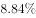
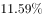
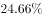
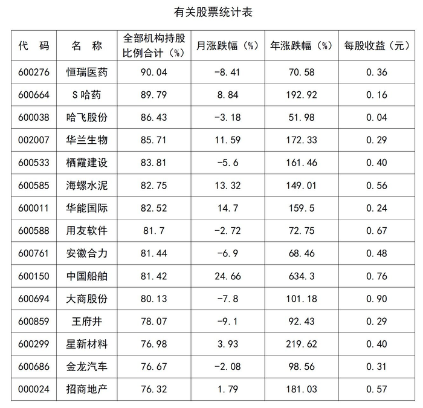

# 表格直接读数与最值比较

考点：[[20-考点/资料分析/其他/表格直接读数与最值比较|其他 / 表格直接读数与最值比较]]
材料：[[15-材料/资料分析/192016 某一时点15只A股股票（恒瑞医药、中|192016 某一时点15只A股股票（恒瑞医药、中]]

**问法模型**：题干问'月涨跌幅最高的是'且选项为四个具体公司 → 定位表中'月涨跌幅(%)'列，对四个选项所在行取数后直接比较大小

## 推理链
1. 第1步：题干要求在A~D四个公司中找月涨跌幅最高者，锁定表格第4列'月涨跌幅(%)'
2. 第2步：逐行读取四个选项对应数值：S哈药8.84、华兰生物11.59、中国船舶24.66、华能国际14.7
3. 第3步：四个值均为正数，直接比较大小：24.66＞14.7＞11.59＞8.84
4. 第4步：中国船舶24.66为最大（且为全列15个数据中的最大值），对照选项得C

**最快解法**：⚡ 定位读数比较法：只扫'月涨跌幅(%)'列四个选项所在行，四值均为正数直接比大小，中国船舶24.66既是选项最大也是全列最大，无需任何计算

## 易错点
- ⚠ 串列陷阱：月涨跌幅与年涨跌幅两列并列且单位同为%，易误读成相邻的年涨跌幅列（如华兰生物年涨跌幅172.33远大于中国船舶月涨跌幅），必须锁死'月涨跌幅(%)'表头
- ⚠ 表格按机构持股比例降序排列而非按涨跌幅排序，不能按行位置默认大小关系，须逐行精确取数
- ⚠ 月涨跌幅列正负混杂（负值代表下跌），比较'最高'时须先看符号，本题四个选项恰均为正值才可直接比绝对值

## 母题抽象
> 🧩 当题干出现'某指标最高/最低的是'且选项为材料中的主体名称时，用'锁定对应列→选项逐行取数→直接比大小'的读数比较法，验证所取数值确来自目标列而非相邻同单位列

**同类特征**：'月涨跌幅最高的是'、选项为四个具体公司名称、单指标最值比较、纯读数比大小无计算、表格多列并列易串列

## 相关题
（暂无）

---

### 题干
下列公司中，月涨跌幅最高的是：

### 选项
- A. S哈药
- B. 华兰生物
- C. 中国船舶　✅
- D. 华能国际

### 官方解析

定位表格，各公司月涨跌幅分别为：A项S哈药、B项华兰生物、C项中国船舶、D项华能国际，月涨跌幅最高的是C项中国船舶。

故正确答案为C。

### 给定材料

