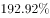
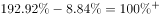
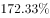
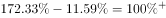
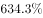
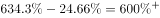
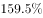
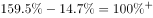

# 两列数据逐行作差求最值（年涨跌幅与月涨跌幅差别比较）

考点：[[20-考点/资料分析/其他/两列数据逐行作差求最值（年涨跌幅与月涨跌幅差别比较）|其他 / 两列数据逐行作差求最值（年涨跌幅与月涨跌幅差别比较）]]
材料：[[15-材料/资料分析/192016 某一时点15只A股股票（恒瑞医药、中|192016 某一时点15只A股股票（恒瑞医药、中]]

**问法模型**：题干出现'A与B差别最大'的问法 → 对选项公司逐行提取两列指标作差（年涨跌幅−月涨跌幅），比较差值取最大者

## 推理链
1. 第1步：从《有关股票统计表》中逐行定位四个选项公司，提取月涨跌幅与年涨跌幅：S哈药(月8.84，年192.92)、华兰生物(月11.59，年172.33)、中国船舶(月24.66，年634.3)、华能国际(月14.7，年159.5)
2. 第2步：规则为'差别'＝年涨跌幅−月涨跌幅；本题四个选项两列数值均为正，直接作差即可，无需处理符号
3. 第3步：代入计算：S哈药 192.92−8.84=184.08；华兰生物 172.33−11.59=160.74；中国船舶 634.3−24.66=609.64；华能国际 159.5−14.7=144.8
4. 第4步：比较四个差值：609.64＞184.08＞160.74＞144.8，差别最大的是中国船舶，与选项C对应
5. 第5步：官方答案为C，计算结论与之一致，确认选C

**最快解法**：⚡ 量级排除法（首数定位）：先扫年涨跌幅列，中国船舶634.3为异常高值，其余三家仅144.8~192.92，即使减去各月涨跌幅（最大24.66），中国船舶差值仍量级碾压，无需精算四个减法即可锁定C；如需验证，仅对中国船舶作一次心算634.3−24.66=609.64即可

## 易错点
- ⚠ 月涨跌幅与年涨跌幅两列并列、单位同为%，但时间跨度不同，取数时极易串列读错
- ⚠ 表格按机构持股比例降序排列而非按涨跌幅排列，四个选项分散在不同位置，须逐行扫描定位；本题四家月涨跌幅恰为正可直接作差，但全表月涨跌幅正负混杂（如栖霞建设−5.6），推广到全表比较时须先处理符号、按绝对差计算
- ⚠ 中国船舶634.3是异常高值，若误用月涨跌幅列或看错小数点位（634.3 vs 24.66），量级判断会出错

## 母题抽象
> 🧩 当题干出现'两列指标差别最大/最小'特征时，锁定选项对应行的两列数据逐行作差再比大小；若某一列存在异常高值（如634.3远超其余150~190量级），可先用首数量级排除锁定答案，省去全部精算

**同类特征**：差别最大、年涨幅与月涨跌幅、逐行作差比较、四个选项跨行定位取数、统计表最值比较、两列单位相同直接相减

## 相关题
（暂无）

---

### 题干
年涨幅与月涨跌幅差别最大的公司是：

### 选项
- A. S哈药
- B. 华兰生物
- C. 中国船舶　✅
- D. 华能国际

### 官方解析

定位表格，A项：S哈药月涨幅、年涨幅，相差；

B项：华兰生物月涨幅、年涨幅，相差；

C项：中国船舶月涨幅、年涨幅，相差；

D项：华能国际月涨幅、年涨幅，相差；

差别最大的是C项中国船舶。

故正确答案为C。

### 给定材料

> [!warning] 疑点（官方解析可能有误，待人工复核）
> 官方解析中各项具体数值缺失（'月涨幅、年涨幅，相差'后无数字），但结论方向与手工计算一致（中国船舶609.64最大），答案C无误
