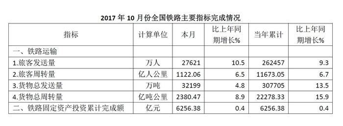
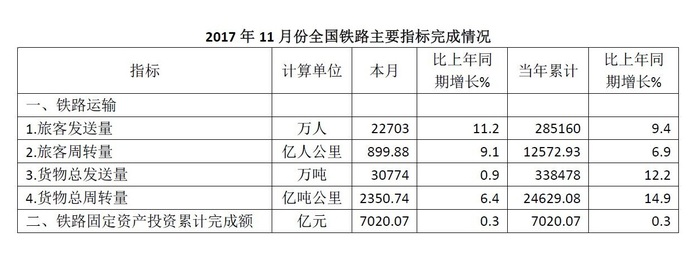

# 月度趋势图形判断（当期值逐月比较）

考点：[[20-考点/资料分析/其他/月度趋势图形判断（当期值逐月比较）|其他 / 月度趋势图形判断（当期值逐月比较）]]
材料：[[15-材料/资料分析/194330 2017年10月、11月、12月各月|194330 2017年10月、11月、12月各月]]

**问法模型**：题干要求给出2017年10-12月旅客发送量与货物总发送量的图示形态 → 从三张表'本月'列取出各月当期值，比较逐月大小走势，用趋势排除法匹配图形

## 推理链
1. 第1步：从10、11、12月三张表的'本月'列取旅客发送量（万人）：27621、22703、23219
2. 第2步：旅客发送量走势为10→11月下降约4918万人、11→12月回升约516万人，呈'先降后微升'的V形，排除呈其他形态的B、C两项
3. 第3步：再取三张表'本月'列货物总发送量（万吨）：32199、30774、30387
4. 第4步：货物总发送量走势为10→11月降约1425万吨、11→12月再降约387万吨，逐月单调递减
5. 第5步：在A、D中对照货物曲线，仅A项两指标形态同时吻合（旅客先降后升、货物逐月递减），故选A

**最快解法**：⚡ 趋势排除法（只看点不精算）：旅客发送量10月最高（27621）且12月（23219）>11月（22703）呈V形，排除B、C；货物总发送量32199>30774>30387单调下降，排除D，锁定A

## 易错点
- ⚠ 误用'当年累计'值（262457/285160/308379）画趋势——累计值必然逐月上升，会得到两指标都递增的错误形态，必须用三表各自的'本月'值
- ⚠ 指标串行：旅客发送量（万人）与货物总发送量（万吨）在表中相邻，隔行读取易把32199等货物值错当旅客值
- ⚠ 只验证一个指标就选答案：旅客的V形只能排除B、C，还需货物的单调递减排除D，两指标形态必须同时匹配

## 母题抽象
> 🧩 当题干出现'某时段各月……的图示应为'特征时，从各期报表的'本月'列取数比较逐月大小走势，对每个指标用趋势排除法淘汰选项，验证形态（上升/下降/V形）与数值量级双重吻合

**同类特征**：图示应为、10-12月份、旅客发送量、货物总发送量、月度趋势、图形匹配

## 相关题
- [[10-真题/资料分析/增长/2264421 环比增长率计算与折线图匹配|2264421]]（国考 2019，相关度1）
- [[10-真题/资料分析/增长/12881991 同比增长率计算（增长量÷基期量）|12881991]]（广东 2025，相关度1）
- [[10-真题/资料分析/增长/14096261 增长量计算与比较（柱状图趋势匹配）|14096261]]（选调 2025，相关度1）
- [[10-真题/资料分析/其他/2172132 跨月当期值加总（区间合计）|2172132]]（广州市考 2018，相关度1）

---

### 题干
2017年10-12月份全国铁路旅客发送量和货物总发送量的图示应为（  ）。

### 选项
- A. A　✅
- B. B
- C. C
- D. D

### 官方解析
由材料可得“2017年10月、11月和12月，全国旅客发送量分别为27621万人、22703万人和23219万人”，则旅客发送量，排除B、C两项；根据“2017年10月、11月和12月，全国货物总发送量分别为32199万吨、30774万吨和30387万吨”，则货物总发送量月，排除D项。
故正确答案为A。

### 给定材料

