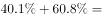
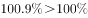
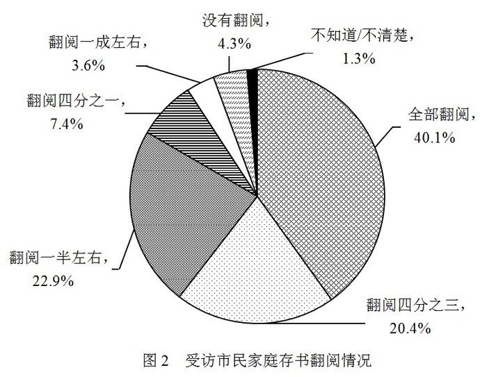

# 容斥原理-抽屉原理——两集合占比和＞100%必有交集的必然性判断

考点：[[20-考点/资料分析/其他/容斥原理-抽屉原理——两集合占比和＞100%必有交集的必然性判断|其他 / 容斥原理/抽屉原理——两集合占比和＞100%必有交集的必然性判断]]
材料：[[15-材料/资料分析/194344 某市统计局对2007名18岁以上常住|194344 某市统计局对2007名18岁以上常住]]

**问法模型**：题干'……的受访市民中，一定有人的家庭存书为……'是两套分类（共享意愿×存书量）交集的必然性判断→用容斥抽屉模型：两类占比之和＞100%则必有交集，逐项验证，取唯一超过100%的选项。

## 推理链
1. 第1步：提取条件——总体为受访市民2007人，材料无年份、全为占比结构；'无条件愿意'占比设为x（文字段该数值在给定文本中空缺，须回原卷取数）；图1各档占比：50册及以下40.1%、51-100册25.7%、101-300册21.9%、301-500册6.7%、501册及以上5.6%。
2. 第2步：所用规则（容斥/抽屉原理）：同一总体中两个子集占比之和＞100%，则两子集必有交集；等价表述：若x＞100%−某档占比，即'无条件愿意'人数超过该档以外全部人数，则该档内必藏有'无条件愿意'的人。
3. 第3步：验证A：官方解析确认x+40.1%＞100%（即x＞59.9%，'50册及以下'以外的总占比仅59.9%，装不下全部'无条件愿意'人群），故'无条件愿意'人群中必有家庭存书50册及以下者。
4. 第4步：验证其余选项：B、C、D对应档位占比25.7%、21.9%、6.7%+5.6%=12.3%均小于40.1%，按原卷x值核验，x与其相加均不超过100%，交集可能为空，只能得'可能有'，不满足'一定有'。
5. 第5步：对照选项，仅A满足'占比和＞100%⇒必有交集'的必然性条件，故正确答案为A。

**最快解法**：⚡ 抽屉原理秒杀（两集合占比和＞100%必有交集）：锁定图1最大扇区'50册及以下'40.1%，其补集仅59.9%；官方口径'无条件愿意'占比超过59.9%，补集装不下⇒必有交集，直接锁定A；其余档位（25.7%/21.9%/12.3%）占比更小、更难凑超100%，无需乘2007、无需算人数，纯加和即排除。

## 易错点
- ⚠ 数据冒名顶替：文字段四个意愿比重在给定文本中空缺，严禁拿两图同名的'40.1%'（图1=50册及以下存书占比、图2=全部翻阅占比，口径完全不同）或25.7%充当'无条件愿意'占比，本题必须回原卷文字取数。
- ⚠ 模型错位：把'一定有人'误当求人数（去×2007）或误以为选占比最大档位即可；正确模型是纯占比加和判定交集，'和≤100%'只能得'不一定有'，不能反推'一定没有'。
- ⚠ D项加总口径：'301册及以上'=6.7%+5.6%=12.3%需跨扇区加总（不含'101-300册'的21.9%），漏加5.6%或误并101-300册会导致对D的错误判断。

## 母题抽象
> 🧩 当题干出现'……中一定有……'（同一总体两套分类找必然交集）特征时，用容斥抽屉模型：逐项计算'一类占比+另一类占比'，和＞100%者必有交集即为答案，全程只用百分比加和、不乘样本量。

**同类特征**：一定有人、无条件愿意、家庭存书为、两套分类求必然交集、占比和超过100%、抽屉原理型判断

## 相关题
- [[10-真题/资料分析/综合/2367976 综合推断（'能够推出'判定——交集必然性-容斥思想）|2367976]]（江苏 2019，相关度1）
- [[10-真题/资料分析/比重/2452647 两项目交集必然存在判定（占比之和-100%的容斥-最不利模型）|2452647]]（江苏 2020，相关度1）

---

### 题干
选择“无条件愿意”共享家庭存书的受访市民中，一定有人的家庭存书为：

### 选项
- A. 50册及以下　✅
- B. 51—100册
- C. 101—300册
- D. 301册及以上

### 官方解析

定位文字材料第一段可得：选择“无条件愿意”的受访市民所占比重为；定位饼状图1可得，受访市民家庭存书情况中50册及以下所占比重为，二者之和为，二者之和超过整体，说明二者之间必然有交集，也就是说选择“无条件愿意”共享家庭存书的受访市民肯定有人的家庭存书为50册及以下。

故正确答案为A。

### 给定材料

        为了解市民家庭存书（不含教材教辅）阅读和共享意愿情况，某市统计局成功访问了18岁以上的常住市民2007人。调查显示，关于家庭存书共享意愿的问题，选择“无条件愿意”“有条件愿意”“不愿意”“不知道/不清楚”的受访市民所占比重分别是、、、。

> [!warning] 疑点（官方解析可能有误，待人工复核）
> 给定文本与官方解析引述中'无条件愿意'占比数值均为空缺（'分别是、'‘二者之和为’），本笔记仅依据官方解析确认的'x+40.1%＞100%'这一判定成立，x须回原卷文字取数；此为材料转录空缺问题，不影响官方答案A的正确性。

<!-- CODEX-ANSWER-REVIEW:BEGIN -->
### 本次独立复核

**复核状态：** `resolved`（答案与解析已核定）

**计分答案：** A（可计分）

**复核解析：**

原仓库公式图给出“无条件愿意”60.8%，“50册及以下”40.1%；两者合计100.9%>100%，两集合必有交集，故A必然成立。其余书量档占比与60.8%相加均不足100%，不能保证必有交集。选A。

**相关信息：**

2018年江苏省公务员录用考试《行测》题（C类）（网友回忆版）；其他 / 容斥原理/抽屉原理——两集合占比和＞100%必有交集的必然性判断。单位与比较口径按题面材料：2018年度/期间。 复核裁定：原公式图给出60.8%和40.1%，总和100.9%，足以证明必有交集；纯文本转录空缺不再影响判定。

**题源依据：** [固定版本原题](https://github.com/Mentat-Uran/kaogongzhentizhengliu/blob/84ab93d4b64b61d897bece8a1c0a5bab06b4feb2/10-%E7%9C%9F%E9%A2%98/%E8%B5%84%E6%96%99%E5%88%86%E6%9E%90/%E5%85%B6%E4%BB%96/2172295%20%E5%AE%B9%E6%96%A5%E5%8E%9F%E7%90%86-%E6%8A%BD%E5%B1%89%E5%8E%9F%E7%90%86%E2%80%94%E2%80%94%E4%B8%A4%E9%9B%86%E5%90%88%E5%8D%A0%E6%AF%94%E5%92%8C%EF%BC%9E100%25%E5%BF%85%E6%9C%89%E4%BA%A4%E9%9B%86%E7%9A%84%E5%BF%85%E7%84%B6%E6%80%A7%E5%88%A4%E6%96%AD.md)；固定内容 commit `84ab93d4b64b61d897bece8a1c0a5bab06b4feb2`，Markdown blob `cd01be7280c345f7baf3b575e0a00c5432218138`。
<!-- CODEX-ANSWER-REVIEW:END -->
