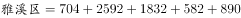
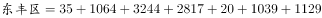
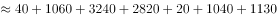
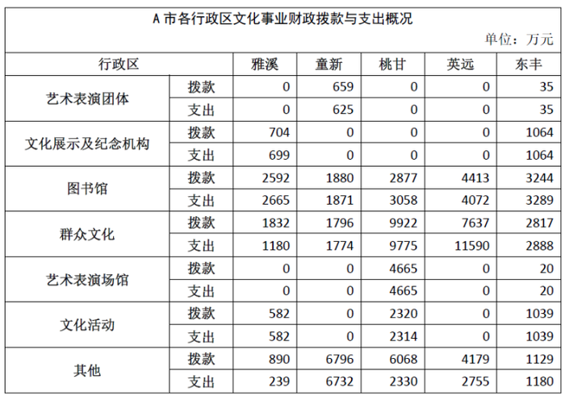

# 简单计算——分区纵向求和后比较大小（合计值最值）

考点：[[20-考点/资料分析/其他/简单计算——分区纵向求和后比较大小（合计值最值）|其他 / 简单计算——分区纵向求和后比较大小（合计值最值）]]
材料：[[15-材料/资料分析/194404 A市五个行政区（雅溪、童新、桃甘、英|194404 A市五个行政区（雅溪、童新、桃甘、英]]

**问法模型**：问'拨款最少的行政区' → 对每个行政区把7类项目的拨款额纵向加总，比较5个合计数的大小取最小

## 推理链
1. 第1步：从表格逐区提取拨款行数据（只读'拨款'行，不看'支出'行）：雅溪=704/2592/1832/582/890等，童新含659/1880/1796/6796，桃甘含2877/9922/4665/2320/6068，英远含4413/7637/4179，东丰含35/1064/3244/2817/20/1039/1129
2. 第2步：所用规则：行政区拨款总额=该区7类项目拨款额之和（0项跳过），再对5个合计数比较大小
3. 第3步：代入加总：雅溪=0+704+2592+1832+0+582+890=6600万元；童新=659+1880+1796+6796=11131万元；桃甘=2877+9922+4665+2320+6068=25852万元；英远=4413+7637+4179=16229万元；东丰=35+1064+3244+2817+20+1039+1129=9348万元
4. 第4步：比较：6600<9348<11131<16229<25852，雅溪最小，与选项A对照，故选A

**最快解法**：⚡ 排除法+非零项快速加总：先看非零项少的区——雅溪仅4个非零拨款项（704+2592+1832+582+890=6600），英远仅3项但单值大（4413+7637+4179≈16000+已远超6600），东丰7项加总9348也明显大于6600，直接锁定雅溪，无需精确算出其余各区

## 易错点
- ⚠ 拨款/支出两行混排查串行：如雅溪'其他'拨款890与支出239仅隔一行，加总时若误读支出行会算错
- ⚠ 用'非零项目个数'代替'拨款金额'判断：英远只有3项有数据但合计16229并非最少，拨款最少的是非零项4个但数值小的雅溪（6600万元），东丰7项全有也不代表拨款多
- ⚠ 漏加或跳项：文化活动雅溪拨款582、艺术表演场馆桃甘拨款4665等零散数据分散在表中，逐行扫读时容易漏加某一项

## 母题抽象
> 🧩 当题干出现'某指标合计最少（最多）的行政区/类别'特征时，按列挑出非零数据加总后比较，并用'非零项少但单值大'的区先做排除，勿以项目覆盖个数代替金额大小

**同类特征**：拨款最少、行政区比较、纵向加总、合计最值、含0项求和、查数型比较

## 相关题
（暂无）

---

### 题干
A市文化事业财政资金拨款最少的行政区是（  ）。

### 选项
- A. 雅溪　✅
- B. 童新
- C. 英远
- D. 东丰

### 官方解析

由表格材料可得，A市各行政区文化事业财政资金拨款分别为：万元；万元；万元；万元。故A市文化事业财政资金拨款最少的行政区是雅溪区。

故正确答案为A。

### 给定材料

> [!warning] 疑点（官方解析可能有误，待人工复核）
> 官方解析文本中各区拨款合计的具体数值缺失（'万元；'处为占位空白），但按表格数据核算雅溪=6600万元确为最小，答案A无误，仅解析排版存在数值空缺

<!-- CODEX-ANSWER-REVIEW:BEGIN -->
### 本次独立复核

**复核状态：** `resolved`（答案与解析已核定）

**计分答案：** A（可计分）

**复核解析：**

1. 第1步：从表格逐区提取拨款行数据（只读'拨款'行，不看'支出'行）：雅溪=704/2592/1832/582/890等，童新含659/1880/1796/6796，桃甘含2877/9922/4665/2320/6068，英远含4413/7637/4179，东丰含35/1064/3244/2817/20/1039/1129
2. 第2步：所用规则：行政区拨款总额=该区7类项目拨款额之和（0项跳过），再对5个合计数比较大小
3. 第3步：代入加总：雅溪=0+704+2592+1832+0+582+890=6600万元；童新=659+1880+1796+6796=11131万元；桃甘=2877+9922+4665+2320+6068=25852万元；英远=4413+7637+4179=16229万元；东丰=35+1064+3244+2817+20+1039+1129=9348万元
4. 第4步：比较：6600<9348<11131<16229<25852，雅溪最小，与选项A对照，故选A

**最快解法**：⚡ 排除法+非零项快速加总：先看非零项少的区——雅溪仅4个非零拨款项（704+2592+1832+582+890=6600），英远仅3项但单值大（4413+7637+4179≈16000+已远超6600），东丰7项加总9348也明显大于6600，直接锁定雅溪，无需精确算出其余各区

**相关信息：**

2018年广州市公务员录用考试 《行测》题（3月25日网友回忆版）；其他 / 简单计算——分区纵向求和后比较大小（合计值最值）。单位与比较口径按题面材料：2018年度/期间。

**题源依据：** [固定版本原题](https://github.com/Mentat-Uran/kaogongzhentizhengliu/blob/84ab93d4b64b61d897bece8a1c0a5bab06b4feb2/10-%E7%9C%9F%E9%A2%98/%E8%B5%84%E6%96%99%E5%88%86%E6%9E%90/%E5%85%B6%E4%BB%96/2172875%20%E7%AE%80%E5%8D%95%E8%AE%A1%E7%AE%97%E2%80%94%E2%80%94%E5%88%86%E5%8C%BA%E7%BA%B5%E5%90%91%E6%B1%82%E5%92%8C%E5%90%8E%E6%AF%94%E8%BE%83%E5%A4%A7%E5%B0%8F%EF%BC%88%E5%90%88%E8%AE%A1%E5%80%BC%E6%9C%80%E5%80%BC%EF%BC%89.md)；固定内容 commit `84ab93d4b64b61d897bece8a1c0a5bab06b4feb2`，Markdown blob `0da7f0f688c973aed8198494868dbc049682c179`。
<!-- CODEX-ANSWER-REVIEW:END -->
