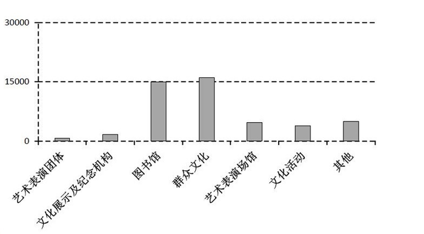
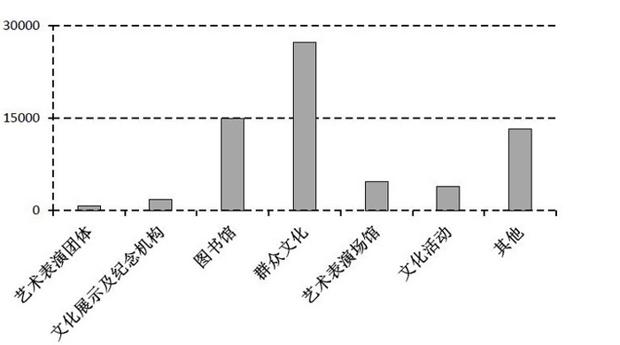

# 分类别横向求和与统计图匹配（简单计算+图形排除）

考点：[[20-考点/资料分析/其他/分类别横向求和与统计图匹配（简单计算+图形排除）|其他 / 分类别横向求和与统计图匹配（简单计算+图形排除）]]
材料：[[15-材料/资料分析/194404 A市五个行政区（雅溪、童新、桃甘、英|194404 A市五个行政区（雅溪、童新、桃甘、英]]

**问法模型**：题干要求'所有行政区各项文化事业财政支出总额'的图形匹配 → 对每一类项目的支出行横向跨5个区加总，得到7个类别总额后比较数量级与排序，用排除法对照图形

## 推理链
1. 第1步：从表格提取7类项目各自的'支出'行数据，明确每类总额=雅溪+童新+桃甘+英远+东丰五区支出之和（0照加）
2. 第2步：规则为分类横向加总，重点算决定图形形态的关键类别，而非全部硬算
3. 第3步：群众文化=1180+1774+9775+11590+2888=27207，接近30000；其他=239+6732+2330+2755+1180=13236；图书馆=2665+1871+3058+4072+3289=14955
4. 第4步：艺术表演场馆=4665+20=4685，文化活动=582+2314+1039=3935，文化展示及纪念机构=699+1064=1763，艺术表演团体=625+35=660
5. 第5步：排序为群众文化27207>图书馆14955>其他13236>艺术表演场馆4685>文化活动3935>文化展示及纪念机构1763>艺术表演团体660
6. 第6步：对照选项排除——群众文化≈27207接近30000排除A；其他=13236排除C；艺术表演团体660小于文化展示及纪念机构1763排除D，故选B

**最快解法**：⚡ 排除法+截位速加：先只算群众文化支出（1180+1774+9775+11590+2888≈27207，接近3万）排除A；再算其他类（239+6732+2330+2755+1180=13236）排除C；最后比较艺术表演团体625+35=660与文化展示及纪念机构699+1064=1763的大小排除D，三个关键类别即可锁定B，无需算完全部7类

## 易错点
- ⚠ 看串行：同一项目下'拨款'与'支出'两行混排，本题必须全程只看'支出'行，若混入拨款数据（如群众文化拨款9922、7637）总额与图形全错
- ⚠ 漏加：横向跨5列求和易漏区，尤其英远群众文化支出11590是全表最大值，漏掉后群众文化仅约15618，'接近30000'的判断失效
- ⚠ 图形对照惯性误判：其他类13236与图书馆14955接近、约为艺术表演场馆4685的近3倍，且艺术表演团体660与文化展示及纪念机构1763的大小关系易凭直觉写反，需以计算值为准

## 母题抽象
> 🧩 当题干出现'所有行政区/全部对象某指标总额'并要求'最符合的是（图形）'时，按类别横向加总，优先计算最大值类别和最接近的两组类别，用排除法对照图形的数量级与排序关系即可

**同类特征**：所有行政区、各项文化事业财政支出总额、最符合……情况的是、图形匹配选项、分类横向求和、排序比较排除

## 相关题
（暂无）

---

### 题干
下图最符合A市所有行政区各项文化事业财政支出总额情况的是（  ）。

### 选项
- A. 

- B. 

　✅
- C. 

- D. 

### 官方解析
由表格材料可得：A市所有行政区各项文化事业财政支出额中，群众文化万元，与30000万元比较接近，排除A项；其他万元，排除C项；艺术表演团体（万元）小于文化展示及纪念机构（万元），排除D项。
故正确答案为B。

### 给定材料

> [!warning] 疑点（官方解析可能有误，待人工复核）
> 官方解析中'群众文化（　）万元''其他（　）万元'等处数值显示缺失，但按表格计算27207、13236、660、1763与其排除逻辑及答案B完全一致，不影响结论
