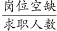
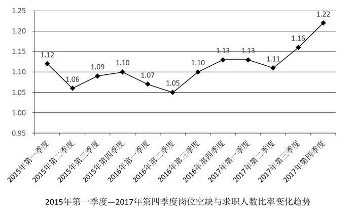
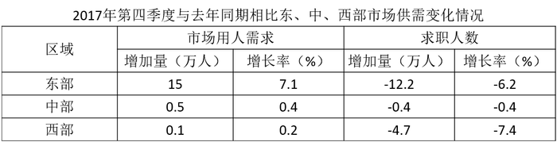

# 岗位空缺与求职人数比率读数与极值比较（供求匹配程度判断）

考点：[[20-考点/资料分析/其他/岗位空缺与求职人数比率读数与极值比较（供求匹配程度判断）|其他 / 岗位空缺与求职人数比率读数与极值比较（供求匹配程度判断）]]
材料：[[15-材料/资料分析/194915 2015—2017年（重点2017年|194915 2015—2017年（重点2017年]]

**问法模型**：题干问'供给最能满足市场需求的是哪个季度'→ 先明确比率方向（比率=岗位空缺/求职人数，比率越小说明求职人数相对岗位越充裕、人力资源供给越能满足市场需求）→ 折线图直接读数取最小值

## 推理链
1. 第1步：由题干，'人力资源供给'指求职者，'市场需求'指岗位空缺；岗位空缺与求职人数比率=岗位空缺/求职人数，比率越小表示求职人数相对岗位空缺越多，即人力资源供给越能满足市场需求
2. 第2步：定位折线图《2015年第一季度—2017年第四季度岗位空缺与求职人数比率变化趋势》，共12个季度数据点，选项对应四个时点
3. 第3步：读取四个选项季度比率：2015年第三季度=1.09、2016年第二季度=1.05、2017年第一季度=1.13、2017年第四季度=1.22
4. 第4步：比较大小：1.05＜1.09＜1.13＜1.22，最小值为2016年第二季度的1.05
5. 第5步：故2015—2017年间人力资源供给最能满足市场需求的是2016年第二季度，对应选项B

**最快解法**：⚡ 直接读数比较法：折线图全图最低点即2016年第二季度的1.05（目测为整条曲线谷底），无需任何计算，秒选B

## 易错点
- ⚠ 比率方向搞反：比率=岗位空缺/求职人数，'人力资源供给（求职者）最能满足市场需求（岗位空缺）'对应比率最小；若误认为比率越大供给越能满足需求，会错选比率最大1.22的D项
- ⚠ 图形读数混淆：2016年第二季度1.05与2015年第二季度1.06两点非常接近，须仔细对准横轴季度标签，勿错取1.06对应时点
- ⚠ 时间范围：题目要求在2015—2017共12个季度中比较，四个选项跨越三个年份，不能只看2017年的数据

## 母题抽象
> 🧩 当题干出现'供给最能满足需求/供求匹配程度'这类比率方向判断特征时，先依据比率定义（岗位空缺/求职人数）确定'越小越匹配'，再到折线图直接读选项对应时点数据取极值验证

**同类特征**：供给最能满足市场需求、岗位空缺与求职人数比率、2015—2017年、季度时点对应、折线图读数、极值（最小值）比较

## 相关题
- [[10-真题/资料分析/平均数/2185132 现期平均数计算（折线图多期数据算术平均，削峰填谷-基准线法）|2185132]]（广东 2018，相关度2）
- [[10-真题/资料分析/增长/12019702 增长量比较（城镇化率相邻时点百分点差值）|12019702]]（广东 2026，相关度1）
- [[10-真题/资料分析/增长/2185129 比率（岗位空缺与求职人数比）的环比差值计算（图表数据点相减）|2185129]]（广东 2018，相关度1）
- [[10-真题/资料分析/综合/2185139 综合判断题（比率与供求关系多选项交叉验证）|2185139]]（广东 2018，相关度1）
- [[10-真题/资料分析/其他/4708226 折线图直接读数与增速极值比较（找同比增速最低月）|4708226]]（福建 2019，相关度1）

---

### 题干
2015—2017年，人力资源市场供给最能满足市场需求的是（  ）。

### 选项
- A. 2015年第三季度
- B. 2016年第二季度　✅
- C. 2017年第一季度
- D. 2017年第四季度

### 官方解析

定位折线趋势图，是2015年第一季度至2017年第四季度岗位空缺与求职人数比率变化趋势，即。人力资源供给最能满足市场需求的是比率最小的。直接读数2015年三季度比率是1.09，2016年二季度是1.05，2017年一季度是1.13，2017年四季度是1.22，比较可知最小的是1.05。

故正确答案为B。

### 给定材料

根据下列资料，回答91～95题：

        2017年第四季度，人力资源部门对东、中、西三大区域共95个城市的公共就业服务机构市场供求信息进行了统计分析，部分数据如下：

        总体而言，用人单位通过公共就业服务机构招聘各类人员约433.7万人，进入市场的求职者约354.2万人，岗位空缺与求职人数的比率约为1.22，比去年同期上升0.09，市场需求略大于供给。

        与去年同期相比，需求人数增加15.6万人，求职人数减少17.3万人。与上季度相比，需求人数和求职人数分别减少了58.9万人和73.2万人，各下降了和。

        分区域看，东、中、西部市场岗位空缺与求职人数的比率分别为1.22、1.18、1.29，市场需求均略大于供给。

