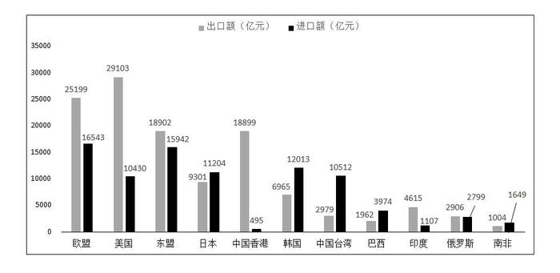

# 进出口总额加总比较（读数求和+排序）

考点：[[20-考点/资料分析/其他/进出口总额加总比较（读数求和+排序）|其他 / 进出口总额加总比较（读数求和+排序）]]
材料：[[15-材料/资料分析/195134 2017年我国对欧盟、美国、东盟、日|195134 2017年我国对欧盟、美国、东盟、日]]

**问法模型**：题干问'进出口总额最多的国家或地区'→不能看单根柱，须对每个候选地区做'出口额+进口额'加总后横向比较取最大

## 推理链
1. 第1步：题干要求找2017年'进出口总额最多'的国家或地区，选项锁定欧盟、美国、东盟、中国香港四个候选，回图1分别取其出口额（灰柱）与进口额（黑柱）
2. 第2步：模型为'进出口总额=出口额+进口额'，对四个候选分别加总
3. 第3步：欧盟=25199+16543=41742亿元；美国=29103+10430=39533亿元；东盟=18902+15942=34844亿元；中国香港=18899+495=19394亿元
4. 第4步：排序得41742>39533>34844>19394，欧盟总额最大，且欧盟比美国仅多约41742-39533=2209亿元，必须精算不能目测
5. 第5步：对照选项，欧盟为A项，与官方答案一致

**最快解法**：⚡ 差额抵消法（配截位口算）：欧盟与美国只需比两项之差——美国出口多29103-25199≈3900亿元，但欧盟进口多16543-10430≈6100亿元，6100>3900故欧盟胜出；东盟、香港两柱均明显偏矮目测即排除，全程不需精确加总

## 易错点
- ⚠ 视觉误导选B：美国出口29103是全图最高单柱，只看最高柱会误选美国；实际欧盟两根柱均超16000，加总41742反超39533
- ⚠ 张冠李戴：每地灰柱=出口、黑柱=进口且数值标签紧挨，易把25199与16543、29103与10430对应错位
- ⚠ 概念混淆：'出口额最多'是美国、'进口额最多'是欧盟、'进出口总额最多'是欧盟，三个问法结论不同，不能凭单一极值作答

## 母题抽象
> 🧩 当题干出现'进出口总额（总规模）最多的国家/地区'且材料为双柱图时，必须逐地'出口+进口'加总再排序，警惕单根最高柱误导；两强接近时用'出口差与进口差抵消'快速定胜负

**同类特征**：进出口总额最多、双柱图（出口/进口两柱）、需要加总后比较、候选项含单柱最高者、柱状图带数据标签、同一地区两柱求和

## 相关题
（暂无）

---

### 题干
2017年对我国的进出口总额最多的国家或地区为：

### 选项
- A. 欧盟　✅
- B. 美国
- C. 东盟
- D. 中国香港

### 官方解析
柱状图是我国对其它国家或地区的进、出口额，分别对应其它国家或地区对我国的出、进口额。定位柱状图数据可得：
欧盟对我国的进口额是25199亿元，对我国的出口额是16543亿元，则欧盟对我国的进出口总额是：亿元；
美国对我国的进口额是29103亿元，对我国的出口额是10430亿元，则美国对我国的进出口总额是：亿元；
东盟对我国的进口额是18902亿元，对我国的出口额是15942亿元，则东盟对我国的进出口总额是：亿元；
中国香港对我国进口额是18899亿元，对我国出口额是495亿元，则中国香港对我国的进出口总额是：亿元；
由上述数据可知欧盟是对我国的进出口总额最多的地区。
故正确答案为A。

### 给定材料

根据以下资料，回答126～130题。

        2017年对主要国家和地区货物进出口额

