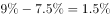
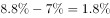
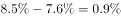
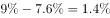
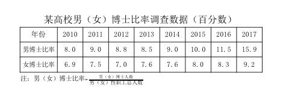

# 两比率差值比较（直接查表作差）

考点：[[20-考点/资料分析/其他/两比率差值比较（直接查表作差）|其他 / 两比率差值比较（直接查表作差）]]
材料：[[15-材料/资料分析/195135 某高校2010-2017年男、女博士|195135 某高校2010-2017年男、女博士]]

**问法模型**：题干问'男女博士比率最接近的是哪一年'→对选项各年份逐年求男博士比率与女博士比率之差，差值（百分点）最小的年份即为答案

## 推理链
1. 第1步：从表格提取选项涉及年份的数据——男博士比率2011年9.0%、2012年8.8%、2013年8.5%、2014年9.0%；女博士比率2011年7.5%、2012年7.0%、2013年7.6%、2014年7.6%
2. 第2步：规则：两比率'最接近'即两行数据逐年差值的绝对值最小，本题各年男比率均大于女比率，直接用男博士比率−女博士比率
3. 第3步：代入计算：2011年9.0−7.5=1.5，2012年8.8−7.0=1.8，2013年8.5−7.6=0.9，2014年9.0−7.6=1.4（个百分点）
4. 第4步：比较四个差值1.5、1.8、0.9、1.4，最小为0.9个百分点，对应2013年，与选项C对照一致

**最快解法**：⚡ 差值比较法（心算直减）：只需比较选项四个年份，逐列男博士比率减女博士比率得1.5、1.8、0.9、1.4，最小0.9对应2013年，直接选C，无需看2010、2015-2017年数据

## 易错点
- ⚠ 凭走势目测易误判：2013年的8.5%和7.6%都既非各行最高也非最低，相邻年份水平接近（如8.8与9.0），必须逐列精确作差，不能凭曲线走势判断
- ⚠ 混淆'比率最接近'与'比率最高/最低'：本题只看两行差值大小，与比率水平高低无关
- ⚠ 范围判断：仅需比较选项给出的2011-2014四个年份即可，不必对全部8年作差浪费时间（若扩大范围2010年8.0−6.9=1.1也不影响结论）

## 母题抽象
> 🧩 当题干出现'两个指标最接近/差距最小的是哪一年/哪一项'且表格分行给出逐年数据时，直接对选项所涉年份逐一两行作差，差值最小者即为答案

**同类特征**：男女博士比率、最接近、哪一年、两行数据作差、差值最小、直接查表比较

## 相关题
- [[10-真题/资料分析/其他/2172454 两量差值比较（找最接近年份）|2172454]]（江苏 2018，相关度1）
- [[10-真题/资料分析/增长/4695874 同比增长率计算（分量增速，一般增长率）|4695874]]（选调 2018，相关度1）
- [[10-真题/资料分析/平均数/5509994 现期算术平均数（多年区间求年平均＋最接近值匹配）|5509994]]（江西 2023，相关度1）
- [[10-真题/资料分析/平均数/5514966 混合平均（加权平均）反解权重大小——线段法-十字交叉求人数之比|5514966]]（广东 2023，相关度1）
- [[10-真题/资料分析/增长/16069831 增量不变的外推追及（现期追及型年份推算）|16069831]]（贵州 2026，相关度1）

---

### 题干
男女博士比率最接近的是哪一年？

### 选项
- A. 2011
- B. 2012
- C. 2013　✅
- D. 2014

### 官方解析

定位表格材料可知，男女博士比率差，2011年为，2012年为，2013年为，2014年为。比较可知，2013年比率差值最小，即男女博士比率最接近。

故正确答案为C。

### 给定材料

<b>根据以下资料，回答</b><b>121-125题。</b>

> [!warning] 疑点（官方解析可能有误，待人工复核）
> 官方解析中各年差值数字在原文中显示缺失（'2011年为，2012年为…'后无数值），经重算差值依次为1.5、1.8、0.9、1.4个百分点，结论（2013年最小、选C）与官方答案一致，不影响答题
